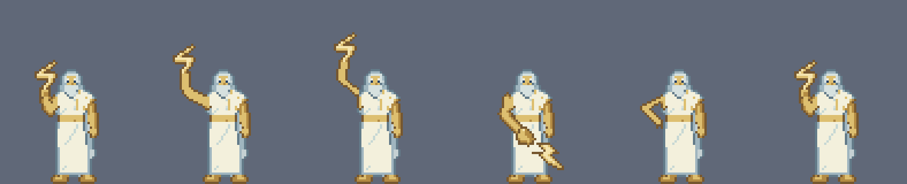
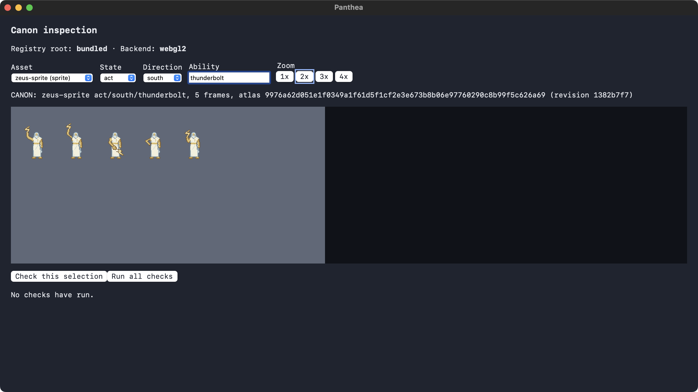

# Zeus thunderbolt act, published as canon

Requirements: U07, U08, X02. Zeus's `act/south/thunderbolt` (5 frames, 83/100/83/83/100 ms, 449 ms) is canon in `zeus-sprite`
revision `1382b7f7…` (atlas `9976a62d…`), beside the unchanged idle-south (333/167/333/167 ms) and seated-south (500/500 ms). The
owner approved and published it in the studio app. This is an abbreviated throw, not the six-frame plan; see the limits below.

`idle-then-act-frames-1x.png` is the same strip at 1x.

## Method

- **Body.** Every frame keeps the head, crown, beard, torso, robe and feet as pixels of canon idle frame 0, in place. Only the bolt
  arm and the bolt are redrawn, frame by frame, inside boxes the spec declares. The last frame is idle frame 0 itself.
- **Frames.** Anticipation, high wind-up, a release key pose, follow-through, and idle frame 0. All five are rebuilt byte for byte
  from the committed spec `tools/probes/art-edit/act_spec_zeus.json` by `tools/probes/art-edit/sprite_act_composite.py`.
- **Release frame.** Its arm and bolt cross in front of the robe on rows 48 to 75 (an `occlude` box in the spec). The tool refuses an
  occlude box that touches the protected rows: 30 to 47 (crown, beard, shoulders) and 76 to 79 (feet). Idle's own robe pixels stay
  wherever the arm is not drawn.
- **Colours and outline.** Idle's 13 colours only, binary alpha, and the C2c outline rules on every new pixel; a handful of pixels
  the rules cannot decide are ruled explicitly in the spec (9, 7, 21 and 5 for the four drawn frames).
- **Provenance.** The lineage pick is the generated candidate `zeus-act-key-0000`, used for lineage only: no pixels were adopted from
  it. The edit was finished with `method: script` and a description naming the spec and the tool. Original-work licence: MIT.
- **Studio steps.** conform of the pick with the idle lineage's settings, working set `zeus-act-set`, pick, open and export, import of
  the built sheet, `finish --method script` (the app cannot record a scripted finish, so the CLI did), then pack, approve and
  publish in the app. Pack carried idle-south and seated-south forward unchanged.

## Tried and rejected

- Two full six-frame throw rounds were rejected at independent visual review: the release read as a sideways chop, the
  follow-through as a hand on the hip, and the open fingers as a claw.
- Three single-frame release key poses followed. Key pose 2 (a small square hand at the belt with the bolt below it) read as a
  buckle and was rejected by the owner, and so was key pose 3. The owner chose key pose 1, the diagonal arm sweep with a separate
  bolt, as the release frame, and the animation shipped as the abbreviated five-frame throw.

## Limits

- The throw is abbreviated and the torso is frozen: only the arm and bolt move. The release frame's hand is a simple mitten and
  its bolt a plain zigzag.
- The normal game does not play an act until event-driven acts exist (strike events carry no ability id). Today the act is visible
  only in the inspection view.
- The studio's preview pane cannot show an act (ability) state. `apps/studio/src/harness/layout.ts` places only idle and seated
  actors, and `STATES` in `apps/studio/src/App.tsx` omits `act`, so the act was reviewed from the sheet and the packaged inspection view, not in the studio preview.
- The lightning effect is out of scope (Unit 10).
- The packaged inspection view keeps the ability text after the state changes: choosing `seated` with `thunderbolt` still typed
  asks for `seated/south/thunderbolt` and shows a placeholder. Clearing the field shows seated as canon.

## Verification

- **Packaged game** (release bundle, bundled registry, WebGL2, one host): `CANON: zeus-sprite act/south/thunderbolt, 5 frames … (revision 1382b7f7)`.
  Check this selection: 28 passed, 0 failed (source, atlas, frames, then the 1x target and four canvases for each of the 5 frames).
  Run all checks: 120 passed, 0 failed. Idle-south (4 frames) and seated-south (2 frames) are still canon at the new revision.
  Act with no ability draws the placeholder, as it should.
- **Repository:** the client tests assert the act as canon (frame rectangles at x=384 to 640, 83/100/83/83/100 ms, 5 sprites on one
  texture) and the placeholders for act without an ability and for walk; the reference digests now cover 17 frames; the probe tests
  rebuild all five frames from the spec and compare them with the published atlas cells.
