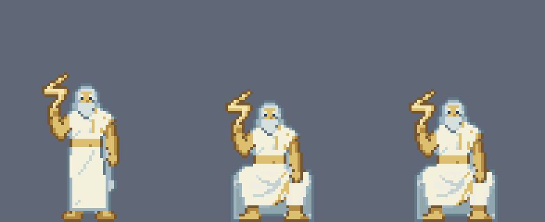
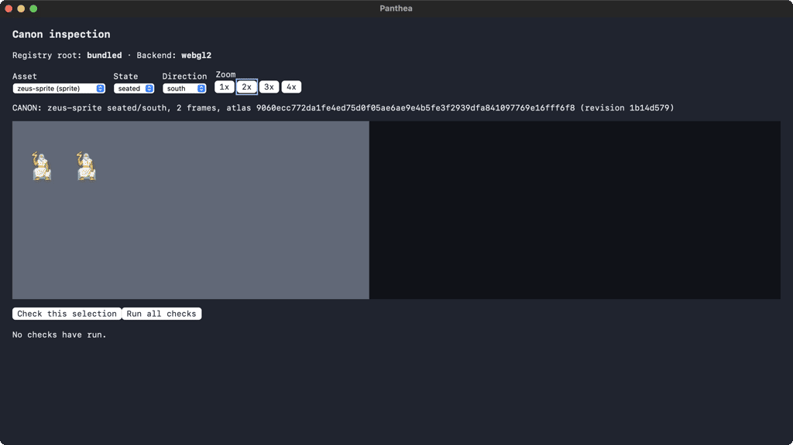
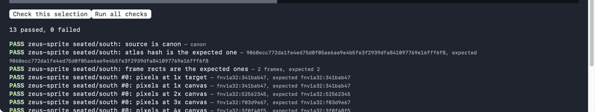
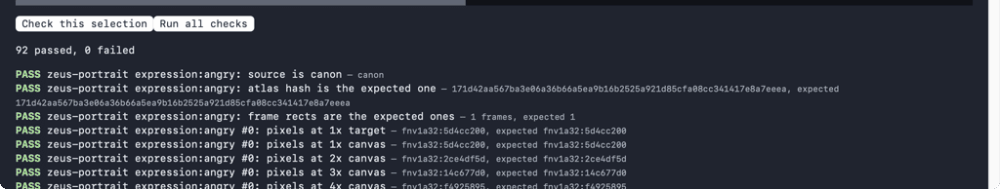

# Zeus seated: the timed sitting (T1)

**Scope: one sitting on one macOS host. The studio app and the packaged release game were both run from this tree, WebGL2.** It adds Zeus's `seated/south` (two frames, 500 ms each) to canon `zeus-sprite` and shows it drawn from canon in the packaged game, about 36 minutes after the request was submitted. Idle-south and the portrait were already canon.

Requirements: U07, U08, X02 (see `docs/product/traceability.md`). The art guide's seated note is dated 2026-10-10: the owner cut the cloud.

## The criterion

[Asset studio requirements](../../../brainstorms/2026-10-03-asset-studio-requirements.md), success criterion 1 (line 158):

> The owner can submit one request and, within one sitting, have a canon Zeus idle-south, seated pose, and portrait drawn in the game client over the placeholder, with provenance that would survive a licence audit. (T1)

The note on that line says the game client path did not wait for it: seated, strike and the timed sitting were queued studio work.

## What this proves, and what it does not

- **Proves:** one request (eight `seated/south` candidates) became a published canon state, with a recorded provenance chain, through the packaged studio app, and the rebuilt packaged game drew it from the bundled registry (`CANON: zeus-sprite seated/south, 2 frames`), with 13 of 13 selection checks and 92 of 92 suite checks passing.
- **Does not prove T1 as written for the idle and the portrait.** They were published in earlier sittings (units 5 to 8) and were only re-checked here, unchanged, in the same suite. This run added seated.
- **Is not a clean-room timing.** The scripted steps (candidate processing, review, scripted finish, registry check, digests, game rebuild) used tools written beforehand. Time lost to process mistakes is in the figure (see below).

## Timeline (UTC, 2026-10-11)

Measured times come from the progress log the tooling wrote while polling the studio store, from file and registry state, or from command output. Approximate ones are marked "about".

**Before the clock (not counted).** The scripted tooling (seated driver and composite, with tests), the pack fix that lets Pack carry published cells (PR #205), the studio and game app builds, and a smoke run of the studio app on the sitting's config. The request form was filled in and resolved before the clock started; Generate was not pressed.

| Time | Event | Basis |
| --- | --- | --- |
| 15:24:56 | Eight `seated/south` jobs queued: **clock start**. The previous poll, with an empty queue, was 15:23:55; the poll interval was 15 s, so Generate was pressed up to 15 s earlier and the total below could be up to 15 s longer. | measured |
| 15:36:43 | All eight jobs succeeded (11 min 47 s, about 88 s per job). | measured |
| about 15:41 | The owner quit the app so the scripted steps could write to the store (the store lock is held while the app is open). The lock was free at 15:41:44. | about / measured |
| after 15:41:44 | Candidate processing. The driver's sole anchor refused all eight renders, because each drew a throne whose base is the lowest thing, not two feet. They were placed by the throne base instead (`--anchor base`) and compared with idle frame 0 on an alignment sheet. | no timestamps |
| about 15:50:42 | Independent visual review picked candidate 7, wrote the spec, and the owner's visual gate passed. This stretch includes a few minutes of rework on the review request. | about |
| 15:51:25 | Scripted finish (`finish --method script`). | measured |
| 15:51:59 | The owner relaunched the app. | measured |
| 15:51:59 to 15:59:57 | Pack, approve, publish in the app. Pack succeeded, but the app neither selected the new draft nor labelled it distinctly from the existing records, so finding it cost a few minutes. | about |
| 15:59:57 | Publish verified in the registry (`zeus-sprite` now maps to `1b14d579…`). | measured |
| 16:00:31 | The packaged game was rebuilt. | measured |
| about 16:01:10 | The inspection fixture showed seated as canon: **clock stop**. | about (the capture is stamped 16:01:13) |

**Total: about 36 min 14 s from Generate to in-game canon.** By interval: generation 11:47; the owner quitting and the lock freeing 5:01; candidate processing, review, spec and the gate 8:58; gate to finish 0:43; finish to relaunch 0:34; pack, approve and publish 7:58; publish to rebuilt game 0:34; rebuilt game to the canon line 0:39.

## Provenance

The published manifest (`1b14d579…`, atlas `9060ecc7…`) records, for the new state:

- **Generated pick:** job `zeus-9b55981c-0007`, seed 497755933, from the recorded job. Stack: sd.cpp `master-929-3f8527a` (MIT), Z-Image Turbo `z_image_turbo-Q3_K` (Apache-2.0), text encoder `Qwen3-4B-Instruct-2507-Q4_K_M` (Apache-2.0), VAE `z-image-ae` (Apache-2.0). No LoRA. The pick's input hash is `0251caa6…`.
- **Scripted composite, recorded as `method: script`**, with this description from the manifest:

  > generated Z-Image candidate zeus-9b55981c-0007 downscaled to the Olympus palette at the idle source-to-sprite ratio (145/13) with the throne base on row 79; head, crown, beard, shoulders and bolt arm kept from canon idle frame 0 moved down 6 px, lap, legs and seat adopted from the candidate and redrawn in idle's ramps and outline rules (tools/probes/art-edit/sprite_seated_composite.py); 1 px upper-body rise for frame 2

- **Original-work licence:** MIT (the owner's hand work, as for the idle).
- **Source revision:** `sourceAssets` names the idle revision `be87747b…`. Its four cells and 333/167/333/167 ms timings are carried unchanged (checked in the registry and again by the game's suite).
- **What is canon's and what is generated:** the head, crown, beard, shoulders and bolt arm are canon idle frame 0's pixels moved down 6 px. Only the lap, legs and seat come from the candidate. Frame 2 is a 1 px upper-body rise built from frame 1 by the spec's fixed rows.
- **Counts for frame 1** (from the composite's report): 500 kept pixels, 537 adopted, 23 patched, 21 ruled, 13 colours, feet on row 79 with the sole midpoint at x=32. Frame 2 changed 91 pixels. Both frames pass the report-only conformance checks at scale 1.

Reproduction (`tools/probes/art-edit/README.md`, "Sprite seated"): the driver in `--anchor base` mode reproduces the cell that was used byte for byte, and `build` and `frame2` with the committed spec (`seated_spec_zeus.json`) reproduce both published seated cells byte for byte.

Left to right: canon idle frame 0, seated frame 1, seated frame 2 (1× version: `idle-vs-seated-1x.png`).

## Packaged game

The release `panthea-desktop.app`, run with a throwaway data directory, opened on the inspection fixture with Alt+Shift+I. The header reads `Registry root: bundled`, `Backend: webgl2`. The reference digests were regenerated from the new canon before the game was rebuilt.

- **Selection `zeus-sprite` seated/south:** `CANON: zeus-sprite seated/south, 2 frames, atlas 9060ecc772da1fe4ed75d0f05ae6ae9e4b5fe3f2939dfa841097769e16fff6f8 (revision 1b14d579)`. "Check this selection": **13 passed, 0 failed** (source canon, atlas hash, two frame rects, and the pixel digests of both frames at the 1× target and 1× to 4× canvas).
- **Selection `zeus-sprite` idle/south:** `CANON: zeus-sprite idle/south, 4 frames, atlas 9060ecc7… (revision 1b14d579)`.
- **Run all checks:** **92 passed, 0 failed**.

## Known gaps

- **The seed was drawn, not pinned.** The app's generate form has no seed field, so the request's seeds were chosen by the app (497755926 to 497755933), not the 20261060 series that was planned.
- **The app cannot record a scripted finish.** Its finish sends only the edit id and the reviewed sheet hash, so the scripted finish was done with the CLI (`finish --method script`). The app would have recorded a hand edit.
- **The owner had to quit the app for the scripted steps.** The store has one writer and the app's sidecar holds the lock while it is open, so conform, set creation, pick, open and finish (all CLI writes) waited for the quit, and the app was relaunched to pack, approve and publish.
- **The new draft is neither selected nor labelled distinctly.** Pack succeeded, but afterwards the app did not select the new draft or label it so it could be told from the existing records. Finding it cost a few minutes.
- **Residual artefacts.** The independent visual review named two residual artefacts: the lap folds meander and the throne panels are unevenly shaded. Both read as cloth and stone at 1×. They were accepted for this sitting. They are in the published pixels.
- **The digests were regenerated before the game rebuild.** The packaged game compares against committed reference digests, so after publish they were regenerated from the new canon (now 12 frames × 4 zooms over 2 assets) and the client's Zeus fixtures were updated to the new revision; the seated-placeholder tests now cover an unpublished state (`act`, `walk`) and a canon seated.
- **Not measured:** device loss in the packaged app, and a second host.

## Verification

- Packaged game, `bundled` registry, WebGL2, one host: 13 of 13 selection checks and 92 of 92 suite checks.
- Registry: `zeus-sprite` maps to `1b14d579…`; the idle's four cells and timings are byte-identical to the previous revision.
- `bun run check`, `bun run --cwd tools/content validate:assets` and the probe tests pass on the tree that includes this evidence.
