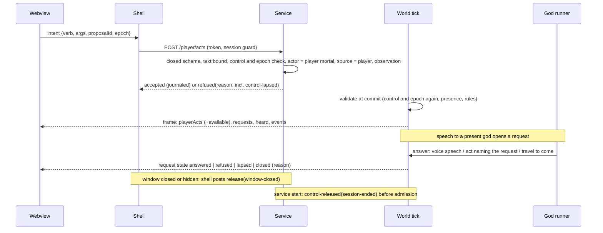

# feat: M3 phase 1, a mortal in the town

## Overview

Phase 1 makes the world playable. The owner creates a mortal with one of the town's trades and enters the running town. From there they can:
- move and travel between places and realms;
- work, eat, exchange goods, pray, make offerings and choose a patron;
- speak to gods, who answer in their own voice or with an act;
- speak to mortals, who answer from their own state;
- step away, and come back to a summary of what happened;
- retire the mortal from the menu.

Every player act enters through a new player intake, and the world validates and journals it like any other actor's. The client builds on the renderer, follow model and receipt path that already draw canon art. Phase 1 ends at two gates:
- a queue-wait re-measure that includes player speech;
- the owner's play rating.

## Problem Frame

The client draws the world but nobody can take part (see origin: Problem Frame). Research against main `98de0b45` confirmed what phase 1 has to add:
- **Entry and control.** There is no path for a client act. Actors are created only at genesis. `ActorState` carries a required sprite but no name; authored names stay in content, and the client shows ids. A mortal's routine always drives it.
- **Speech.** Speech has no event and no memory kind. Prayers need a known cause and an altar. Frame events carry no text, and the frame keeps only 10 ticks of events while a request lasts 150.
- **Patron choice.** A patron change is emitted only when a prayer ends.
- **Looks.** No mortal art is published. Every mortal draws the same placeholder, whatever its sprite id.
- **The client.** It follows one place at a time and has no input beyond click rows and the Alt+Shift+I inspect chord. Its copy says "Read only".

## Requirements Trace

- R1–R2. Create a mortal from a name, a spawn in the mortal realm, one of the playable trades and an optional patron. It enters as an ordinary inhabitant (M01).
  - The trade gives it the template inhabitant's starting goods, drives and routine, and a workplace place.
  - The mortal's look comes from its trade (owner, 2026-10-17).
  - The mortal is honest whatever the template's temperament (owner, 2026-10-17).
- R3. Player acts are validated and journaled proposals. Intake accepts only a closed set of fields and refuses an act unless the player holds control. Creation and control changes are recorded inputs (W05; ADR-0008 superseding note).
- R4. Move, travel where a mortal is allowed, stop a journey (`docs/product/ux-direction.md`: movement can be cancelled), work, eat, exchange goods, pray, make an offering, choose a patron (W02, M04).
- R5. Keyboard, pointer and controller parity, with on-screen text entry and quick phrases (M02, X06, A17).
- R6. Acts that can't happen are shown disabled with a reason. Refused acts show the world's reason.
- R7. Pause and normal speed, in game as well as in the tray (owner, 2026-10-10).
- R8–R13. Typed speech to anyone present:
  - Speech to a present god opens a request the god owes an answer. It is answered on the god's next turn while a priority budget shared by all gods has room. Otherwise it waits in rotation as `queued` (owner, 2026-10-10).
  - One request per god is open at a time. Further lines to that god are refused until it closes (owner, 2026-10-17).
  - Speech to an absent god opens a plea. A god spoken to by name, or prayed to at its altar, may come.
  - Request states are visible: queued, waiting, answered, refused, lapsed and closed.
  - Mortals answer from their own state.
  - Speech is perceived only by those present (M02, W04).
- R14. Choosing a patron is recorded as a defection that both gods perceive (M04).
- R15. The world's existing pressures apply to the player: wrongs, grudges and shortages (W06, W09).
- R16–R17. Playing, observing and away are distinct states. Watching another place, or minimising the window, keeps control (owner, 2026-10-17). The return summary leads with the mortal's events and shows applied and skipped time (M07, A07, A08).
- R18. Queue wait is re-measured with player speech before phase 2 (ADR-0005, O08). If it misses, the shared priority window is widened.
- R19. The owner rates play after phase 1.
- R29, menu part only. Retiring from the menu, pulled forward from phase 4 (owner, 2026-10-10). The player can never take that mortal back. It lives on in town under its routine, and a new mortal can be created.
- R35. Works offline (P01, P07).

## Scope Boundaries

- Phase 1 only. Interruption, artifacts, conflict, death, the Underworld as a place to play, god defeat, realm rules and transformation belong to later phases.
- Mortals answer without a model.
- There is no look picker. A mortal of a trade carries that trade's sprite id and draws as the placeholder until the studio publishes that id.
- A new mortal owns no building. It gathers and sells alongside the existing owners.
- Pointer selection goes through the people-and-places rows. There is no hit-testing on the scene.
- Retiring from the Underworld is phase 4.
- The rest of the M2 tuning list is not phase 1 work.

### Deferred to Separate Tasks

- Phases 2–6 of the origin document get their own plans after the phase 1 gates.
- The look picker, together with the first published mortal sprites.
- Trade sprites (`trade-<id>`) are published through the asset studio.
- Scene hit-testing for pointer selection.

## Context & Research

### Relevant Code and Patterns

**Intake**
- `apps/simulation/src/server.ts`: `handleProposal`, `checkRequestGuards` and `IN_PROCESS_SOURCES`. That list blocks only `model` and `director`, so `routine` can be claimed over HTTP. `handleProposal` refuses a `proposalId` the trace already holds for another proposal. `POST /receipts` is the rate-limited relay pattern.
- `packages/contracts/src/proposal.ts`: `PROPOSAL_SOURCES`, read by the proposal and observation parsers, and `parseProposal`.
- `packages/persistence/src/journal.ts`: `insertExternalProposal`, which journals before the acknowledgement.
- `apps/simulation/src/agents.ts`: `createGodTurnRunner`, the pattern for a service-set source and observation. Its `nextGod` skips journeying gods unless awaited.

**Actors, content and state**
- `packages/world/src/state.ts`: `createInitialWorldState`, the only place actors are created. It requires `sprite` and sets `ActorState.sprite`. `ActorState` has no name, though authored inhabitants and gods have one in content.
- `packages/contracts/src/content.ts`: authored inhabitant fields (`sprite`, `gathers`, `startingInventory`, `devotion`, `temperament`, `drives`, `wants`, `rivals`).
- `content/greek/world/inhabitants.json`: 20 mortals with `placeholder-<id>` sprites, the source of trade templates. `content/greek/world/locations.json` has no spawn field.
- `apps/simulation/src/greek-world-pack.ts`: the sidecar embeds the four world JSON files by static import, and `packages/content/src/load.ts` reads a fixed file list. A new content file must be added to both.
- `packages/world/src/memory.ts`: memory kinds (witnessed, told, noticed, sign, patronage) and eviction at 24.

**Persistence**
- `packages/world/src/codec.ts`: actor and memory codecs.
- `packages/persistence/src/store.ts`: `CURRENT_SCHEMA_VERSION` is 7 (ADR-0011).
- `packages/persistence/src/archive.ts`: `HASHED_TABLES`, export and import.

**Routines, journeys and ticks**
- `packages/world/src/routines.ts`: `decideRoutineProposal`, gated only on alive and drives.
- `apps/simulation/src/tick.ts`: `buildRoutineQueue`, `mergeTickQueue` and `admitWithinCap`.
- `packages/world/src/journey.ts` (`planHop`, `planJourneyReplaced`): journey hops advance outside `buildRoutineQueue`, and a committed act ends a journey as `replaced`. `journey-ended` carries an `ending` from `arrived`, `refused` and `replaced`.

**Validation**
- `packages/world/src/validate.ts`: `validateProposal` and `commit` are exported; the handlers are private. `handleMove`, `handleRealmTransition`, `handleGather`, `handleProduce`, `handleTrade` and `handleConsume` are open to mortals. `handleTravel` is limited to deities. `handlePray` needs the altar and a cause. `handleWorship` credits a god. `handleReport` is the co-located words path.

**Petitions and patrons**
- `packages/world/src/petitions.ts`: `prayableCauses`, `routePetition`, `blessability`, `lapsingPetitions`, and the 150-tick window (`answerWindowTicks`).
- `packages/world/src/patrons.ts`: `defectionOf`, which reads `sign` memories, and `applyPatronChanged`, which drops standing for the required `from` patron.

**Scheduling, perception and prompts**
- `packages/agents/src/practices.ts`: `schedulingSignals`.
- `packages/agents/src/scheduler.ts`: `pickGod` tiers (obligation, awaited, rotation).
- `packages/world/src/perception.ts`: `perceivesEvent`, co-location at event time.
- `packages/agents/src/context.ts`: `buildGodContext`.
- `packages/agents/src/prompt-cap.ts`: shed `TIERS` and the protected floor.

**Snapshot**
- `packages/contracts/src/snapshot.ts`: `SyncFrame`, `CatchUpSummary` (service-minted stable id) and `RecentEvent`, which carries no text.

**Client**
- `apps/client/src/App.tsx`: app state, observer, receipts and catch-up dismissal.
- `apps/client/src/connection.ts`: `Transport` with `subscribeWorld` and `presentEvent`.
- `apps/client/src/observer.ts`: idle, following and held. Idle defaults to `town-square`.
- `apps/client/src/ui/surface.tsx`: click-only people-and-places rows, "Read only" and "No world controls" copy.
- `apps/client/src/inspect/Root.tsx`: the Alt+Shift+I chord swaps `<App/>` out. Settings swaps out the workspace the same way.
- `apps/client/src/renderer/scene.ts`, `actors.ts` and `layout.ts`: one followed place per frame through `packages/renderer`. Actors are placed by index into 14 `ACTOR_CELLS`, and actors past 14 are not drawn.
- `apps/client/src/renderer/presentation.ts` and `apps/client/src/receipts.ts`: receipts for drawn events only, paced at 40 per second against the service's 50.
- `packages/assets/src/browser.ts`: `resolveAssetPixels` looks canon up by exact asset id. The placeholder path ignores the sprite id.

**Desktop shell**
- `apps/desktop/src-tauri/src/proxy.rs`: token-bearing `pause`, `resume`, `present_event` (with a stale-session guard) and `relay_receipt`.
- `apps/desktop/src-tauri/src/commands.rs`, `build.rs`, `lib.rs` and `capabilities/proxy.json`: nine commands, and a test in `commands.rs` pins the capability list across all four. `canon_registry` and `canon_atlas` are the canon commands.
- `apps/desktop/src-tauri/src/lib.rs`: closing the window hides it. Saving settings or a key restarts the sidecar.
- `apps/desktop/src-tauri/src/tray.rs`: pause and resume.

**Scenarios and test support**
- `tools/scenarios/m2-greek-cast/src/steps/staging.ts`: `stageWorld` and `stagePrayer`.
- `tools/scenarios/m1-living-world/src/client.ts`: a headless client built from the client modules, with `presentEvent` injected.
- `apps/simulation/src/test-service.ts`: `startTestService`.
- Test-only helpers live under each app's `test/` or in `@panthea/testkit`. No source file name starts with an underscore.

### Institutional Learnings

- **Validation:** proposals carry intent only and are revalidated at commit. Pin only the facts they depend on (`authoritative-rule-validation`, `whole-entity-revision-pins-refused-petition-answers`).
- **Durability:** journal before acknowledging, and consume atomically with the tick (`proposal-accepted-then-lost-before-durable`, `side-effects-inside-the-commit-transaction`).
- **Replay:** use fresh composition, and recorded inputs only (`world-persistence-composition-broken-after-reopen`).
- **Prompt:** budget the whole prompt, use copyable answer forms, and keep schema and parser in agreement (`ollama-4k-prompts-truncate-silently`, `prompt-commanding-old-action-hides-new-option`, `move-realm-transition-destination-pairing`).
- **Request windows:** windows and feasibility use one predicate (`world-judged-obligation-evidence-windows`).
- **Perception:** perception happens at event time (`knowledge-leaks-through-perception-timing-and-citations`).
- **Admission order:** admission order is policy and must be tested under a binding cap (`tick-admission-starved-external-proposals`).
- **Summaries:** a summary is persistent level state with a stable id (`catch-up-summary-lost-between-polls`, `catch-up-cap-per-backlog-not-per-run`).
- **Receipts:** pace receipts against the service's fixed window, drain them apart from frames, and bind them to the session that drew them (`logic-errors/receipt-pacing-matches-service-window-2026-10-10`).
- **Client presentation:** map presentation by contract event kind and real subject locations, and test with parsed or authored data, not invented fixtures (`logic-errors/client-view-presentation-against-invented-fixtures-2026-09-28`). Present a frame before awaiting compile (`integration-issues/client-scene-presents-before-compile-2026-10-10`).
- **Render tests:** test doubles honour the camera contract, and tests assert pixels at the game camera (`test-failures/soft-test-backend-dropped-camera-2026-10-15`).
- **Registry fixtures:** isolate fixtures from the committed asset registry (`test-failures/canon-registry-polluted-validator-fixtures-2026-10-08`).
- **Placement:** placement comes from published art extents, and actor and structure non-overlap is pinned in tests (`logic-errors/structure-footprint-must-match-art-2026-10-15`).
- **Test support:** helpers live outside production source (`best-practices/test-support-outside-production-source-2026-10-10`).
- **Shell checks:** build the sidecar before Clippy, and run Clippy with `--locked --all-targets` (`workflow-issues/tauri-clippy-requires-built-sidecar-2026-10-04`).
- **Packaged build:** it keeps the WebGL2 baseline and the koota `unsafe-eval` CSP exception (`wkwebview-webgpu-unavailable-macos-15`, `koota-new-function-tauri-csp`).
- **Scenarios and process:** every negative claim in a scenario needs a positive control, and scenario causes are staged. Build the direct version first (`end-to-end-scenario-with-positive-controls`, `greenfield-anti-over-engineering`).

### Constraint Documents

- ADR-0005: queue-wait target p95 105 ticks.
- ADR-0008: world state and client transport, the single webview capability set, and client-owned summary dismissal.
- ADR-0011: canon art loading, the required actor sprite, and canon commands that never take a path.
- ADR-0012: mortals on 64×64 cells with 40–48 px figures, and no props.
- `docs/product/ux-direction.md`: keyboard and joypad movement, pointer selection, text input, and controller navigation of core menus.

## Prior-Art Survey

```json
{
  "schema_version": 2,
  "verdict": "extend",
  "scope": "apps/simulation, apps/desktop/src-tauri, apps/client/src, packages/contracts, packages/world, packages/agents, packages/persistence, packages/assets, content/greek, tools/scenarios",
  "freshness": {
    "vcs_reference": "98de0b45dab6fa1b37769656ae38cc780c8dc00e"
  },
  "budget": {
    "max_search_passes": 24,
    "max_candidate_inspections": 100,
    "exhausted": false
  },
  "candidates": [
    {"path_or_symbol": "apps/simulation/src/server.ts handleProposal, checkRequestGuards", "description": "Token-guarded /proposals intake; refuses only the in-process sources model and director, so routine can still be claimed over HTTP", "disposition": "extend"},
    {"path_or_symbol": "packages/persistence/src/journal.ts insertExternalProposal", "description": "Journals proposal and observation in one transaction before the acknowledgement", "disposition": "reuse"},
    {"path_or_symbol": "apps/simulation/src/server.ts POST /receipts", "description": "Token-bearing shell relay limited to 50 per second; the pattern for the player-act relay", "disposition": "reuse"},
    {"path_or_symbol": "apps/simulation/src/agents.ts createGodTurnRunner", "description": "In-process producer that sets source and observation; nextGod skips journeying gods unless awaited", "disposition": "extend"},
    {"path_or_symbol": "packages/contracts/src/proposal.ts PROPOSAL_SOURCES, parseProposal", "description": "Closed source list read by the proposal and observation parsers; no player source and no per-verb intent schema", "disposition": "extend"},
    {"path_or_symbol": "apps/simulation/src/tick.ts buildRoutineQueue, mergeTickQueue, admitWithinCap", "description": "Routine queue per actor, external proposals first, and action/claim/goal buckets under maxProposalsPerTick; no control skip and no player reservation", "disposition": "extend"},
    {"path_or_symbol": "packages/world/src/routines.ts decideRoutineProposal", "description": "Per-actor routine decision gated only on alive and drives", "disposition": "extend"},
    {"path_or_symbol": "packages/world/src/validate.ts handleTravel", "description": "Journey start limited to deities, then a capability-gated route check", "disposition": "extend"},
    {"path_or_symbol": "packages/world/src/validate.ts handleMove, handleGather, handleProduce, handleTrade, handleConsume, handlePray, handleWorship", "description": "Existing rule handlers the player's move, work, trade, eat, pray and offer acts reuse", "disposition": "reuse"},
    {"path_or_symbol": "packages/world/src/validate.ts handleReport", "description": "Co-located words with a told memory and no obligation to answer", "disposition": "insufficient", "insufficiency_reason": "Speech requests need a ledger, a window and visible states; a report creates none of them"},
    {"path_or_symbol": "packages/world/src/petitions.ts prayableCauses, routePetition, lapsingPetitions", "description": "Petitions with a cause, an altar, a cooldown and routing; the 150-tick answer window", "disposition": "insufficient", "insufficiency_reason": "Free speech has no cause or altar; only the window predicate is reusable"},
    {"path_or_symbol": "packages/world/src/patrons.ts defectionOf, applyPatronChanged", "description": "Defection reads only sign memories; the reducer moves standing and writes patronage memories", "disposition": "extend"},
    {"path_or_symbol": "packages/world/src/journey.ts planHop", "description": "Advances journey hops outside the routine queue; journey-ended has no control reason", "disposition": "extend"},
    {"path_or_symbol": "packages/world/src/state.ts createInitialWorldState", "description": "Genesis-only actor creation that requires a sprite", "disposition": "insufficient", "insufficiency_reason": "A mortal entering after genesis needs its own event and reducer"},
    {"path_or_symbol": "packages/world/src/state.ts ActorState, MemoryEntry; packages/world/src/codec.ts", "description": "Actor state with a required sprite and no name; five memory kinds; actor and memory codecs", "disposition": "extend"},
    {"path_or_symbol": "packages/world/src/perception.ts perceivesEvent", "description": "Co-location perception at event time", "disposition": "reuse"},
    {"path_or_symbol": "packages/agents/src/practices.ts schedulingSignals; packages/agents/src/scheduler.ts pickGod", "description": "Obligation, awaited and rotation tiers with no request tier", "disposition": "extend"},
    {"path_or_symbol": "packages/agents/src/context.ts buildGodContext; packages/agents/src/prompt-cap.ts", "description": "God prompt with no spoken-to-you section; shed tiers and the protected floor", "disposition": "extend"},
    {"path_or_symbol": "packages/contracts/src/snapshot.ts SyncFrame, CatchUpSummary, RecentEvent", "description": "Frame with a stable-id catch-up summary and recent events that carry no text", "disposition": "extend"},
    {"path_or_symbol": "packages/persistence/src/archive.ts HASHED_TABLES; packages/persistence/src/store.ts CURRENT_SCHEMA_VERSION", "description": "Nine hashed tables and store version 7", "disposition": "extend"},
    {"path_or_symbol": "packages/assets/src/browser.ts resolveAssetPixels", "description": "Canon lookup by exact asset id; the placeholder path ignores the sprite id", "disposition": "reuse"},
    {"path_or_symbol": "content/greek/world/inhabitants.json", "description": "Authored inhabitants with gathers, startingInventory, drives, temperament and placeholder sprites; the source of trade templates", "disposition": "reuse"},
    {"path_or_symbol": "apps/desktop/src-tauri/src/proxy.rs, commands.rs, build.rs, lib.rs, capabilities/proxy.json", "description": "Token-bearing pause, resume, present_event and relay_receipt; nine commands whose capability list a test pins across four files", "disposition": "extend"},
    {"path_or_symbol": "apps/client/src/connection.ts Transport; apps/client/src/App.tsx", "description": "Subscribe and presentEvent transport; app state with observer, receipts and catch-up dismissal; no act transport", "disposition": "extend"},
    {"path_or_symbol": "apps/client/src/observer.ts; apps/client/src/ui/surface.tsx; apps/client/src/inspect/Root.tsx", "description": "Idle/following/held follow model, click-only selection rows, read-only copy, and the Alt+Shift+I inspect chord that swaps the app out", "disposition": "extend"},
    {"path_or_symbol": "apps/client/src/renderer/actors.ts planActors; apps/client/src/renderer/layout.ts ACTOR_CELLS", "description": "Actors placed by index into 14 cells; actors past 14 are not drawn", "disposition": "extend"},
    {"path_or_symbol": "apps/client/src/renderer/presentation.ts; apps/client/src/receipts.ts", "description": "Receipts for drawn events only, paced at 40 per second", "disposition": "extend"},
    {"path_or_symbol": "tools/scenarios/m1-living-world/src/client.ts; tools/scenarios/m2-greek-cast/src/steps/staging.ts; apps/simulation/src/test-service.ts", "description": "Headless client built from client modules, staged causes, and the in-process test service", "disposition": "reuse"}
  ]
}
```

## Key Technical Decisions

- **Player intake: `POST /player/acts` (owner, 2026-10-10).** The webview sends a typed intent through a new shell command, and the shell keeps the token.
  - An intent is a verb, its arguments, a client-minted `proposalId` and the control epoch the client observed.
  - **The intent schema is closed.** A new parser in `packages/contracts/src/player-intent.ts` declares each verb's fields. Any other field, including actor, source, observation, epoch overrides, `expectedRevisions` or a release reason, gets a 400 (W05).
  - **Recorded as proposals.** Every intent except `pause` and `resume` becomes a journaled proposal with source `player` and a matching proposal kind in `packages/contracts/src/proposal.ts` (R3).
  - **Text bound.** Speech text is 1–280 code points at intake. The same bound applies to god and mortal speech text before it becomes an event (R3, W05).
  - **Intake requires control.** An act is refused as `control-lapsed` unless the mortal's control is player and the epoch matches. The commit checks again (R16).
  - **Lifecycle intents have their own preconditions** and carry no epoch:
    - `create` needs no active player mortal. The new mortal enters under player control with a fresh epoch, which the next frame carries.
    - `take-control` needs the active player mortal to be under routine control. The next frame carries the new epoch.
    - `release` (step away) and `retire` need player control and the current epoch.
    - `pause` and `resume` need no mortal.
  - The service sets the actor from the world's one player mortal, sets `source: player`, and builds the observation and pins, the way `createGodTurnRunner` does.
  - **Proposal ids.** `/player/acts` refuses a `proposalId` the trace already holds for another proposal, with the same check `handleProposal` runs (R3).
  - `POST /proposals` accepts only the `fixture` and `operator` sources, for the proposal and its observation. Every other source, including `routine` and `player`, is refused.
  - All of this is recorded in an ADR-0008 superseding note.
- **Control is world state.** New events are `mortal-entered` (which carries control = player), `control-taken`, `control-released` and `mortal-retired`.
  - Control state and the request ledger live in the world projection state, so archive, rebuild and hash already cover them.
  - A player proposal carries the control epoch. A mismatch is refused as `control-lapsed`, at intake and again at commit.
  - `buildRoutineQueue` skips an actor while the player has control. In that state the mortal waits for the player (owner, 2026-10-10). There is no idle timeout.
  - **Moving the camera never releases control (owner, 2026-10-17).** Following or viewing another place keeps control, and so does minimising the window. Acts and talk always apply where the mortal stands.
  - **Release.** Control passes to the routine on three paths:
    - "Step away": the webview's `release`, always with reason `stepped-away`.
    - Closing or hiding the window. The shell posts `release` and sets the reason `window-closed` itself.
    - Every service start. The service journals an `operator`-source `control-release` proposal with reason `session-ended`, targeted at the first tick after start and admitted before every other proposal of that tick. Catch-up therefore always runs the routine, including after a crash. A player act pending before the restart is then refused as `control-lapsed`. Its outcome is recorded once, and a retried `proposalId` returns that refusal.
  - **Taking control ends the mortal's in-flight journey.** It records `journey-ended` with the new ending `control-taken`. Journey hops advance outside `buildRoutineQueue`, so the routine stand-down alone does not stop them.
- **One player mortal is active at a time.** Retiring from the menu (confirmed, irreversible) clears it. The retired mortal stays in town under its routine with its history, and a new mortal can be created. The player can never take a retired mortal back (R29). Mortal ids are minted by the service and are never reused or deleted.
- **Trades are content (owner, 2026-10-17).** A `trades` table in `content/greek/world/` lists the playable trades: fisher, farmer, olive grower, weaver, smith, herdsman and provisioner. The ferryman and the gods are not playable. Each trade has:
  - an id and a display name;
  - a template inhabitant;
  - a trade-level sprite id, `trade-<id>`;
  - a workplace place, the template inhabitant's location.
- **What creation copies.** The new mortal copies the template's `gathers`, `startingInventory` and `drives`; without drives the away routine never runs. Its temperament is honest, so it never commits wrongs on its own. Others can still wrong it (R15). It owns no building.
- **The look comes from the trade (owner, 2026-10-17).** The mortal's `ActorState.sprite` is the trade's sprite id.
  - Canon lookup matches the asset id exactly, so the mortal draws as the placeholder until the studio publishes an asset with that id. Then every mortal of that trade shows it, with no alias map.
  - Template inhabitants keep their own sprite ids, so a published trade sprite never puts a double of an authored inhabitant in town.
- **Names (R1, R8).** Every actor carries `name` in `ActorState` and the client view actor. Genesis sets it from content. The player's mortal gets it from `mortal-entered`.
  - The client shows names instead of ids, so the player can tell addressees apart.
  - One shared normalizer applies the player's name rules: NFKC fold, strip every control and format character (Unicode Cc and Cf), 1–32 code points, refuse an empty result. The `mortal-entered` parser runs it too, so replay and archive import apply the same rules. Names need not be unique.
  - The client shows the name with "(you)" and the trade. God prompts quote it as bounded data.
- **Spawn.** A spawn is any place in the mortal realm. Places have no actor cap. Creation during catch-up is refused with a retryable reason (R17).
- **Movement.** The player's mortal may use `travel`, so the deity-only rule becomes "a deity, or the player's mortal". Destinations stay gated by capability, so `olympus-gate` and `judgment-hall` stay out of reach.
  - Travel to `asphodel-meadow` is allowed because content allows it. The Underworld as a place to play is still phase 4.
  - A `stop` act ends the mortal's own journey (`journey-ended` with the new ending `stopped`).
  - Any other committed act during a journey ends it through the existing `planJourneyReplaced`, and the client says so.
- **Eat and work.** Eating reuses `consume`. Work is the existing gather (and produce, where the trade has a recipe) at the workplace (R4).
- **Available acts.** The world exposes one function that dry-runs `validateProposal` for each candidate act of the player's mortal against the current state, and returns each act as available or unavailable with the validator's reason. The handlers stay private. The frame carries the result as `playerActs.available`. It is advisory; the commit refusal is authoritative (R6).
  - The pray candidates are the mortal's prayable causes, so the player prays about a real need, trouble or wrong.
- **A request ledger in world state.** It is keyed by mortal id. It is separate from petitions: a request has no cause and no altar, does not use the prayer cooldown, and does not count toward defection rules.
  - **Speech or plea.** Speech to a co-located god opens a `speech` request the god owes an answer. Speech to an absent god opens a `plea` with the same 150-tick window. The world decides which at commit, because the god may move between the player's send and the commit.
  - **Text.** Each entry carries the question text, the answer event id and the answer text.
  - **Limits (owner, 2026-10-17).** There is one open request per god. A further line to that god is refused with `request-open` until the request is answered, refused, lapses or closes. There is no other cooldown.
  - **Retirement.** On `mortal-retired`, every open request from that mortal closes with reason `retired` in the same commit.
  - **Answering in voice.** The god emits a placed `speech` event, which needs the player co-located at emission. If the player is not there, only acts (bless, strike, refuse, offer terms) or "come" are offered.
  - **Answering with an act.** An act answers the request when it names it.
  - **Coming** is a `travel` toward the player.
    - The god is offered it only when the route fits the request's remaining window, using the same predicate as the answer.
    - The request does not close on arrival unless the god answers.
    - A god spoken to by name, or addressed by an open prayer at its altar, is offered it under the same rule (R10).
  - **Leaving.** If the god leaves before its turn, the request's kind changes from speech to plea with the remaining window. Its state does not change, and the frame shows the new kind.
  - **States** are `queued`, `waiting`, `answered`, `refused`, `lapsed` or `closed`, each with a reason code. `waiting` means the request is inside the speech priority budget. `queued` means it waits in rotation. `closed` happens only on retirement.
  - **Lapse reasons** are distinct: `no-turn-in-window` and `models-unavailable`.
  - **Addressees.** The addressee list shows all 7 gods, each marked present or plea, and the mortals present. There are no pleas to absent mortals.
- **Scheduling.** Tiers are: obligation, then request (within budget), then awaited, then rotation.
  - **Speech priority is a shared budget (owner, 2026-10-10).** It covers all gods together: at most `speechPriorityTurns` forced turns per `speechPriorityTicks` window, starting at 2 per 120 ticks.
  - A request inside the budget is answered on the god's next turn. Once the budget is used up, a request waits in rotation with state `queued`.
  - If the Unit 9 gate misses 105, the window is widened, which lowers the number of forced turns.
  - **Journeying gods.** The request tier follows `nextGod`'s rule: a journeying god is skipped, so its request waits for its arrival.
- **Prompt.** Open requests join the protected floor under the prompt cap. Each has copyable answer forms, and the schema and parser agree on them. Player text and names are quoted as data.
- **Mortal replies.** The reply is a placed `speech` event by the mortal, using the persisted PRNG. It is chosen from authored line sets keyed by need, grudge, temperament, trade and patron.
  - **Own state only.** A reply uses only the speaking mortal's own state and memories. It never names a patron change, and never names another actor's private facts (W04).
  - **Words memory.** Words heard become a new `words` memory kind. Only the latest one per speaker is kept, so a flood of lines cannot evict a grudge (R12, R15).
- **Heard lines.** World state keeps a bounded list of the last `heardLines` speech lines the player's mortal perceived (starting at 20), each with its event id and text. The frame carries it as `heard`. Speech `RecentEvent`s carry `text` for the observer.
- **Receipts.** A speech line shown in the talk panel counts as presented. It is receipted at its first render, inside the client's 40-per-second pace.
- **Patron choice.** It emits `patron-changed` with cause `chosen` and skips the prayer preconditions.
  - `patron-changed` becomes a discriminated union on `cause`. The prayer-ending variant keeps `answered` and `unanswered`. The `chosen` variant has neither.
  - `from` is optional on the `chosen` variant, because the mortal may have had no patron. `applyPatronChanged` drops the old patron's standing only when `from` is present, and keeps its patronage memories.
  - It has a cooldown, `patronChoiceCooldownTicks`, which limits defection churn (R14; the M2 known limit). A patron set at creation starts no cooldown.
  - A patron picked at creation is initial state, set the way an authored inhabitant's devotion is, with no event. A `chosen` change from no patron to a god has one perceiver.
- **Offerings** reuse `worship` and require the altar. They write a new `offering` memory kind, not a `sign`: a sign needs a petition, and `defectionOf` reads signs.
  - The addressed god perceives the offering wherever it is, because the offering is addressed to it.
  - `defectionOf` ignores `offering` memories (R4, R14).
- **Return summary.** It is level state built from the log when control is taken, with a stable id, in its own single-row table.
  - It leads with all of the mortal's events since control was released, then answers, then applied and skipped time, with an item cap. It is built after any catch-up ends.
  - Dismissal is client-owned, in its own localStorage key separate from the catch-up key (ADR-0008).
- **Admission.** The player slot is reserved inside `admitWithinCap`, under `maxProposalsPerTick`, not in `mergeTickQueue`. Only one player act can be pending at a time, and a client-minted `proposalId` makes retries idempotent (R3).
- **Pause.** New shell commands relay pause and resume. The tray keeps its own (owner, 2026-10-10). While paused, ordinary acts are disabled with the reason "World paused". "Resume world", "Take control", "Step away", create and retire stay available. Request windows count ticks, so a pause lapses nothing.
- **Shell commands.** The net new commands are `player_act`, `pause` and `resume`.
  - Each is added to `commands.rs`, `build.rs`, `lib.rs` and `capabilities/proxy.json`, and the pinned capability test covers it.
  - `player_act` carries `present_event`'s stale-session guard.
  - The names don't collide with `canon_registry` or `canon_atlas`.
- **Client text.** The client renders all player, god and mortal text as text nodes, with no HTML or markdown (U05 webview boundary).
- **Store.** `CURRENT_SCHEMA_VERSION` goes from 7 to 8, and a version-7 store is refused. Worlds from earlier milestones are not migrated (greenfield).
  - The return-summary table joins `HASHED_TABLES` in `packages/persistence/src/archive.ts`, with export and import.
  - Archive export and import keep every journal row, including `player` rows, pending or consumed, because they are the world's recorded inputs (O01). The source restriction applies only to live `/proposals` intake. A pending player act in an imported archive is refused as `control-lapsed` by the startup release. A consumed act keeps its outcome, so a retried `proposalId` returns it.
- **Verification is headless.** Tests, CLI checks, headless renders and the m3 scenario on the compiled service are the evidence.
  - Launching the packaged app needs the owner's approval first, through the question tool. That includes the gamepad probe.
  - Screenshots never go into the repo.

## Open Questions

### Resolved During Planning

- How player acts enter: through the intake design above (owner, 2026-10-10).
- What playing-but-idle means: the mortal waits.
- Whether watching another place releases control: it does not (owner, 2026-10-17).
- Where pause lives: in game, as well as in the tray.
- How a creation mistake is fixed: retire from the menu, pulled forward into phase 1.
- What a trade is: a content entry with a template, a sprite id and a workplace, and no building.
- Where a look comes from: the trade (owner, 2026-10-17).
- Which trades are playable, and the mortal's temperament: seven trades without the ferryman, and honest (owner, 2026-10-17).
- How speech differs from prayer: it is a separate request ledger.
- How speech priority is bounded: a shared budget across all gods (owner, 2026-10-10).
- What a second line to the same god does: it is refused until the open request closes (owner, 2026-10-17).
- How the startup release is recorded: an `operator`-source proposal admitted first in the first tick after start.
- Whether places cap actors: they don't. The client draws the player's mortal first, then the gods present.

### Deferred to Implementation

- Exact event and payload field names, and reason-code strings.
- The defaults, each set in `docs/product/defaults.md` with a boundary test:
  - `speechPriorityTurns` (starting at 2) and `speechPriorityTicks` (starting at 120);
  - `patronChoiceCooldownTicks` (starting at 300);
  - `heardLines` (starting at 20);
  - the return-summary item cap.
- The size of the authored mortal line sets.
- The frame-size cost of `heard`, the ledger and `playerActs`, measured once they exist.
- The control scheme and the quick-phrase set. These are design decisions in Unit 7.

## High-Level Technical Design

> *This illustrates the intended approach and is directional guidance for review, not implementation specification. The implementing agent should treat it as context, not code to reproduce.*

```mermaid
stateDiagram-v2
  [*] --> NoMortal
  NoMortal --> Playing: create
  Playing --> Routine: release (stepped-away, window-closed, session-ended)
  Routine --> Playing: take-control
  Playing --> Retired: retire (confirmed)
  Retired --> NoMortal
  note right of Playing: camera may follow any place; control holds
```





## Implementation Units

- [ ] **Unit 1: Contracts, content, state and store for players, control and requests**

**Goal:** add the data shapes the rest of the plan stands on.

**Requirements:** R1, R2, R3, R4, R11, R12, R14, R16

**Dependencies:** none

**Files:**
- Modify: `packages/contracts/src/proposal.ts`, `packages/contracts/src/event.ts`, `packages/contracts/src/snapshot.ts`, `packages/contracts/src/content.ts`
- Create: `packages/contracts/src/player-intent.ts`, `content/greek/world/trades.json`
- Modify: `content/greek/world/rules.json` (`heardLines`), `packages/content/src/load.ts` (fixed file list) and `apps/simulation/src/greek-world-pack.ts` (static import and `trades` key)
- Modify: `packages/world/src/state.ts`, `packages/world/src/codec.ts`, `packages/world/src/memory.ts`, `packages/world/src/perception.ts`
- Modify: `packages/persistence/src/store.ts`, `packages/persistence/src/archive.ts` (the `HASHED_TABLES` list, export and import)
- Test: `packages/contracts/src/event.test.ts`, `packages/contracts/src/proposal.test.ts`, `packages/contracts/src/player-intent.test.ts`, `packages/contracts/src/content.test.ts`, `apps/simulation/src/greek-world-pack.test.ts`, `packages/world/src/codec.test.ts`, `packages/persistence/src/archive.test.ts`, `packages/persistence/src/store.test.ts`

**Approach:**
- Add the `player` source, and one proposal kind per player verb.
- Add the closed intent parser, with the shared name normalizer and the 280-code-point text bound.
- Add the events `mortal-entered` (with `name`, trade and sprite), `control-taken`, `control-released`, `mortal-retired`, `speech` (with text), `request-opened`, `request-answered`, `request-lapsed`, `request-converted` and `request-closed`. The `mortal-entered` parser runs the name normalizer.
- Add the `journey-ended` endings `stopped` and `control-taken`.
- Make `patron-changed` a discriminated union on `cause`. The prayer-ending variant keeps `from`, `answered` and `unanswered`. The `chosen` variant has an optional `from` and neither of the others. This is the parser change; its tests are in Unit 3.
- Add `name`, a control union and an actor status to `ActorState`. Genesis sets `name` from the content name of each inhabitant and god.
- Add the `words` and `offering` memory kinds, the request ledger keyed by mortal id, and the bounded heard list. All live in the world projection state.
- Add perception rules for the new events.
- Add the `trades` content table and its parser. Each trade's template must be an authored mortal with drives, and its workplace must be a mortal-realm place. Both the directory loader and the sidecar's embedded pack load it.
- Add the frame fields `playerActs` (with `available`), `requests`, `heard` and `returnSummary`, and `text` on speech `RecentEvent`s.
- Give the return summary its own single-row table, separate from `catch_up_summary`, and add it to `HASHED_TABLES`, export and import.
- Archive export and import keep `player` journal rows, pending and consumed.
- Bump `CURRENT_SCHEMA_VERSION` to 8.

**Patterns to follow:** existing event and codec round-trips, `CatchUpSummary`, and the inhabitant content parser.

**Test scenarios:**
- Happy path: each new event and state shape round-trips through its parser and the codec.
- Happy path: after genesis, `fisher-kallias` carries the name "Kallias the Fisher" and Zeus carries his content name.
- Error path: a malformed `mortal-entered` (missing name, trade, sprite or spawn) is refused by the parser.
- Error path: a trade whose template is a god, an unknown inhabitant or an inhabitant without drives is refused by the content parser. So is a workplace outside the mortal realm.
- Happy path: the authored `trades` table parses, lists the seven playable trades, and gives each a `trade-<id>` sprite.
- Integration: the sidecar's embedded Greek pack lists the same seven trades as the directory loader.
- Error path: the intent parser refuses an undeclared field, a speech text of 281 code points, and a name that is empty after the normalizer strips a Unicode tag character and a zero-width space.
- Error path: a `mortal-entered` row with a name carrying a Cf character is refused by the parser, so an imported archive cannot bring it in.
- Edge case: a store at version 7 is refused with the existing mismatch error.
- Integration: an archive with control state, a request ledger, a heard list and a return summary round-trips through export and import, and the content hash matches. Changing the summary row changes the hash.
- Integration (O01): create a mortal, commit one player act and leave a second pending, then export and import into a fresh store. The import succeeds. The committed act keeps its outcome, and a retried `proposalId` returns it. After the first start the pending act is refused as `control-lapsed` by the startup release.

**Verification:** contracts, content, codec, store and archive tests pass, and the typecheck is clean.

- [ ] **Unit 2: World: mortal entry, control and retirement**

**Goal:** a mortal can enter after genesis, control is recorded, and the routine stands down while the player holds control.

**Requirements:** R1, R2, R3, R16, R29 (menu)

**Dependencies:** Unit 1

**Files:**
- Create: `packages/world/src/player.ts`
- Modify: `packages/world/src/actions.ts` (reducers), `packages/world/src/journey.ts`, `packages/world/src/routines.ts`, `packages/world/src/perception.ts`, `packages/world/src/codec.ts`, `apps/simulation/src/tick.ts` (`buildRoutineQueue`)
- Test: `packages/world/src/player.test.ts`, `packages/world/src/codec.test.ts`, `packages/world/src/perception.test.ts`, `apps/simulation/src/world-store.test.ts`

**Approach:**
- Creation reads the trade: it copies the template's gathers, starting inventory and drives, sets the trade's sprite id and workplace, and sets the temperament to honest.
- Names are normalized and bounded. The spawn must be a place in the mortal realm.
- The new mortal enters under player control with a fresh epoch.
- A patron picked at creation is initial state, set the way an authored inhabitant's devotion is, with no event.
- `mortal-entered` is a placed event, so actors co-located with the arrival perceive it.
- `control-taken` and `control-released` bump the epoch.
- `control-taken` ends the mortal's in-flight journey and records `journey-ended` with ending `control-taken`.
- `buildRoutineQueue` skips any actor whose control is player.
- `mortal-retired` clears the active player and returns the mortal to routine. Unit 4 adds closing its open requests.

**Execution note:** write the world rules test-first.

**Test scenarios:**
- Happy path: a fisher created at the town square has the fisher template's gathers, goods and drives, carries `trade-fisher` as its sprite and its name, and appears in the next frame.
- Happy path (R2): the fisher's workplace is the trade's workplace place, and the mortal owns no building.
- Edge case (R2): a mortal created from a trade whose template is greedy is honest, and over 300 staged ticks of its routine it commits no wrong.
- Edge case: a name made only of zero-width and control characters is refused. A 33-code-point name is refused. A 32-code-point name is accepted.
- Error path: creation into the Underworld or onto Olympus is refused with a reason.
- Happy path: a new mortal is under player control with epoch 1, and its routine proposes nothing.
- Happy path: a patron chosen at creation sets the mortal's devotion and emits no `patron-changed` event.
- Happy path: while the player holds control, the mortal's routine proposes nothing for 50 ticks. After `control-released`, the routine resumes on the next tick.
- Edge case: a mortal mid-journey stops when the player takes control. `journey-ended` is recorded with ending `control-taken`, and no further hop applies.
- Edge case: a second creation while a player mortal is active is refused (`player-exists`).
- Edge case: after retirement, a new creation succeeds. The retired mortal keeps its name, history and routine.
- Error path (R29): `take-control` and any act aimed at the retired mortal are refused.
- Error path: a player proposal with a stale epoch is refused (`control-lapsed`).
- Integration: rebuild from genesis plus the log reproduces the entered mortal, its name, sprite, control state and retirement exactly (fresh composition).
- Integration: a co-located mortal gets a `witnessed` memory of the arrival, and a mortal elsewhere gets none.

**Verification:** the world and world-store tests pass, and rebuild equals live.

- [ ] **Unit 3: World: the player's acts, available acts, patron choice, offerings and mortal replies**

**Goal:** the phase 1 acts are legal for the player's mortal, the world reports which are available, and mortals answer speech.

**Requirements:** R4, R6, R12, R13, R14, R15

**Dependencies:** Unit 2

**Files:**
- Modify: `packages/world/src/validate.ts` (`handleTravel` for the player's mortal, `stop`, `worship` writing an `offering` memory, eat through `consume`, work through gather and produce), `packages/world/src/patrons.ts` (`chosen` variant, `applyPatronChanged` guarding an absent `from`, `defectionOf` ignoring `offering`), `packages/world/src/journey.ts` (`stopped` ending), `packages/world/src/memory.ts` (`offering` and `words` kinds, latest `words` per speaker), `packages/world/src/perception.ts`, `packages/world/src/player.ts` (available acts, heard list)
- Create: `packages/world/src/replies.ts` and authored line sets under `content/greek/` (path set in implementation)
- Test: `packages/world/src/player-acts.test.ts`, `packages/world/src/replies.test.ts`, `packages/world/src/patrons.test.ts`, `packages/world/src/memory.test.ts`, `packages/contracts/src/event.test.ts`

**Approach:**
- Travel stays capability-gated. `stop` ends the mortal's own journey with ending `stopped`. Any other committed act during a journey ends it through `planJourneyReplaced`.
- Move reuses `handleMove` and `handleRealmTransition`.
- Pray reuses `handlePray`. The player picks one of the mortal's prayable causes, which the available acts list.
- Exchanging goods reuses trade, and its counterparty check gives a reason when there is no buyer.
- Eating reuses `consume`. Work is the existing gather (and produce, where the trade has a recipe) at the workplace.
- The available-acts function dry-runs `validateProposal` for each candidate act against the current state and returns the validator's reason for each unavailable one.
- Patron choice reuses `applyPatronChanged`, which drops the old patron's standing only when `from` is present, with a cooldown (`patronChoiceCooldownTicks`). A patron set at creation starts no cooldown.
- An offering at the altar writes an `offering` memory for the addressed god, whether or not it is present. `defectionOf` ignores `offering` memories.
- A mortal reply is a placed `speech` event chosen from the speaking mortal's own state with the persisted PRNG. It names no patron change and no other actor's private facts.
- The words heard become a `words` memory, and only the latest one per speaker is kept. The player's mortal also records each perceived line in the heard list.

**Execution note:** write the tests first.

**Test scenarios:**
- Happy path: the player's mortal travels from the town square to `asphodel-meadow` hop by hop.
- Error path: travel to `olympus-gate` is refused because the destination requires `divine`.
- Happy path (R4): the player's mortal moves to an adjacent place, and a move to a place with no edge is refused with the validator's reason.
- Happy path (R4): at the altar, the player prays about one of the mortal's prayable causes, and a petition opens. A pray with a cause the mortal doesn't have is refused.
- Happy path (R4): `stop` mid-journey records `journey-ended` with ending `stopped`, and no further hop applies.
- Edge case (R4): eating mid-journey ends the journey as `replaced`, then the meal commits.
- Happy path (R4): a player holding food at mealtime eats, and the need closes.
- Happy path (R4): at the workplace the player's fisher gathers, and produces where the trade has a recipe.
- Happy path (R6): with no buyer present, the available acts mark "sell" unavailable with the same reason the trade validator gives at commit.
- Edge case (R6): the available-acts result for each act agrees with the commit outcome of that act on the same state.
- Edge case (R6): "sell" is available in one tick's frame, the only buyer leaves the next tick, and the sale sent from the older frame is refused at commit with the world's reason.
- Happy path: choosing Hermes over Poseidon emits `patron-changed` with cause `chosen`, and both gods receive patronage memories.
- Edge case: choosing a patron from none emits `patron-changed` without `from`, changes no other god's standing, and gives one perceiver. The first change after a patron set at creation is not held by a cooldown.
- Error path: the parser refuses a `chosen` `patron-changed` that carries `answered` or `unanswered`, and still accepts the prayer-ending variant with them.
- Edge case: a second patron choice inside the cooldown is refused (R14). An open prayer to the old patron stays answerable.
- Happy path: an offering at the altar to an absent Poseidon credits his divinity and gives him an `offering` memory, not a `sign`.
- Edge case (M04): repeated offerings never trigger a defection. `defectionOf` ignores `offering` memories and no `patron-changed` follows.
- Happy path (AE4): a smith with a grudge against the player answers from the grudge line set, keeps a `words` memory, and refuses a sale.
- Edge case: twenty lines from the player to one mortal leave one `words` memory from the player, and the mortal's grudge memory survives (R12, R15).
- Edge case: the heard list keeps the last `heardLines` lines the player's mortal perceived, oldest dropped first, each with its event id and text.
- Edge case (W04): after a reply, a co-located third party's memory holds no defection or grudge facts, and the reply never names a patron change.
- Integration: an absent mortal perceives no speech event, and a co-located one does (W04).
- Edge case: the same seed gives the same reply line, and a different seed changes it.
- Integration (R15): another mortal wrongs the player's mortal, a grudge follows, and it changes what that mortal does.
- Integration (R15): a shortage leaves the player's mortal unable to buy, and the refusal carries the shortage reason (W06, W09).

**Verification:** the world tests pass, and replay reproduces the replies and the heard list.

- [ ] **Unit 4: World: speech requests and pleas**

**Goal:** speech to a god becomes a request that the god owes an answer, with visible outcomes.

**Requirements:** R9, R10, R11

**Dependencies:** Unit 3

**Files:**
- Create: `packages/world/src/requests.ts`
- Modify: `packages/agents/src/practices.ts` (`schedulingSignals` request tier), `packages/world/src/validate.ts` (bless, strike, refuse and offer-terms naming a request; god `speech`; `travel` toward the player)
- Test: `packages/world/src/requests.test.ts`, `packages/agents/src/practices-context.test.ts`

**Approach:**
- The ledger is keyed by mortal id and holds the open request per god, with the question text, the answer event id and the answer text.
- The world decides at commit whether a line opens `speech` (god co-located) or `plea`, with a 150-tick window.
- A request opens `waiting` while the shared speech priority budget has room, and `queued` once the budget is used up.
- A further line to a god with an open request from the mortal is refused with `request-open` (owner, 2026-10-17).
- On `mortal-retired`, every open request from that mortal closes with reason `retired` in the same commit. This extends the Unit 2 retirement reducer.
- A god's voice answer needs the player co-located when it is spoken. An act answers a request only when it names that request.
- "Come" is a `travel` toward the player. It is offered only when the route fits the request's remaining window, by the same predicate as the answer. The request does not close on arrival.
- If the god leaves first, the request's kind changes to plea with the remaining window, and its state stays as it was.
- A lapse records `no-turn-in-window` or `models-unavailable`.
- `schedulingSignals` raises a request tier that spends a shared budget of `speechPriorityTurns` forced turns per `speechPriorityTicks`. The tier skips a journeying god, as `nextGod` does.

**Execution note:** write the tests first, keeping one predicate for the window and the feasibility of an answer.

**Test scenarios:**
- Happy path (AE2): the player speaks to a co-located Poseidon, and the request is `waiting`. His voice answer next turn marks it `answered`, the entry carries both texts, and only co-located actors perceive the exchange.
- Happy path (AE3): words to an absent Poseidon open a plea. With no answer within 150 ticks, it is `lapsed` with reason `no-turn-in-window`.
- Edge case: Poseidon is co-located when the line is sent and leaves before it commits. The world opens a `plea`, not a `speech` request.
- Edge case: the god travels away before its turn, so the request's kind becomes plea with the remaining window, its state is unchanged, and the frame shows the new kind.
- Edge case: a voice answer while the player is elsewhere is refused. A bless that names the request answers it from afar.
- Error path: a second line to a god with an open request is refused with `request-open`, and the open request and the god's turn are unaffected. After the request is answered, a new line opens a new request.
- Edge case: retiring the mortal closes every open request from it with reason `retired` in the same commit. A new mortal's requests are unaffected.
- Edge case: speech at tick 149 versus tick 151 of the window: the window uses one predicate for both the answer and the lapse.
- Edge case: the route to the player is longer than the request's remaining window, so "come" is not available and a `travel` toward the player is refused.
- Edge case: a god that came by "come" arrives, and the request stays open until the god answers.
- Edge case: with every model endpoint failing, a request lapses with reason `models-unavailable`.
- Edge case (R3, W05): god and mortal speech text of 280 code points becomes an event, and 281 does not.
- Integration: with requests open to three different gods inside one window and a budget of 2, two get forced turns ahead of rotation and the third shows `queued` and is served in rotation. The boundary is tested at budget and budget plus one.
- Integration: a request to a journeying god is outside the request tier. It waits for the god's arrival, and the god's turn comes then.

**Verification:** the request tests pass, and the scheduling signal is covered at its budget.

- [ ] **Unit 5: Agents: requests in the god prompt and scheduler**

**Goal:** gods see the requests they owe and can answer them in their own voice, with an act, or by coming.

**Requirements:** R9, R10, R18

**Dependencies:** Unit 4

**Files:**
- Modify: `packages/agents/src/context.ts`, `packages/agents/src/prompt-cap.ts`, `packages/agents/src/scheduler.ts`, the god schema and parser
- Test: `packages/agents/src/requests-context.test.ts`, `packages/agents/src/prompt-cap.test.ts`, `packages/agents/src/scheduler.test.ts`

**Approach:**
- Add a "Spoken to you" section. Player text and the player's name are quoted as data.
- Add copyable forms for the voice answer, the acts that name a request, and travel toward the player.
- Offer the "come" form only when the route fits the request's remaining window (the Unit 4 predicate).
- An open prayer addressed to a god also offers that god the "come" form, under the same window rule (R10).
- Open requests join the protected floor.
- The schema and parser accept only the request ids shown.
- `pickGod` gets the request tier, within the shared budget. A `queued` request gets no tier and is served in rotation.

**Patterns to follow:** copyable forms in `context.ts`, the protected causal set in `prompt-cap.ts`, and the W04 enum discipline.

**Test scenarios:**
- Happy path: Zeus with an open speech request sees it and its answer forms, and his prompt fits the cap with a full cast.
- Edge case: with the cap binding, the request survives shedding while recent events are shed first.
- Error path: an answer naming a request that wasn't shown is rejected by the parser.
- Edge case: when the player is not co-located, no voice form is offered.
- Edge case: a name or line containing quote marks and instructions appears only inside the quoted data, and the copyable forms are unchanged.
- Happy path (R10): a god with an open prayer at its altar from an absent mortal is offered the "come" form.
- Edge case: when the route is longer than the remaining window, the "come" form is not offered.
- Happy path: the scheduler serves an obligation before a request, and a request before an awaited thread.
- Edge case: a request beyond the budget is served in rotation, not ahead of an awaited thread.

**Verification:** the agents tests pass, and the busiest prompt with a request is measured under the cap.

- [ ] **Unit 6: Service, shell and the ADR-0008 superseding note**

**Goal:** the approved intake, control recording, frame state, return summary, release on window close, and in-game pause.

**Requirements:** R3, R6, R7, R11, R16, R17

**Dependencies:** Units 1 to 4

**Files:**
- Modify: `apps/simulation/src/server.ts` (`POST /player/acts` with the closed intent parser and the proposal-id collision check; `/proposals` accepting only `fixture` and `operator`), `apps/simulation/src/tick.ts` (startup release admitted first; player slot reserved inside `admitWithinCap`), `apps/simulation/src/index.ts` (journal the `operator`-source `control-release` at start), frame assembly (`playerActs` with `available`, `requests`, `heard`, `returnSummary`, speech text on recent events)
- Modify: `apps/desktop/src-tauri/src/proxy.rs` (`player_act`, `pause`, `resume`, release on close), `apps/desktop/src-tauri/src/commands.rs`, `apps/desktop/src-tauri/build.rs`, `apps/desktop/src-tauri/src/lib.rs` (`CloseRequested` and hide post `release`), `apps/desktop/src-tauri/capabilities/proxy.json`
- Modify: `docs/decisions/0008-world-state-and-client-transport.md` (superseding note)
- Test: `apps/simulation/src/player-intake.test.ts`, `apps/simulation/src/index.test.ts`, the pinned capability test in `apps/desktop/src-tauri/src/commands.rs`, shell tests in `apps/desktop/src-tauri`

**Approach:**
- The service sets the actor, source and observation for each player act, and checks the epoch.
- The intent schema is closed. Each verb accepts only its declared fields, and text is limited to 280 code points.
- `/player/acts` refuses a `proposalId` the trace holds for another proposal, as `handleProposal` does.
- `/proposals` becomes an allowlist: `fixture` and `operator`, for the proposal and its observation.
- Intake refuses an act as `control-lapsed` unless the mortal's control is player and the epoch the client observed matches. The commit checks again.
- Static refusals return 400 with a reason. Refusals that depend on world state appear in `playerActs`.
- One player act may be pending at a time. A repeated `proposalId` is idempotent, including across a restart (R3).
- At start the service journals an `operator`-source `control-release` proposal with reason `session-ended`, targeted at the first tick. The tick admits it before every other proposal, so it applies before any pending player act is validated.
- The return summary is built at `control-taken` from the log after any catch-up ends, lists all of the mortal's events since the release, and keeps a stable id.
- The shell relays intents, pause and resume. `player_act` copies `present_event`'s stale-session guard. On `CloseRequested` or hide the shell posts `release` with the reason `window-closed`, which it sets itself. The post runs on the async runtime and never blocks the close path. Minimising posts nothing. The webview never sees the token.
- The three new commands are added to all four pinned files, and the pinned capability test covers them.

**Execution note:** write a failing test first for the `routine` claim over `/proposals`.

**Test scenarios:**
- Error path: `/proposals` refuses every member of `PROPOSAL_SOURCES` except `fixture` and `operator`, for the proposal and for its observation.
- Error path (R3): a player `proposalId` equal to a routine outcome id in the trace gets a 409.
- Happy path: an intent `pray` from the webview path produces a journaled proposal with `source: player`, the service-built observation and the current epoch.
- Error path (W05): an intent carrying actor, source, observation, an epoch override or `expectedRevisions` gets a 400. So does any other undeclared field.
- Edge case (R3, W05): speech text of 280 code points is accepted at intake, and 281 is refused.
- Error path (R16): an act sent after `control-released` is refused as `control-lapsed`.
- Error path: a spawn outside the mortal realm returns 400 with a reason code. Creation during catch-up returns a retryable refusal.
- Edge case (M01, R16): `create` succeeds with no epoch when no player mortal is active, is refused while one is, and the next frame shows the mortal under player control with its epoch. After a step away, an ordinary act is refused as `control-lapsed`, and `take-control` succeeds and the next frame carries the new epoch.
- Error path: a webview `release` carrying a reason gets a 400.
- Edge case: a second act while one is pending is refused. A retried `proposalId` returns the original result.
- Integration: with a binding `maxProposalsPerTick` filled by gods and the director, the player's act still commits that tick.
- Integration: kill the service while the player holds control, restart it, and confirm the `control-release` proposal is admitted first in the first tick after start, `control-released` (`session-ended`) commits, and the routine runs through catch-up.
- Integration: kill the service while a player act is pending. After restart the act is refused as `control-lapsed`, its outcome is recorded once, and a retried `proposalId` returns that refusal.
- Integration (AE5): step away, stage a director theft, then take control. The summary leads with the theft and shows applied and skipped time.
- Edge case: a theft of the mortal's goods that the catch-up summary also lists still appears in the return summary.
- Happy path: the frame's `heard` list and the request ledger carry the line texts, and a speech recent event carries its text.
- Happy path: the pause command from the webview pauses ticks, and resume continues them.
- Happy path (shell): hiding the window posts `release` with reason `window-closed`, and the next frame shows routine control.
- Error path (shell): a `player_act` from a stale session is refused by the guard, as `present_event` refuses it.
- Happy path (shell): the pinned capability test lists `player_act`, `pause` and `resume` in all four files.

**Verification:** the simulation and shell tests pass, and the cargo gates pass with the sidecar built. The ADR note records the source, relay, observation, closed schema, control check, release on close and capability changes.

- [ ] **Unit 7: Client: entry, controls, talk, request states and return**

**Goal:** the player-facing surfaces, designed and built by @designer on the existing client.

**Requirements:** R1, R4, R5, R6, R7, R8, R11, R16, R17, R29 (menu)

**Dependencies:** Unit 6

**Files:**
- Create: `tools/probes/gamepad/` (probe and README with method and results)
- Modify: `apps/client/src/connection.ts` (act transport), `apps/client/src/store.ts` (actor `name`), `apps/client/src/App.tsx`, `apps/client/src/observer.ts`, `apps/client/src/ui/surface.tsx`, `apps/client/src/inspect/Root.tsx`, `apps/client/src/renderer/actors.ts`, `apps/client/src/receipts.ts`, and new modules under `apps/client/src/` (layout set by the designer)
- Test: `apps/client/src/**/*.test.tsx`, `apps/client/src/renderer/actors.test.ts`

**Approach:**
- **Gamepad first.** A probe in `tools/probes/gamepad/` checks that WKWebView delivers gamepad input in the packaged app. Running it needs the owner's approval first. If it fails, stop and report the measured conflict and an alternative to the owner. Simulated-pad tests are not proof.
- **Builds on** `packages/renderer`, `observer.ts`, the receipt pipeline and the people-and-places rows.
- **Entry states.** Each state says what is offered:
  - No mortal: observe, or create.
  - Routine-held: "Take control" or observe, with a line for the release reason (stepped away, window closed, or the world restarted).
  - Catching up: create and "Take control" are disabled with "Catching up" and become available on the first frame after catch-up ends.
  - Paused: "Resume world" is offered.
  - Models degraded or not configured: a notice that gods can't answer right now. Talk to gods stays open, and those requests lapse with `models-unavailable` if no god turn comes.
  - Retired: create a new mortal, or observe.
- **Creation form.** Name, trade, spawn and patron, with "No patron" as the default. Name errors show on the field: empty after normalizing, or over 32 code points. A refusal keeps every choice.
- **Copy.** State-driven labels replace "Read only" and "No world controls". "Take control" and "Resume world" are separate labels. Each request state and reason code has a plain player-facing line. Retirement copy says the player can never take that mortal back and that it lives on in town.
- **Drawing order.** The scene draws the player's mortal first, then the gods present, then other mortals. If more actors are present than the 14 cells, the scene shows "+N not drawn", and the text list stays complete. Actors show their names, not ids. The player's mortal shows its name with "(you)" and its trade.
- **Camera and control.** Following another place keeps control, and the client shows an observing indicator (R16). Acts and talk apply where the mortal stands. A line says where the mortal is. A key returns the camera to the mortal.
- **Mortal status.** A status strip shows the mortal's place, its open needs and the latest event about it, wherever the camera is (R15, R16).
- **Movement.** The client shows the exits of the mortal's place and journey progress, and says when an act ends a journey.
- **Acts.** Contextual acts come from `playerActs.available`, with disabled acts showing their reason. A sent act shows as pending, and other acts are disabled with "Waiting for your last act" until it commits or is refused, and the outcome is shown. While paused, ordinary acts show "World paused".
- **Talk.** The panel shows the addressees: all 7 gods marked present or plea, and the mortals present. It has an on-screen text entry with quick phrases. A god with an open request is disabled with "Waiting for <god>'s answer". The request shows the kind the world chose, speech or plea, and shows a change of kind. Lines and answers come from `heard` and the ledger. A line shown in the panel is receipted at first render, inside the 40-per-second pace.
- **Input.** One layer maps keyboard, pointer and gamepad to the same acts.
  - Pointer selection goes through the people-and-places rows.
  - Player keys ignore Alt+Shift+I.
  - Dialogue entry is separate from movement keys.
  - Text entry handles IME composition, so Enter never sends mid-composition.
  - Keyboard focus and controller navigation reach every core menu (X06, A17).
- **Drafts.** Draft and talk state live above the swap that Alt+Shift+I and Settings perform, so they survive both, as well as frame updates and refused sends (R6). After a sidecar restart the client shows "control ended" and keeps the draft.
- **Summaries.** The return summary panel shows on `take-control`, with its own dismissal key, separate from the catch-up key.
- **Text.** All player, god and mortal text renders as text nodes, with no HTML or markdown (U05).
- **Rendering.** Present a frame before awaiting compile.

**Execution note:** the visual and interaction design belongs to @designer. Copy is reviewed afterwards without changing the design. Lanes must stop and report before launching or driving any GUI app, and must view their own headless renders before reporting.

**Test scenarios:**
- Happy path: each phase 1 act can be reached by keyboard, pointer (through the rows) and simulated gamepad. The probe, not this test, is the proof that the packaged app receives the pad.
- Happy path: with 16 actors in the followed place, including a god, the player's mortal is drawn first and the god is drawn, the scene shows "+2 not drawn", and the list names all 16. The render test uses the game camera and asserts pixels.
- Happy path: the player's mortal resolves canon pixels when an isolated registry fixture holds `trade-fisher`, and the placeholder when it does not.
- Edge case: following another place keeps control and shows the observing indicator. The acts listed are those of the mortal's own place, and the status strip shows a theft of the mortal's goods there.
- Edge case: a draft survives a frame update, a refused send, Alt+Shift+I, opening Settings and a sidecar restart.
- Edge case: Enter during IME composition does not send. Alt+Shift+I still opens inspect and triggers no player act.
- Happy path: a request moves through queued or waiting, then answered, refused or lapsed, and the player-facing line is shown.
- Edge case: while a request to Poseidon is open, Poseidon is disabled in the addressee list with the waiting line.
- Edge case: a sent act shows as pending, other acts are disabled until its outcome arrives, and a `control-lapsed` refusal is shown.
- Happy path: a heard line is receipted once at first render, and receipts stay within the pace.
- Edge case: while paused, ordinary acts are disabled, and "Resume world", "Take control", "Step away", create and retire stay enabled.
- Edge case: during catch-up, create and "Take control" are disabled, and become enabled on the first frame after catch-up ends.
- Edge case: the return summary is shown on take-control, and dismissing it keeps it dismissed. Dismissing the catch-up summary leaves the return summary unaffected.
- Error path (U05): a player line, a god line and a mortal line containing markup render as literal text, and no element is created from them.

**Verification:** the client tests pass. The gamepad probe README records the result. The packaged build keeps the WebGL2 baseline and the CSP exception.

- [ ] **Unit 8: Causal scenario: a new fisher**

**Goal:** prove phase 1 against the compiled service.

**Requirements:** R1–R17, R29 (menu), R35

**Dependencies:** Units 2 to 6

**Files:**
- Create: `tools/scenarios/m3-mortal-in-town/` (steps, staging, README)
- Modify: `tools/scenarios/package.json` (script)

**Approach:** the scenario posts intents to `/player/acts` with the service token, as the m2 harness posts to `/proposals`. It creates Nikias the fisher at the town square, then runs these steps in order:
1. Sell fish.
2. Pray at the altar.
3. Speak to a co-located Poseidon and get his answer.
4. Plead with an absent Hermes until the plea lapses, or Hermes comes.
5. Choose Hermes as patron.
6. Step away, while a director theft is staged.
7. Take control and read the return summary.
8. Retire.

Causes are staged, and each step runs a step subset. The scenario runs with no network (R35).

**Patterns to follow:** `tools/scenarios/m2-greek-cast` staging and controls.

**Test scenarios:**
- Each step asserts committed events and state.
- Each negative claim has a positive control that fails at its own step. The claims are:
  - the routine stays silent while the player has control;
  - absent actors don't perceive speech;
  - the routine source is refused on `/proposals`;
  - a stale epoch is refused;
  - an act sent after `control-released` is refused;
  - a second line to a god with an open request is refused;
  - take-control on the retired mortal is refused.
- Offline (R35): the scenario passes with no network available, and no step reaches a hosted provider.

**Verification:** the scenario passes on the compiled service, and every control fails as intended.

- [ ] **Unit 9: Phase 1 gates, defaults and traceability**

**Goal:** close phase 1 with evidence.

**Requirements:** R18, R19

**Dependencies:** Units 1 to 8

**Files:**
- Modify: `tools/scenarios/m1-living-world/src/client.ts` (an injected `sendIntent`, a token POST when headless)
- Modify: `tools/scenarios/m2-greek-cast/src/unattended.ts` (a scripted player built on that client)
- Modify: `docs/product/defaults.md`, `docs/product/traceability.md`
- Test: the scripted player's unit test under `tools/scenarios/`

**Approach:**
- The scripted player uses the headless client with `sendIntent`. Release and control rules stay in the service, because the unattended hour has no shell.
- The script retries creation during catch-up, takes control again after each restart, and counts `control-lapsed` as expected.
- It stages god presence in town, addresses gods at the shared budget's rate, and adds a repeat arm (lines to gods with an open request, which are refused) and a plea arm.
- Rerun the unattended hour on a quiet machine. Judge god queue wait against ADR-0005's 105, and report per-request latency and lapse rate.
- If queue wait misses, widen `speechPriorityTicks` with evidence, which lowers the number of forced turns, or bring the conflict to the owner.
- The owner rates a play session on the rubric. Phase 2 does not start while any dimension scores 0.

**Test scenarios:**
- Happy path: the scripted player addresses gods at the configured rate, and in the repeat arm counts each `request-open` refusal as expected.
- Edge case: after a restart the scripted player takes control again, and the `control-lapsed` refusal it receives is counted as expected.

**Verification:**
- The hour's report includes the player-speech rows: queue wait per god, request latency and lapse rate by reason.
- The owner's rating is recorded.
- `defaults.md` holds the new tunables.
- Traceability has dated clauses for M01, M02, M04, M07, W04, W05, X06 and O08.

## System-Wide Impact

- **Interaction graph:** every service start journals a control release. Closing the window releases control. Player acts compete for tick slots. Requests change god scheduling and prompts.
- **Error propagation:** a static refusal goes back to the shell as a 400 with a reason. A refusal at commit becomes a `playerActs` entry. Neither throws inside a tick.
- **State lifecycle risks:**
  - control and the epoch across a crash, including a player act pending at the crash;
  - one pending player act at a time;
  - a journey in flight when control is taken or an act commits;
  - the return summary is level state with a stable id;
  - retired mortals are never deleted, and their open requests close.
- **API surface parity:**
  - the new endpoint, three shell commands and the capability change;
  - `/proposals` accepts only `fixture` and `operator`;
  - no HTTP caller posts `routine`, and the routine fixtures call the world directly, so they do not change;
  - the frame gains `playerActs`, `requests`, `heard`, `returnSummary` and speech text; ADR-0008 allows this without a frame version bump because the client and sidecar ship together.
- **Content and art:** the `trades` table adds the `trade-<id>` sprite ids, which the studio publishes later.
- **Integration coverage:** crash and restart with control held and with an act pending; admission under a binding cap; rebuild, archive and import with a mortal created after genesis.
- **Unchanged invariants:**
  - the world stays authoritative;
  - offline mode never falls back to a hosted provider;
  - credentials stay in the shell and Keychain;
  - god knowledge stays perception-bound;
  - canon art loads only through `canon_registry` and `canon_atlas`.

## Risks & Dependencies

| Risk | Mitigation |
|------|------------|
| Player speech pushes queue wait past 105 | The shared priority budget, one open request per god, the Unit 9 gate with repeat and plea arms, and widening the window with evidence |
| Queued requests lapse at a queue wait near 102 ticks against a 150-tick window | The gate reports the lapse rate by reason, and the owner sees it in the rating session |
| The prompt overflows when a request is protected | Units 5 and 9 measure the busiest prompt; the request replaces, rather than adds to, the answer-slot prayer |
| WKWebView does not deliver gamepad input | The probe runs first in Unit 7, and a failure goes to the owner with evidence and an alternative |
| Frame size grows with `heard`, the ledger and `playerActs` | Bounded lists; measure once they exist |
| The new webview capability widens the attack surface | Intents only, with a closed schema and a 280-code-point text bound. The token stays in the shell, and the service sets the actor and source |
| Rendered text carries markup | The client renders text nodes only (U05) |
| Mortals of one trade look alike, including retired ones, until art differs | Accepted (owner, 2026-10-17). Names, "(you)" and the status strip identify the player's mortal |
| Earlier worlds stop opening | Accepted. Greenfield, no migration |

## Documentation / Operational Notes

- The ADR-0008 superseding note: the player source, the relay, the observation, the closed intent schema, the control check, release on window close and the pause command.
- New tunables in `defaults.md`, each with a boundary test.
- `tools/scenarios/m3-mortal-in-town/README.md` and `tools/probes/gamepad/README.md` with results.
- Traceability is updated in each PR that touches a requirement.

## Sources & References

- **Origin document:** [docs/brainstorms/2026-10-10-m3-playable-consequences-requirements.md](../brainstorms/2026-10-10-m3-playable-consequences-requirements.md)
- ADR-0005 (queue-wait target), ADR-0008 (world state and client transport), ADR-0011 (game canon art loading), ADR-0012 (retro art direction)
- `docs/product/defaults.md`, `docs/product/acceptance.md` (A05–A08, A17), `docs/product/ux-direction.md`
