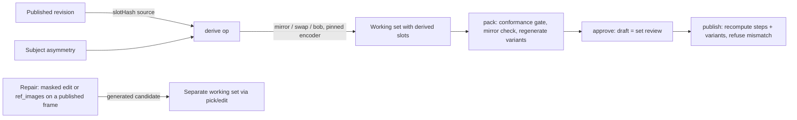
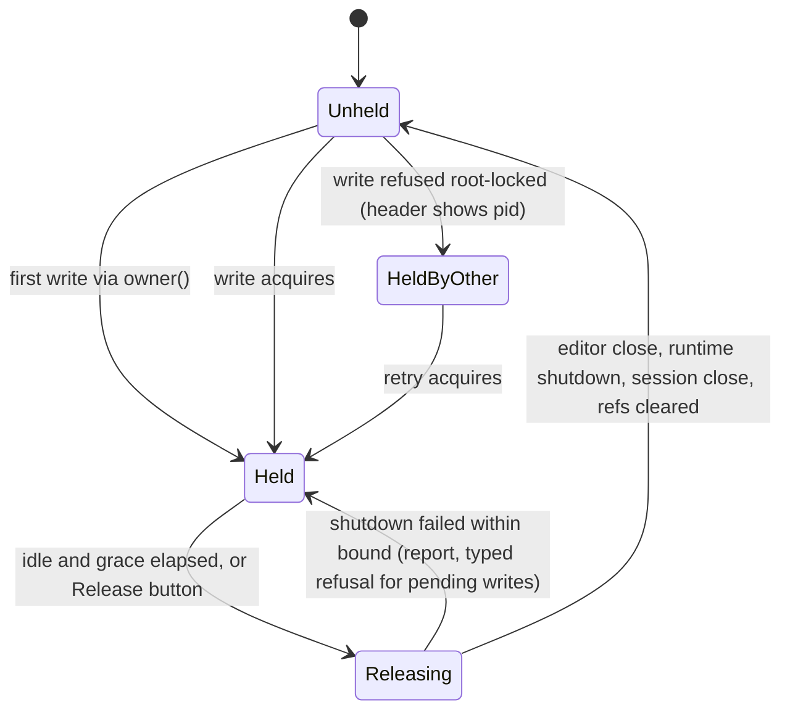
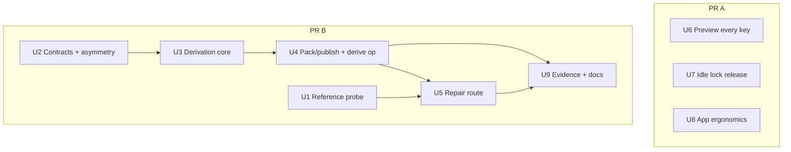

# feat: Studio derivation, repair route and app ergonomics (asset studio Unit 9)

## Overview

This plan builds Unit 9 of the asset-studio foundation plan (`docs/plans/2026-10-03-001-feat-asset-studio-foundation-plan.md`). It adds the studio features the owner asked for after the Zeus seated and act sittings.

The studio gains deterministic derivation from published sprites: east→west mirror, realm palette swap and idle bob. Frames that derivation cannot make get a repair route, starting with a probe of reference-conditioned generation on the pinned runtime. The preview plays every published state, direction, ability and expression at manifest timing.

The app stops holding the store writer lock while idle, records scripted finishes, takes a base seed, and keeps a long queue responsive.

## Problem Frame

R13–R15 require honest, reproducible derivation (see origin). Today `derive` is a refusal stub, and nothing produces `DerivedProvenance`, `realmVariants` or `asymmetry`. The art guide names Zeus's bolt hand as asymmetric, but no content declares it, so nothing would block a mirror.

The studio preview hard-codes idle and seated, so the owner never saw the published thunderbolt act.

The seated and act sittings exposed four more app problems:
- The app holds the lock for its whole lifetime, so the owner had to quit it before every CLI step.
- The app cannot record `method: script`.
- There is no seed field.
- The form lags with a 72-job queue.

## Requirements Trace

- **R2:** derived and repaired outputs carry complete provenance: recipe, version, parameters, source, licences and any hand steps.
- **R9:** derived cells pass conformance before approval.
- **R12:** a hand edit on a derived cell is recorded as hand work and never overwritten by an automatic step.
- **R13 (partial):** mirror, palette swap and idle bob derive deterministically where the guide allows. Overlays move to Unit 10.
  - Origin wording: "walk and act cycles are not derived". This plan keeps that literally. Walk and act frames are never mirrored or bobbed.
  - Realm palette swaps recolour the whole asset, including act, because art guide L47 defines realm variants as swaps of the asset.
- **R14:** non-derivable frames go through repair. That means a masked edit on a published frame, plus reference conditioning if the probe passes. Candidates go through review. If the probe returns NO-GO, the generated route is partial and hand-drawing remains (recorded in traceability).
- **R15:** a derived batch regenerates byte-identically from its manifest alone, through the pinned encoder.
- **R17:** derived drafts and every published key appear in the preview without a restart.
- **R18:** `derive` and `release` are real ops with parity across the CLI, native and webview tables. The app and the CLI call the same functions.
- **R20 (partial):** the remaining Zeus idle directions are deferred (see Scope Boundaries).
- **AE4:** on a symmetric subject, a mirror repeats byte-identically. A declared asymmetry blocks it.
- **Stable IDs:** U06, U07, U08 for the derivation and preview work, and X02 for visual evidence only.

## Scope Boundaries

- **No Zeus art.** North, east and west wait for the sprite-pipeline research in note #445. *Supersedes the parent Unit 9 verification line (owner, 2026-10-11).* Parent Unit 10's T2 completion waits on that work, and the parent's Unit 10 carries a dated note saying so.
- **No overlays.** Damage and fire overlays move to Unit 10, alongside the first structure (owner, 2026-10-11).
- **Derivation reads published revisions only.** This narrows the origin's "approved" input (F3, AE4). The owner confirmed it on 2026-10-11, and a dated note goes in the origin doc. AE4 is restated against a published east.
- **No runtime upgrade.** The pinned `master-929-3f8527a` advertises `ref_images` in its capabilities upstream. The body format is confirmed only by the U1 live run. Any pin change needs owner approval and an ADR.
- **No new dependency and no `bun.lock` change.** Encoding reuses `encodeRgbaPng`.
- **Masked-edit mask files stay CLI-only.** The webview never receives paths (ADR-0010).

### Deferred to Separate Tasks

- Zeus north, east and west idle art: after the note #445 research.
- Damage and fire overlay op and vocabulary: Unit 10.
- App controls for repair (masked edit and reference): after U5, depending on the probe verdict.

### Delivery

Two PRs:
- **PR A:** U6, U7 and U8. These fix the sitting friction and don't depend on derivation.
- **PR B:** U1–U5 and U9. U1 runs first, and its verdict gates U5.

## Context & Research

### Relevant Code and Patterns

- `packages/assets/src/placeholder.ts` `encodeRgbaPng`: deterministic PNG writer (filter 0, deflate level 9), pinned by `placeholder.golden.test.ts`.
- `packages/assets/src/studio/png/decode.ts`: the decoder.
- `packages/assets/src/studio/packing.ts`:
  - `packAsset` crops carried cells from the prior atlas without re-conforming.
  - `trace` requires a pick.
  - `method: "generated"` is hard-coded.
  - `asymmetry` and `realmVariants` are carry-forward only.
- `packages/contracts/src/assets.ts`: `DerivedProvenance` (free `operation`, no recipe), `SpriteManifest.asymmetry`, `RealmVariant`, `GenerationEdit` (mask mandatory), `HandEditStep.method`.
- `packages/assets/src/conformance.ts`: the mirror check exists, but no studio caller passes `mirror`.
- `packages/assets/src/studio/edit.ts` `imgGenBody`/`editSettings`: the masked img2img body and its recorded settings.
- `tools/studio/src/commands.ts` `OPS` (with the `derive` stub in `READ_ONLY`), `apps/studio/src-tauri/src/schema.rs` `OPS` and `PATHISH`, and `apps/studio/src/host/client.ts` `STUDIO_OPS`. Their parity is tested in `client.test.ts`.
- `tools/studio/src/host.ts`:
  - `owner()` promotes lazily and retries.
  - `session.close()` runs only at shutdown.
  - The runtime and editor close over the session.
  - The edit watcher calls the cached editor directly.
- `packages/assets/src/studio/preview-source.ts`: `PreviewListingEntry` has no animation keys, but `resolve` already takes `ability`.
- `packages/renderer/src/layer.ts` `frameIndexAt`: per-frame timing with `loopStart`. `SceneLayer.tick` runs one global clock.
- `apps/studio/src/harness/layout.ts` `harnessItems` and `apps/studio/src/App.tsx` `STATES`: idle and seated are hard-coded, and `act` is absent.
- `apps/studio/src/workflow/Workflow.tsx`:
  - `QueueItem` receives the whole state and inline closures.
  - Generate sends `resolved.seed` only.
- `apps/studio/src/workflow/actions.ts`: `slotHint` and `parseSlotSpecs`.
- `packages/assets/src/studio/export-import.ts` `handStepOf`, plus the Aseprite adapter `finishEdit(..., undefined, reviewed)` calls.
- Probe references: `tools/probes/art-edit/sprite_idle_c2.py` (bob method), `sprite_act_composite.py`, `act_spec_zeus.json`.

### Institutional Learnings

- `docs/product/art-guide.md` L26–29, L47: only bob, east/west mirror, palette swap and overlays are derivable. Asymmetry blocks the mirror. Realm variants swap colours and never redraw.
- `docs/solutions/integration-issues/incomplete-pngs-pass-hash-and-header-checks-2026-10-04.md`: validate structure, CRCs and inflated output, not just hashes.
- `docs/solutions/logic-errors/transparent-rgb-bytes-broke-grid-recovery-2026-10-05.md`: ignore RGB under alpha 0 for visual comparison, but keep byte identity separate.
- `docs/solutions/best-practices/scripted-art-edits-record-method-script-provenance-2026-10-08.md`: script finishes record `method: script` and a description.
- `docs/solutions/best-practices/portrait-expressions-from-one-masked-base-2026-10-08.md` and `god-sprite-local-generation-open-research-2026-10-08.md`: the repair precedents, and the routes that failed.
- `docs/decisions/0010-studio-app-host.md`: read-only mode, lazy acquisition, and the quit order (TERM, abort, stop the server group, release).
- `docs/solutions/best-practices/lifecycle-state-one-lock-transitions-2026-09-28.md`: check-and-mutate under one lock, with effects after unlock.
- `docs/solutions/performance-issues/progress-poll-starved-job-drain-2026-10-08.md` and `studio-edit-save-lag-and-unreviewed-finish-2026-10-09.md`: no aggregate reads on timers. Keep the stale-review gate.
- `docs/solutions/integration-issues/version-keyed-asset-bridge-live-reload-2026-10-08.md`: preview bytes stay keyed by pixel version.
- `docs/solutions/test-failures/canon-registry-polluted-validator-fixtures-2026-10-08.md` and `best-practices/test-support-outside-production-source-2026-10-10.md`: isolated registries, and no new underscore files.
- `docs/evidence/asset-studio/unit7/README.md`: parity relies on the recorded seed.

### External References

- W3C PNG spec: identical pixels can encode to different bytes, so a fixed filter, fixed zlib settings and golden-byte tests are what prove reproducibility.
- Aseprite, Pixelorama, LibreSprite: per-frame durations, scrubbing and onion skin are the baseline preview UX. Tools do not record recipes, so the studio manifest owns them.
- stable-diffusion.cpp `master-929-3f8527a` `examples/server/routes_sdcpp.cpp` (read in source): the capabilities report `ref_images: true`, and `img_gen` accepts `ref_images` as base64 strings or data URLs. `docs/flux2.md`: FLUX.2 Klein 4B with `flux2_ae` and Qwen3-4B supports `-r` editing. The latest release is `master-956-1b0ba10` (2026-10-10). It has not been audited for API breaks.
- SQLite WAL locking, the Git lockfile API, and Git LFS locking: acquire lazily, release explicitly or when idle, and show the holder.

## Prior-Art Survey

```json
{
  "schema_version": 2,
  "verdict": "extend",
  "scope": "packages/assets/src/studio, packages/contracts/src, apps/studio/src, tools/studio/src, tools/probes/art-edit",
  "freshness": {
    "vcs_reference": "b904c50",
    "scope_baseline": "git trees: packages/assets/src/studio c1fc71ff9beb931673a15be3d05a5319db94f33b; packages/contracts/src dcf341c47d3f0e7f55f22ffa5d5dd92f006e09ac; apps/studio/src 0e3056a7929b27d282673b3d04aca7de69a688c5; tools/studio/src 005575c3a7680a1e6634f736752a90c5988bd310; tools/probes/art-edit 31a378ab76306fb3ec25822ef7965e5a2431787a"
  },
  "budget": {
    "max_search_passes": 16,
    "max_candidate_inspections": 24,
    "exhausted": false
  },
  "candidates": [
    {
      "path_or_symbol": "packages/assets/src/studio/packing.ts#packAsset",
      "description": "Turns working-set slots into atlas and manifest. Carries unchanged keys from the published atlas without re-conforming, and sets provenance method to generated (hard-coded at line 701).",
      "disposition": "extend"
    },
    {
      "path_or_symbol": "packages/assets/src/studio/packing.ts#trace",
      "description": "Follows each slot back through finished edits to a pick and a succeeded job. It is the only route into a slot's source, so a derived slot needs a new branch here.",
      "disposition": "extend"
    },
    {
      "path_or_symbol": "packages/assets/src/placeholder.ts#encodeRgbaPng",
      "description": "Deterministic RGBA-to-PNG writer: filter 0, deflate level 9, CRC32 framing. Pinned by placeholder.golden.test.ts SHA-256 goldens.",
      "disposition": "reuse"
    },
    {
      "path_or_symbol": "packages/assets/src/studio/png/decode.ts#decodePng",
      "description": "Decodes 8-bit RGB or RGBA non-interlaced PNG without tRNS to RGBA, using png.ts structural validation and node:zlib inflate.",
      "disposition": "reuse"
    },
    {
      "path_or_symbol": "packages/contracts/src/assets.ts#DerivedProvenance",
      "description": "Provenance method derived with operation (free string), runtime, resultHashes, and non-empty sourceAssets. Parsed and tested, produced by no code, with no recipe or params field.",
      "disposition": "extend"
    },
    {
      "path_or_symbol": "packages/contracts/src/assets.ts#SpriteManifest.asymmetry",
      "description": "Optional feature record meaning the west side is drawn, not mirrored. Parsed; no producer; packing only carries it forward from the prior revision.",
      "disposition": "extend"
    },
    {
      "path_or_symbol": "packages/contracts/src/assets.ts#RealmVariant",
      "description": "paletteFamily and paletteId per realm variant on SpriteManifest.realmVariants. Parsed; no producer; packing only carries it forward.",
      "disposition": "extend"
    },
    {
      "path_or_symbol": "packages/assets/src/conformance.ts#mirror check",
      "description": "East/west flip comparison, skipped when asymmetry is declared, driven by input.mirror. Tested; no studio caller passes mirror.",
      "disposition": "extend"
    },
    {
      "path_or_symbol": "packages/assets/src/studio/export-import.ts#handStepOf",
      "description": "Builds the finish step for provenance. With no recorded step it produces hand edit <id> with no method, which the contract reads as hand. A scripted finish from the app is therefore recorded as hand.",
      "disposition": "extend"
    },
    {
      "path_or_symbol": "packages/contracts/src/assets.ts#GenerationEdit",
      "description": "Masked img2img request: base, mandatory mask Sha256, strength in (0,1], cue. Recorded in GenerationRef.request.",
      "disposition": "insufficient",
      "insufficiency_reason": "Generative, not deterministic. The mask is mandatory, so unmasked reference conditioning cannot be expressed. Its request recording is reusable for reference settings."
    },
    {
      "path_or_symbol": "packages/assets/src/studio/edit.ts#imgGenBody",
      "description": "sd-server img_gen body builder: init_image, mask_image, strength, lora empty. No reference or conditioning field. editSettings records base, mask and strength.",
      "disposition": "insufficient",
      "insufficiency_reason": "The pinned body has no reference-conditioning field, and the repo holds no capabilities evidence for one on master-929-3f8527a."
    },
    {
      "path_or_symbol": "packages/assets/src/studio/preview-source.ts#resolve",
      "description": "Resolves a selection by state, direction, ability and expression against the published snapshot, or returns the placeholder with a reason.",
      "disposition": "reuse"
    },
    {
      "path_or_symbol": "packages/assets/src/studio/preview-source.ts#PreviewListingEntry",
      "description": "Listing entries carry id, kind, state and ok. keys() returns change tokens only. No animation or ability list is exposed.",
      "disposition": "extend"
    },
    {
      "path_or_symbol": "packages/renderer/src/layer.ts#frameIndexAt",
      "description": "Frame index at elapsed milliseconds from per-frame durations with loopStart. The playback clock for manifest timing.",
      "disposition": "reuse"
    },
    {
      "path_or_symbol": "apps/studio/src/harness/layout.ts#harnessItems",
      "description": "Preview items built from state and direction only. The seated companion is fixed to south. The subject is the wanted listing entry or the first sprite. No ability.",
      "disposition": "extend"
    },
    {
      "path_or_symbol": "apps/studio/src/App.tsx#STATES",
      "description": "Hard-coded state list idle, seated, walk, hurt, down. act is absent. State and direction are local useState.",
      "disposition": "extend"
    },
    {
      "path_or_symbol": "apps/studio/src/workflow/actions.ts#slotHint",
      "description": "Hint text says state/direction. The parser in the same file accepts state, direction, ability and expression.",
      "disposition": "extend"
    },
    {
      "path_or_symbol": "tools/probes/art-edit/sprite_idle_c2.py#Rise",
      "description": "Idle bob for one figure: movable cluster moved 1 px up, with hand-listed REPAIRS and CHEST edits. PNG and GIF I/O through ffmpeg.",
      "disposition": "insufficient",
      "insufficiency_reason": "Hard-coded per-pixel lists for one figure. Not parameterised by sprite, not recorded as a recipe, and Python with ffmpeg I/O. Its bob method is the reference to port."
    },
    {
      "path_or_symbol": "tools/probes/art-edit/sprite_cleanup_b1.py#LEFT_HALF",
      "description": "Hand-authored left-half grid mirrored about x=32 for one figure. The mirror applies to hand-drawn art, not a published cell, and has no asymmetry input.",
      "disposition": "insufficient",
      "insufficiency_reason": "Mirrors a hand-drawn grid, not an approved cell. It is a probe for one figure and does not produce a recipe."
    },
    {
      "path_or_symbol": "tools/probes/art-edit/sprite_act_composite.py#build_frame",
      "description": "Composites act frames from the idle base plus per-frame hand patches in act_spec_zeus.json over a keep mask.",
      "disposition": "insufficient",
      "insufficiency_reason": "Act frames are hand patches. The art guide forbids deriving act by bob, so the derivation method does not apply to act."
    },
    {
      "path_or_symbol": "tools/studio/src/commands.ts#derive",
      "description": "Explicit unsupported stub that refuses with exit 1, is listed in READ_ONLY, and is refused by the native table.",
      "disposition": "extend"
    },
    {
      "path_or_symbol": "content/greek/assets/vocabulary.json#states",
      "description": "Four global directions. Per-state frame bounds with no direction or mirror rule. Idle allows all four directions.",
      "disposition": "extend"
    },
    {
      "path_or_symbol": "content/greek/assets/subjects/zeus.json",
      "description": "Zeus subject: paletteFamily olympus, iconography thunderbolt, portrait zeus-portrait. No asymmetry or held-hand declaration, though the art guide names Zeus's bolt hand.",
      "disposition": "extend"
    }
  ]
}
```

## Key Technical Decisions

### Terms

- **Frame:** one image in one animation.
- **Slot:** one animation key, `state/direction[/ability]`, or a portrait's `expression`.
- **Slot hash:** SHA-256 over the slot's frames' RGBA, in order, plus its duration list.
- **Frame ref:** `(assetId, revision, slotKey, frameIndex, frameHash)`.

### Derivation

- **Derived output is a normal draft.**
  - `derive` writes a working set whose slots are derived slots `{recipe, version, params, source: (assetId, revision, slotKey, slotHash)}`.
  - Pack, approve and publish then run as they do today. Approve on that draft is the set review for the batch.
  - To leave one slot out, re-derive a narrower batch.
  - Identical inputs return the existing working set.
- **Derived provenance records `steps[]`.**
  - Each step holds recipe, recipe version, canonical params, source, output slot and result hash.
  - A slot listed in `steps[]` is derived. Any other slot is carried, or is a hand step.
  - Manifest-level `method: "derived"` applies whenever `steps[]` is non-empty.
  - `sourceAssets` always holds the prior revision.
  - Licences are the union of the source revision's licences.
  - Pack refuses a revision that mixes new derived slots with new generated slots. Repair lands in its own revision.
- **Hand edits on a derived draft.**
  - Finishing an edit on a derived slot moves that slot out of `steps[]`. It becomes a hand step through `handStepOf`.
  - The recipe and source stay in the step's description as history.
  - The slot is no longer recomputed.
- **Recompute at publish (R15).**
  - Publish reruns every step from its published source through the pinned encoder, and compares result hashes and bytes.
  - It also reruns every realm variant from the new source atlas under its recorded map.
  - A mismatch is refused with the step that failed.
  - Pack runs conformance on derived slots as a gate (R9). A failing derived slot needs the normal owner exception.
- **Asymmetry.**
  - A subject declares asymmetry with an optional `asymmetry: {feature}`, parsed in `packages/content/src/god-visual-profile.ts`. Zeus declares `"bolt hand"`.
  - The subject is authoritative. Pack writes its value into the manifest and no longer carries the prior revision's value forward.
  - The mirror recipe refuses whenever the subject declares asymmetry. Publish recomputes through the same recipe, so a mirror published before a later declaration is refused at the next publish.
  - Pack passes `mirror` to the existing conformance check for east/west pairs.
- **Which op applies to which state:**

  | Op | Allowed | Otherwise |
  |---|---|---|
  | mirror | east→west of idle, seated, hurt or down; no declared asymmetry; pivot centred (`2·pivot.x = cell.w`); square footprint | typed refusal naming the reason |
  | palette swap | the whole asset (every slot, act included) to an approved realm palette with equal-length ramps | `unmapped-colour` names the first colour that doesn't map |
  | bob | idle only; frame count and durations inside idle vocabulary bounds | `non-derivable`, naming the repair route |

  Walk and act requests to mirror or bob return `non-derivable` (origin R13). A mirror preserves frame order, `durationMs` and `loopStart`.
- **Realm variants live in the same manifest.**
  - `RealmVariant` gains `atlas` and an inline `map`, keyed `(sourceRamp, index) → (targetRamp, index)`.
  - Both are required when a variant is present.
  - Pack regenerates every variant from the new source atlas, and never carries a variant atlas forward.
  - Alpha is preserved.
- **Bob recipe.**
  - A bounded region minus excluded boxes is shifted by an integer `dy` per frame.
  - Params include a seam rule and an optional recorded repair list of `(x, y, colour)` per frame.
  - All values are integers.
  - U3 runs the recipe against the canon idle cell before fixing its shape.
- **Determinism.**
  - Params are canonical JSON.
  - RGB under alpha 0 is zeroed before encoding.
  - The recipe version and the encoder identity go into the provenance `runtime` ref.
  - Goldens are committed byte hashes, plus PNG structure validation.
- **`derive` is a write op in all three tables.** Tests that pinned it as refused or as an unknown-op fixture are flipped explicitly.

### Repair

- **Reference conditioning is probed first, on the pinned build.**
  - The candidate is FLUX.2 Klein base 4B (Apache-2.0), which is the variant on disk.
  - The distilled 4B would need a download, which needs owner approval.
  - An earlier Klein reference run failed (A2 in `tools/probes/art-edit/README.md`: the outputs looked alike and drifted in colour). U1 changes two things: it uses `sd-server` `ref_images` instead of `sd-cli -r`, and it asks for a facing or pose change instead of an expression. GO is judged against identity and colour drift.
- **Repair output is generated, never derived.**
  - `EditBase` gains `published {assetId, revision, slotKey, frameIndex, frameHash}`, with a parse check and a registry-frame reader in `EditSources`.
  - It is not routed through `hand`.

### App and host

- **Releasing the lock when idle.**
  - **Idle** means all of these hold:
    - no op is in flight (a new host counter);
    - no drain is running;
    - no job is queued or running;
    - every terminal job result has reached the client;
    - no edit import is in flight (`watch.busy`);
    - the drain is not stopped by a refusal.
  - An open edit with no import in flight does not block release.
  - **Release is its own path.** It does not reuse `teardown()`, which latches `tearingDown` and unwatches edits. The steps, in order:
    1. Close the editor adapter.
    2. Shut down the runtime. This stops the server group, and with nothing running it aborts nothing.
    3. Close the session.
    4. Clear the session, runtime, editor and preview refs.

    It never sets `tearingDown` and never unwatches edits.
  - `owner()`, `kick()` and `previewSource()` gate on `releasing`, which resolves to a fresh acquire.
  - **Bounds:**
    - Release makes one attempt, bounded like quit (`termGraceMs + killMs` plus a 3 s margin).
    - If it fails, the app keeps the lock, reports, and refuses pending writes with a typed error.
    - `teardown()` keeps its retry loop.
  - **Timing:**
    - Release runs after a grace period on the injected scheduler, which avoids churn between a CLI being blocked and repeated re-acquire.
    - U7 picks the grace period from the measured re-acquire cost. A burst of writes inside the grace period must not cause a release followed by a re-acquire.
    - Model artifact verification still runs on every acquire unless U7's measurement shows it dominates. If it does, a process-level cache keyed on path, size and mtime replaces it.
  - **Release button:**
    - Runs the same path.
    - Disabled when the app is not idle.
  - **Header** shows three states: held by this app, free, or held by pid N. Read-only mode is "held by pid N".
- **The edit watcher is a lazy writer.**
  - Release never stops it.
  - Each import goes through `owner()` and reads the current editor.
  - The baseline advances after a success or a terminal refusal.
  - `root-locked` and `shutting-down` are retried on the next poll.
  - Only finishing or discarding the edit ends the watch.
- **Scripted finish.**
  - `step` is added to `EditorAdapter.refresh` and `refreshFallback` and passed to `finishEdit`.
  - `edit_import` forwards `method` and `description`. The native `finish` row allows both. They leave `PATHISH`, because they are free text.
  - `checkFinishStep` stays the only validator.
  - The app requires `reviewed` for a scripted finish.
  - A retry resends the identical step.
- **Seed field.**
  - The input is a base-seed string matching `^\d+$`.
  - The last job seed (`base + lastOrdinal`) must be at most 2³²−1. That is the range exercised on the pinned engine.
  - Empty draws a seed, and the resolve step shows the drawn seed.
  - Editing the seed clears the resolve.

## Open Questions

### Resolved During Planning

- Swapped pixels live in the same manifest, as a per-variant atlas plus an inline map, regenerated at every pack.
- Sources are published revisions (owner, 2026-10-11).
- Asymmetry is declared on the subject and is authoritative.
- Off-centre pivots and non-square footprints are refused.
- Seed ceiling: the last job seed is at most 2³²−1.
- Set review: approve on the derived draft. A narrower re-derive leaves slots out.
- Mixed derived and generated revisions are refused.
- Mirror on walk or act is refused (origin R13).

### Deferred to Implementation

- The bob seam rule and whether repair lists are needed. Settled by running the recipe on the canon idle cell in U3.
- The release grace period and the verification cache. Settled by U7's measurement.
- Reference probe settings (guidance, strength, reference upscale). Found during the probe, within the committed thresholds.
- Exact helper names and the field names inside `steps[]`.

## High-Level Technical Design

> *This illustrates the intended approach and is directional guidance for review, not implementation specification. The implementing agent should treat it as context, not code to reproduce.*





## Implementation Units



U7 and U8 both edit `apps/studio/src-tauri/src/schema.rs`, so one lane owns that file, or the units run serially.

- [x] **U1: Reference-conditioning probe**

**Goal:** Measure whether reference-conditioned generation on the pinned build can produce a new facing or pose of an existing sprite while keeping its identity.

**Requirements:** R14.

**Dependencies:** None.

**Files:**
- Create: `tools/probes/art-reference/README.md`, `tools/probes/art-reference/run.ts`, `tools/probes/art-reference/run.test.ts`.

**Approach:**
- **Before any run,** the README commits the thresholds:
  - peak RSS headroom on the 16 GiB baseline;
  - a seconds-per-image bound;
  - a scored identity checklist (silhouette, beard and crown, palette family, held bolt);
  - whether the facing or pose changed;
  - colour drift against the reference;
  - the cue count GO requires;
  - the PARTIAL rule (for example, a pose works but a facing doesn't). Under PARTIAL, U5 wires only what passed.
- **Setup:**
  - Query `/sdcpp/v1/capabilities` on `master-929-3f8527a` with FLUX.2 Klein base 4B, `flux2-vae` and `Qwen3-4B-Q4_K_M` from the main checkout's `tools/probes/art-local-2`.
  - Output is 512×640 with a fixed seed. The canon idle cell, upscaled ×8, is the reference.
- **Runs:**
  - baseline with no reference;
  - new facing with one reference;
  - new pose with one reference;
  - the same facing with two references.
- **Downscale:** run palette-mode downscale on the outputs for a 1× read.
- **Review:** an independent visual review from a different model family than the author.
- **If the pinned build rejects the field,** report that with evidence and a concrete alternative.

**Test scenarios:**
- Happy path: the driver builds a `ref_images` body from a PNG with a deterministic base64 payload. The live run's response is recorded and asserted in the README, not just the builder output.
- Error path: if the capabilities response lacks `ref_images`, the driver stops before any job and records why.

**Verification:**
- The README records the thresholds, method, results, verdict and licences.
- The owner sees the 1× sheet.
- No studio code changes.

- [x] **U2: Contracts and subject asymmetry**

**Goal:** Give derived provenance, realm variants, published edit bases and subject asymmetry schemas that code can actually produce.

**Requirements:** R2, R13, R15; U06.

**Dependencies:** None.

**Files:**
- Modify: `packages/contracts/src/assets.ts`, `packages/content/src/god-visual-profile.ts`, `content/greek/assets/subjects/zeus.json`, `tools/content/src/assets.ts`.
- Test: `packages/contracts/src/assets-manifest.test.ts` (including the realm variant fixture at about line 94), `packages/content/src/god-visual-profile.test.ts`, `tools/content/src/assets.test.ts`.

**Approach:**
- `DerivedProvenance.steps[]` holds the fields from Key Technical Decisions.
- `RealmVariant` gains a required `atlas` and an inline `map`.
- `EditBase` gains `published`.
- The subject gains an optional `asymmetry: {feature}`, and Zeus declares `"bolt hand"`.
- No migration. The published canon manifests have `realmVariants: []` and do not use `derived`.

**Execution note:** Write the parser tests first.

**Test scenarios:**
- Happy path: a derived manifest with two steps parses. A derived manifest with carried slots plus steps parses.
- Edge case: a step whose output slot is not in the manifest's animations is refused.
- Error path: each of these is refused with a named reason:
  - empty `steps`;
  - a malformed slot hash;
  - a variant without an atlas or map;
  - a `published` edit base with a malformed frame hash.
- Integration: `validate:assets` passes on the Zeus subject with `asymmetry`. All three published Zeus manifests still parse.

**Verification:** The contract and content tests pass, and canon validates unchanged.

- [x] **U3: Derivation core**

**Goal:** Deterministic mirror, palette swap and bob functions over RGBA frames, each with a recorded recipe.

**Requirements:** R13, R15; AE4; U06, U07.

**Dependencies:** U2.

**Files:**
- Create: `packages/assets/src/studio/derive.ts`, `packages/assets/src/studio/derive.test.ts`, `packages/assets/src/studio/derive.golden.test.ts`.

**Approach:**
- The functions are pure. They take source slots, recipe params and the subject declaration.
- They return either derived slots plus `steps[]`, or a typed refusal: `asymmetric`, `off-centre-pivot`, `non-square-footprint`, `non-derivable`, `unmapped-colour` or `ramp-length`.
- Encoding goes through `encodeRgbaPng` after RGB under alpha 0 is zeroed.
- **Bob:** first run the recipe against the canon `zeus-sprite` idle cell.
  - If a pure translation with a seam rule fails silhouette conformance, the recipe takes a recorded repair list as params.
  - If even that fails, stop and report to the owner with the measured result.

**Execution note:** Implement test-first. Commit goldens as byte hashes.

**Patterns to follow:** `placeholder.golden.test.ts`, the `conformance.ts` mirror check, `tools/probes/art-edit/sprite_idle_c2.py`.

**Test scenarios:**
- Happy path (AE4): a symmetric fixture east→west mirror produces bytes identical to the golden on two runs, and passes the conformance mirror check.
- Happy path: a 4-frame idle mirror keeps durations, pivot, footprint and `loopStart`.
- Error path:
  - with `asymmetry: {feature: "bolt hand"}`, mirror refuses `asymmetric` and names "bolt hand";
  - an off-centre pivot and a 2×1 footprint are both refused;
  - mirror on `act` or `walk` refuses `non-derivable`.
- Happy path: an olympus→underworld swap with equal ramps is byte-stable, alpha is unchanged, and act slots are recoloured.
- Error path: ramps of unequal length are refused, and an unmapped opaque colour is refused, naming the colour.
- Happy path: bob on the canon idle cell with the chosen params passes conformance and stays inside the idle bounds.
- Error path: bob on `act` and on `walk` returns `non-derivable` and names the repair route.
- Edge case: bumping the recipe version changes the step identity but not the pixels.

**Verification:** The goldens pass, the PNG structure validates, and the functions do no I/O.

- [x] **U4: Derived slots through pack and publish, and the `derive` op**

**Goal:** Derived slots become drafts that pack, approve and publish with conformance and recompute. `derive` becomes a real op on every surface.

**Requirements:** R9, R12, R13, R15, R18; U07, U08.

**Dependencies:** U3.

**Files:**
- Modify: `packages/assets/src/studio/packing.ts` (`trace` and the new-slot loop in `packAsset`), `packages/assets/src/studio/publish.ts`, `packages/assets/src/studio/session.ts` (derived working-set slot), `packages/assets/src/studio/export-import.ts` (a hand edit on a derived slot), `tools/studio/src/commands.ts`, `tools/studio/README.md`, `apps/studio/src-tauri/src/schema.rs`, `apps/studio/src-tauri/src/bridge.rs` (tests that use `derive` as the unknown op), `apps/studio/src/host/client.ts`, `apps/studio/src/workflow/Workflow.tsx` (Derive action).
- Test: `packages/assets/src/studio/packing.test.ts`, `publish.test.ts`, `apps/studio/src/workflow/pack-session.test.ts`, `tools/studio/src/commands.test.ts`, `schema.rs` tests, `apps/studio/src/host/client.test.ts`.

**Approach:**
- `derive {asset, op, from, to?, params}` reads the published revision and writes a working set of derived slots.
- `trace` and the `packAsset` new-slot loop take a derived branch. Params come from the source slot's recorded conformance. Pixels come from recomputing the recipe.
- **Pack:**
  - gates conformance on derived slots;
  - passes `mirror` for east/west pairs;
  - writes the subject's `asymmetry`;
  - regenerates realm variants;
  - sets `method: "derived"` and `sourceAssets`;
  - refuses mixed derived and generated new slots.
- **Publish** recomputes steps and variants.
- **App:** a Derive action on a published sprite.
  - Mirror and palette swap come from a list. Bob is offered only on idle.
  - The source and derived frames show side by side.
- All fixture publishes use an isolated registry root.

**Execution note:** Start with a failing real in-process session test (derive → pack → approve → publish).

**Patterns to follow:** the real session flows in `pack-session.test.ts`, the op parity check in `client.test.ts`, and the isolated registry in `canon-registry-polluted-validator-fixtures-2026-10-08.md`.

**Test scenarios:**
- Integration: on a symmetric fixture, derive west → pack → approve → publish. The published manifest carries `steps[]`, and rerunning derive returns the same working set.
- Integration (R15): delete the derived blobs, then regenerate every step from the published manifest and sources. The byte hashes match.
- Integration: an in-place bob on a single-animation idle asset packs with `sourceAssets` set to the prior revision.
- Error path: derive mirror on Zeus is refused with "bolt hand". A mirror published before the subject declared asymmetry is refused at the next publish.
- Error path: a derived slot that fails conformance blocks plain approve.
- Integration: hand-edit a derived slot and finish. Pack and publish record a hand step, and that slot is not recomputed.
- Integration: a later source revision regenerates the realm variant, and publish passes. A tampered variant atlas is refused.
- Error path: a working set with a new derived slot and a new generated slot is refused at pack.
- Happy path: the parity test fails when any one table lacks `derive`, and a session-mode derive acquires the lock.

**Verification:** `bun run check` and `cargo test` pass. Op parity covers `derive`.

- [x] **U5: Repair route**

**Goal:** Non-derivable frames get a recorded repair path: a masked edit on a published frame, plus reference conditioning when U1 passes.

**Requirements:** R2, R14; U06.

**Dependencies:** U1, U4.

**Files:**
- Modify: `packages/assets/src/studio/edit.ts` (`EditSources` registry-frame reader, `imgGenBody`), `packages/assets/src/studio/request.ts`, `packages/contracts/src/assets.ts` (`GenerationRequest.reference`, only on GO or PARTIAL), `packages/assets/src/studio/provider.ts` (Klein profile, only on GO or PARTIAL and after owner approval of the model and licence entry), `tools/studio/src/commands.ts` (flags).
- Test: `packages/assets/src/studio/edit.test.ts`, `tools/studio/src/edit.test.ts`.

**Approach:**
- A `published` frame is resolved in Node and used as the edit base.
- **On GO or PARTIAL:** `reference: {frames: frameRef[], …settings}` maps to `ref_images` in `imgGenBody` and is recorded in `GenerationRef.request`.
- **On NO-GO:** a reference request returns a typed `unavailable` that names the probe README.
- Repair outputs are `generated` candidates and go through normal review in their own working set.

**Test scenarios:**
- Happy path: a masked edit on a `published` base records the base frame ref, mask, strength and cue.
- Happy path (GO): a reference request builds `ref_images` in input order, and provenance records the reference hashes.
- Error path (NO-GO): a reference request is refused as `unavailable`.
- Error path: a `published` base with a wrong frame hash is refused.

**Verification:**
- The edit tests pass.
- On GO or PARTIAL, one real repair candidate is generated through the CLI and reviewed.
- On NO-GO, the refusal is covered by tests and traceability marks R14's generated route as partial.

- [x] **U6: Preview every published key, with playback and scrubbing**

**Goal:** The studio preview selects and plays any published state, direction, ability or expression at manifest timing, with scrubbing.

**Requirements:** R17; U07, U08.

**Dependencies:** None.

**Files:**
- Modify: `packages/assets/src/studio/preview-source.ts`, `apps/studio/src/source/port.ts`, `apps/studio/src/harness/layout.ts`, `apps/studio/src/App.tsx`.
- Test: `packages/assets/src/studio/preview-source.test.ts`, `apps/studio/src/harness/layout.test.ts`.

**Approach:**
- `PreviewListingEntry` gains `animations: {state, direction, ability?}[]` for sprites and `expressions: string[]` for portraits, for canon, draft and approved entries.
- The selectors are built from the entry's keys: state, then the directions available for that state, then ability. Portraits get an expression selector.
- A change of entry or state snaps to the first valid key.
- A key missing from the asset shows "not in this asset", not the placeholder.
- `HarnessSelection` gains `ability` and `expression`. The companion is chosen from the keys.
- A key change restarts the preview scene clock. There is no change to the shared renderer.
- Scrubbing maps frame `i` to the midpoint of its interval, and pause holds a fixed time.
- Controls: play, pause, step and a frame strip.

**Execution note:** Write behaviour tests on the pure listing and layout code with an injected clock.

**Test scenarios:**
- Happy path: the Zeus listing offers idle/south, seated/south and act/south/thunderbolt. Selecting act plays 5 frames at 83/100/83/83/100 ms.
- Happy path: the portrait listing offers six expressions, and selecting one shows it.
- Edge case: picking an unpublished direction under act shows "not in this asset". Switching to the portrait leaves no stale selection.
- Happy path: scrubbing to frame 3 of act shows frame 3, and pause holds it.
- Edge case: with `loopStart = 2`, frames 2–4 repeat after the first pass.

**Verification:**
- A window screenshot of the packaged app shows act at 1×.
- The owner confirms the visuals through the question tool (memory 9133).

- [x] **U7: Release the writer lock when idle, plus a Release button**

**Goal:** The app holds the store lock only while working, so CLI steps work without quitting the app.

**Requirements:** R18; U08.

**Dependencies:** None.

**Files:**
- Modify: `tools/studio/src/host.ts`, `tools/studio/src/commands.ts` (`release` op), `tools/studio/src/index.ts`, `apps/studio/src-tauri/src/schema.rs`, `apps/studio/src-tauri/src/state.rs`, `apps/studio/src/host/client.ts`, `apps/studio/src/workflow/Workflow.tsx`, `apps/studio/src/workflow/model.ts`, `docs/decisions/0010-studio-app-host.md` (a dated note: release is a new path, and the quit order is unchanged).
- Create: `tools/probes/studio-release/README.md` (cold-start and re-acquire cost after release).
- Test: `tools/studio/src/host.test.ts`, `tools/studio/src/lifecycle.test.ts` (unchanged teardown retry stays pinned), the `apps/studio/src-tauri` state tests, `apps/studio/src/workflow/model.test.ts`, `apps/studio/src/host/client.test.ts` (parity includes `release`).

**Approach:**
- Implement idle, the release path, the bounds and the watcher exactly as Key Technical Decisions states.
- Measure first: cold start and re-acquire cost after release on the real store. Then set the grace period and decide whether to cache verification.
- A `root-locked` refusal is authoritative. The form keeps its state, and Retry is offered.

**Execution note:** Write failing tests first for each hazard. Use fake deps and the injected scheduler. No real timers.

**Test scenarios:**
- Happy path: the queue empties and the grace elapses. Release runs and status reads free. The next generate re-acquires, starts a new runtime and runs. Preview still reloads.
- Error path: release is refused while a job is queued, while an op is in flight, while an edit import is in flight, and after a drain refusal.
- Error path: runtime shutdown fails within the bound. The lock is kept, the failure surfaces, and a pending write gets a typed refusal. `teardown()` still retries, as its existing test pins.
- Edge case: a write that arrives mid-release waits, then succeeds. Teardown during release does not close twice. A burst of writes within the grace does not trigger a release.
- Integration: open an edit and release. A fake holder takes the lock and the owner saves in Aseprite. After the holder exits, the next poll imports exactly once, with the saved bytes.
- Integration: the app is idle and a fake CLI holds the lock. A write from the app gets `root-locked` and the form stays intact. After the lock is freed, Retry succeeds.
- Happy path: the Release button calls `release`, and is disabled when the app is not idle. Op parity includes `release`.

**Verification:**
- The probe README records the measured costs and the chosen grace period.
- A run of the packaged app shows a CLI write succeeding while the app is open and idle.

- [x] **U8: App ergonomics: scripted finish, seed, queue performance, slot hint**

**Goal:** Remove the remaining friction from sittings.

**Requirements:** R2, R18; U08.

**Dependencies:** None. Shares `schema.rs` with U7.

**Files:**
- Modify: `packages/assets/src/studio/aseprite.ts`, `packages/assets/src/studio/export-import.ts`, `tools/studio/src/commands.ts`, `apps/studio/src-tauri/src/schema.rs`, `apps/studio/src-tauri/src/bridge.rs`, `apps/studio/src/workflow/EditPanel.tsx`, `apps/studio/src/workflow/actions.ts`, `apps/studio/src/workflow/Workflow.tsx`, `apps/studio/src/workflow/model.ts`.
- Test: `packages/assets/src/studio/edit-session.test.ts`, `schema.rs` tests, the `edit_import` tests in `bridge.rs`, `apps/studio/src/workflow/actions.test.ts`, `model.test.ts`, `Workflow.test.tsx`.

**Approach:**
- **Scripted finish:**
  - Apply the signature changes from Key Technical Decisions.
  - Check `readStep` and `editBring` in `commands.ts` first. Change only the CLI guard that is actually missing or wrong.
  - The app's Finish gets a "Scripted" toggle and a description field labelled as published.
- **Seed:** parse as Key Technical Decisions states. The field is labelled "base seed".
- **Queue:**
  - Rows receive only their own job's fields.
  - Handlers are stable.
  - The reducer keeps object identity for unchanged jobs.
- **Slot hint:** sprites use `state/direction[/ability]`, and `act` needs an ability. Portraits use the `expression` name. `act//thunderbolt` gets a clear message.

**Test scenarios:**
- Happy path: a scripted finish through the editor path records `{method: "script", description}`, and so does one through the no-editor path.
- Error path: a scripted finish without `reviewed` is refused, and a stale hash is refused. A retry with the identical step succeeds.
- Happy path: base `0` is accepted, and so is base `4294967292` with a batch of 4.
- Error path: these are rejected before any record is written:
  - base `4294967295` with a batch of 4;
  - `-1`, `1.5`, `1e3`;
  - whitespace;
  - non-ASCII digits.
- Edge case: editing the seed after resolve disables Generate until the next resolve.
- Happy path: the reducer keeps job object identity for unchanged jobs across a snapshot, and row handlers are stable.
- Edge case: every example line the slot hint shows parses, and `act//thunderbolt` yields the message.

**Verification:**
- `bun run check` and `cargo test` pass.
- Keystroke latency in the packaged app with 72 jobs, before and after, is recorded as performance evidence.
- A packaged screenshot shows the seed field, the Scripted toggle and the hint.
- The owner confirms visual changes through the question tool.

- [x] **U9: Evidence, traceability and parent-plan notes**

**Goal:** Record what was proven, and keep the parent plan and origin honest.

**Requirements:** U06, U07, U08, X02.

**Dependencies:** U4, U5. PR A's units carry their own evidence.

**Files:**
- Create: `docs/evidence/asset-studio/unit9/README.md`.
- Modify:
  - `docs/product/traceability.md`: R13 and R20 partial, and R14 partial on NO-GO.
  - `docs/brainstorms/2026-10-03-asset-studio-requirements.md`: dated note on published-only sources.
  - `docs/product/art-guide.md`: dated note that asymmetry is declared on the subject.
  - `docs/plans/2026-10-03-001-feat-asset-studio-foundation-plan.md`.

**Approach:**
- The evidence covers:
  - a real in-process derive → publish on a symmetric fixture;
  - recipe-only regeneration;
  - the Zeus mirror refusal;
  - the realm variant regeneration;
  - the U1 verdict.
- Images are window-cropped only. No agent or model names, and no absolute paths.

**Test expectation:** none, docs only.

**Verification:** The leak scan is clean, and the traceability rows carry 2026-10-11 notes.

## System-Wide Impact

- **Interaction graph:** `derive` touches the session, working sets, pack, publish, the preview source and three op tables. Release touches the host, the runtime lifecycle, the editor watcher, native state and the preview source.
- **Error propagation:** typed refusals cross the session protocol unchanged. The UI shows the reason and keeps form state.
- **State lifecycle risks:**
  - Release racing a write. Covered by the in-flight counter and the `releasing` gate.
  - Recovery at open fails queued jobs, so release never runs with jobs pending.
  - Variant regeneration at every pack.
- **API surface parity:** CLI `OPS`, native `OPS` and webview `STUDIO_OPS`, enforced by the parity test for `derive` and `release`.
- **Integration coverage:**
  - Real in-process session tests for derive → publish, recipe-only regeneration and scripted finish.
  - The packaged app proves the act preview and release.
- **Unchanged invariants:**
  - The webview receives no paths.
  - The quit and teardown order follows ADR-0010.
  - The stale-review gate stays.
  - Published canon manifest bytes are unchanged.
  - The game client and the shared renderer are untouched.

## Risks & Dependencies

| Risk | Mitigation |
|------|------------|
| A release races a write, an import or the drain | Idle requires no op in flight, no drain, no import and no refusal. Writes wait on `releasing`. Fake-deps tests cover each hazard. |
| Cold start after release is slow | Measured first. The grace period comes from the measurement, and verification is cached only if it dominates. |
| Bob needs hand repairs on the canon idle | U3 runs the recipe on the real cell before fixing its shape. Repairs become recorded params, or the owner gets the measured result. |
| Reference conditioning fails to keep identity, as A2 did | Thresholds are committed before the run. Studio wiring happens only on GO or PARTIAL. NO-GO is recorded as partial R14. |
| Derived bytes drift across runtimes | Golden byte hashes, pinned Bun, PNG structure validation, recompute at publish. |

## Documentation / Operational Notes

- ADR-0010 gets a dated note covering the release path. The quit order is unchanged.
- The art guide and origin get dated notes, listed in U9.
- `tools/studio/README.md` documents `derive`, `release` and scripted finish.

## Sources & References

- **Origin document:** `docs/brainstorms/2026-10-03-asset-studio-requirements.md`.
- Parent plan: `docs/plans/2026-10-03-001-feat-asset-studio-foundation-plan.md`, Unit 9.
- Related PRs: #205, #206, #207, #208.
- Notes: #432 (studio follow-ups), #445 (sprite pipeline rethink).
- Prior Klein reference run: `tools/probes/art-edit/README.md` (A2).
- External:
  - https://github.com/leejet/stable-diffusion.cpp/blob/master-929-3f8527a/examples/server/routes_sdcpp.cpp
  - https://github.com/leejet/stable-diffusion.cpp/blob/master/docs/flux2.md
  - https://www.w3.org/TR/png/
