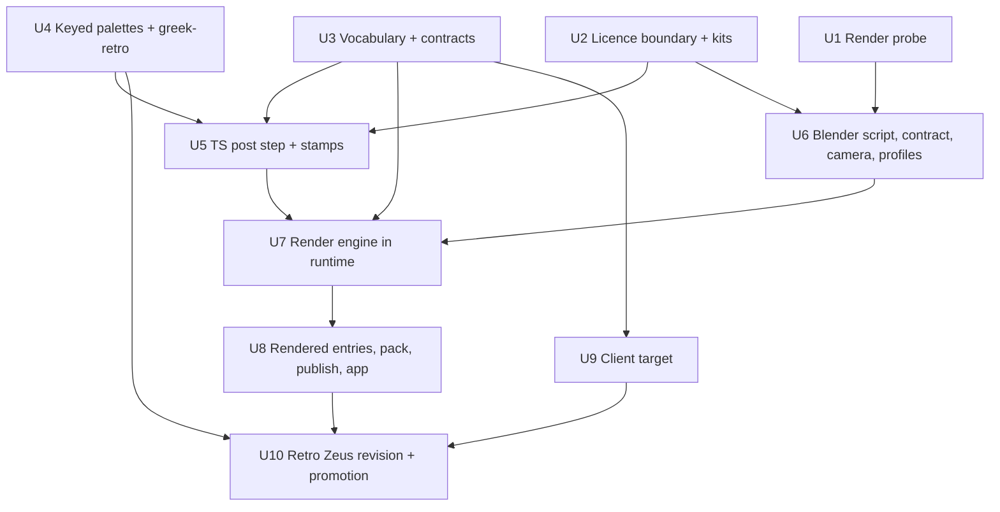

# feat: Pre-rendered retro sprite pipeline and retro Zeus (ADR-0012 build-out)

## Overview

ADR-0012 (#215) moves new art to a pre-rendered retro direction: rigged CC0 kit models rendered headless in a pinned Blender, then a deterministic post step, on a 112×96 `god-tall` cell with a `greek-retro` palette. The probes (#213, #214) proved the route outside the studio. This plan productizes it inside the studio and the game, then proves it with one complete retro Zeus revision promoted over the legacy hand-pixel `zeus-sprite`.

## Problem Frame

Today the studio cannot produce, hold, or publish a retro asset. Four gates refuse a 112×96 cell before a pixel is checked. The palette chain loads exactly one palette. The runtime knows one engine, `sd-server`, and accepts exactly one PNG per job. A working set completes only from hand-authored frames. The client's logical target is too narrow for a 112 px god. The probe's licence gate is prose, and its provenance compares an import list rather than the files a render can read. ADR-0012's Consequences lists the code sites; repo research found more (see Context).

## Requirements Trace

Product IDs: X02, W01, U06, U07, U08. Origin IDs from `docs/brainstorms/2026-10-03-asset-studio-requirements.md`.

- R1 (metadata): retro assets carry cell, declared pivot, footprint, facing, states, timing and palette id; `god-tall` and per-asset pivots parse everywhere a manifest is read (U3).
- R2 (provenance): a new `rendered` method records a revision recipe hash (profile, camera, palette id and digest, pivot, script, post-step version, Blender pin, kit and stamp hashes), a slot recipe hash per slot and the raw-frame hashes; kit closure is checked before render (U1–U3, U5–U8, U10).
- R3 (registry): `zeus-retro` publishes as a new asset id (U3, U10).
- R4 (plain files): kits, profiles, stamps, camera and the `greek-retro` palette are plain committed files, validated by `tools/content` `validate:assets` (U2–U6).
- R5 (providers share one queue): the Blender engine joins the existing FIFO drain and job ledger beside `sd-server` (U1, U7).
- R6 (licences): kit inputs are `CC0-1.0` or owner-assessed; every file a profile references must meet this, checked fail-closed; rendered outputs stay under the repository's MIT licence (U2).
- R7 (specs from data): the recipe (model profile, clip set, camera, palette, pivot) comes from content and the subject, not typed by hand (U3, U6).
- R8 (async queue, abort by restart): render jobs show in the queue, abort stops the Blender process, and quit stays inside the ADR-0010 bound (U1, U7).
- R9 (conformance): rendered cells pass conformance against the `greek-retro` limits and the declared pivot (U4, U5, U8, U10).
- R10–R12 (hand edits): rendered cells can still be opened in Aseprite; hand steps on them are recorded as hand provenance (U8).
- R15 (reproducibility): applies to derived batches; rendered revisions carry the narrower, owner-accepted guarantee in Key Technical Decisions (raw frames stay in the studio store after publish; a fresh clone can re-render from the pins but cannot recompute from raw frames), recorded by dated note (U5, U8).
- R16, R17 (preview): the studio preview plays 112×96, (56,78)-pivot, 16-frame clips at manifest timing at integer zoom with placeholder context, and live-reloads them (U8).
- R18 (CLI parity): the CLI and app expose the recipe request through the same `@panthea/assets` functions (U3, U8).
- R20 (Zeus first): the first target is a complete retro Zeus (idle, walk, seated, act/thunderbolt, 4 facings) (U3, U6, U9, U10).
- R24 (lane coordination): U3's shared-contract change lands in PR 1; the owner's approval of the promotion commit, which edits `content/greek/gods/zeus.json` and simulation goldens, is the core-lane agreement (U3, U10).

## Scope Boundaries

- No retro asset for the other six gods, mortals, animals, scenery, foliage, tiles or sound.
- No realm variants for the first retro Zeus; `pronouncement` act is not rendered.
- No change to `greek-master`, its digest, or any published legacy asset.
- No Blender in CI; no hosted renderer; no fallback renderer when EEVEE is unavailable.
- No Git LFS, no vendor zips in git, no new paid tooling.
- No migration of old saves: actors created with `zeus-sprite` keep resolving it.
- Portrait: not in this plan; Zeus's published portrait stays (ADR-0012). Origin R20 T1 is narrowed accordingly.

### Deferred to Separate Tasks

- Remove the eight underscore-prefixed test-support files that repo research found in production source (`packages/assets/src/studio/_test-*.ts`, `tools/studio/src/_testkit.ts`, `apps/studio/src/source/_testkit.ts`, `apps/studio/src/host/_testkit.ts`, `apps/simulation/src/_test-lock-holder.ts`): separate fix PR before this plan adds test support. This plan adds none.
- Retro scenery, foliage wind loops, temple and tiles: folded into foundation-plan Units 10 and 11.
- Retro mortals and a `mortal` retro walk rule: a later plan.
- Realm variants on `greek-retro` and Zeus `pronouncement`: after the first retro Zeus.
- A 96×96 god class: when an envelope needs it.

## Context & Research

### Relevant Code and Patterns

- Size gates: `packages/assets/src/studio/request.ts` (`GOD_CELL_CLASS`, `MAX_COLOURS`, measured-cell check, pivot default), `packages/assets/src/studio/provider.ts` (`SELECTED_PROFILE.measuredCells`), `content/greek/assets/vocabulary.json` (cell classes; one rule per state id, walk 6 frames at 10 fps, seated limited to `god`), `packages/contracts/src/assets.ts` (`durationBounds`, state lookup by id, cell match against vocabulary, strict animation keys).
- Palette chain: `packages/assets/src/palette.ts` (`parsePalette` fixed family ids and 4–5 shade ramps, `paletteDigest`), `tools/content/src/palette.ts` (fixed file names), `packages/assets/src/studio/content.ts` (`loadStudioContent` reads one palette), `packages/assets/src/registry.ts` `paletteRefusal` (already per `manifest.paletteId`), `packages/assets/src/conformance.ts` `colourBudget`.
- Runtime and jobs: `packages/assets/src/studio/runtime.ts` (`launch`, `stopGroup`, `runJob`, `extractImage`, drain marks every queued job unavailable on an unavailable engine), `packages/assets/src/studio/workspace.ts` (`EngineFacts.model` non-null), `packages/assets/src/studio/request.ts` `planJobs` (job carries `provider`; ordinal seeds), `packages/contracts/src/asset-lifecycle.ts` (`ImageProvider`, unimplemented).
- External-tool precedent: `packages/assets/src/studio/aseprite.ts` (`resolveAseprite` configured → PATH → bundle; argv-only spawn, minimal env, timeout, SIGTERM then SIGKILL; embedded script).
- Working set and pack: `packages/assets/src/studio/working-set.ts` `deriveStatus` ("picks alone never complete a sprite"), `DerivedEntry`; `packages/assets/src/studio/packing.ts` (frames from authored edits; refuses a new revision with a different cell or family; west-mirror gate skipped under declared asymmetry); `packages/assets/src/studio/publish.ts`, `derivation.ts` `auditDerivation` (recompute pattern); `approval.ts` `knownTerms`.
- Host: `tools/studio/src/config.ts` (render section to add, mirroring the editor path), `tools/studio/src/commands.ts`, `tools/studio/src/host.ts` `idleReason`; `apps/studio/src-tauri/src/teardown.rs` quit bound from runtime deadlines; `schema.rs` op table and PATHISH test.
- Client: `apps/client/src/renderer/layout.ts` (`LOGICAL_SIZE` 576×592, `MAX_ACTOR_CELL`), `apps/client/src/assets/canon.ts` (contract parsers), `apps/client/src/renderer/actors.ts` (manifest pivot), `apps/client/src/inspect/`, `tools/scenarios/studio-zeus-scene/reference-digests.json`.
- Content: `content/greek/assets/subjects/zeus.json` (`asymmetry: bolt hand`), `content/greek/gods/zeus.json` `sprite`, `packages/content/src/load.ts` `withGodSprites`.
- Probe code to promote: `tools/probes/retro-render/` (`render_retro.py`, `retro_lib.py` Blender-side; `retro_plan.py`, `palette_plan.py`, `shadow_plan.py`, `stamp_plan.py`, `retro_metrics.py`, `postprocess_retro.py` post side), `tools/probes/blender-sprite/stamps/`.

### Institutional Learnings

- `docs/decisions/0010-studio-app-host.md` and `docs/solutions/integration-issues/studio-quit-drained-queue-and-orphaned-image-server-2026-10-09.md`: quit retires the launch, SIGTERM, bounded wait, SIGKILL; stdin close drains rather than cancels; a new child must sit inside the same bound.
- `docs/solutions/logic-errors/reusing-teardown-latch-blocked-idle-lock-release-2026-10-11.md`: idle release is its own reversible path.
- `docs/decisions/0009-asset-registry-lifecycle-and-uris.md`: palette approval is digest-bound and separate from asset approval.
- `docs/solutions/logic-errors/transparent-rgb-bytes-broke-grid-recovery-2026-10-05.md`, `integration-issues/sdcpp-cli-guidance-is-not-server-cfg-2026-10-08.md`: compare decoded pixels, canonicalize alpha-0 RGB, record effective parameters.
- `docs/solutions/test-failures/canon-registry-polluted-validator-fixtures-2026-10-08.md`: build expected registry state explicitly in tests.
- `docs/solutions/best-practices/end-to-end-scenario-with-positive-controls-2026-09-28.md`: each refusal gets a positive control.
- The four sprite learnings (#216): preregister art criteria; variants and controls share one pose path; pipeline steps share one path rule and fail on empty input; licence gate plus provenance against the import list (with its two known gaps this plan closes).
- `docs/solutions/workflow-issues/generated-art-independent-review-roles-2026-10-08.md`: cross-family review, then the owner's visual gate.
- `docs/solutions/integration-issues/webgpurenderer-render-target-blit-and-compile-2026-10-08.md` vs `client-scene-presents-before-compile-2026-10-10.md`: studio preview compiles then renders; the client presents then compiles.

### External References

- Blender Foundation FAQ (https://www.blender.org/support/faq/): published scripts that use the Blender Python API "have to be made available licensed as GNU GPL".
- GitHub large files (warn at 50 MiB, block at 100 MiB) and Git LFS billing (free tier 10 GiB bandwidth, forks count): reason the curated kit set is ordinary git files with a size cap.
- Blender 5.2 manual, command-line rendering and EEVEE: background mode is documented; EEVEE needs a GPU context, so the sidecar-launched case is measured, not assumed.

## Prior-Art Survey

```json
{
  "schema_version": 2,
  "verdict": "extend",
  "scope": "packages/assets/src/studio; packages/contracts/src (asset-lifecycle.ts, assets.ts); tools/studio/src; apps/studio/src-tauri/src; tools/probes/retro-render and tools/probes/blender-sprite as candidates",
  "freshness": {
    "vcs_reference": "f5969c0"
  },
  "budget": {
    "max_search_passes": 8,
    "max_candidate_inspections": 14,
    "exhausted": false
  },
  "candidates": [
    {
      "path_or_symbol": "packages/contracts/src/asset-lifecycle.ts ProviderDescriptor, ImageProvider",
      "description": "Declared generator seam (descriptor, availability, generate). Implemented and called by nothing.",
      "disposition": "extend"
    },
    {
      "path_or_symbol": "packages/assets/src/studio/runtime.ts openRuntime, launch, stopGroup, runJob",
      "description": "Owned local child with hash-verified artifacts, own process group, readiness, one-at-a-time drain and abort by group kill. Image-only: one PNG per job, sd-server specific.",
      "disposition": "extend"
    },
    {
      "path_or_symbol": "packages/assets/src/studio/provider.ts PROVIDER, SELECTED_PROFILE",
      "description": "Pinned engine profile with binary sha256, component licences, sampling and measuredCells.",
      "disposition": "extend"
    },
    {
      "path_or_symbol": "packages/assets/src/studio/aseprite.ts resolveAseprite, createEditorAdapter.run",
      "description": "External tool resolution and argv-only supervised spawn with an embedded script.",
      "disposition": "insufficient",
      "insufficiency_reason": "Edits existing sheets and renders nothing; its spawn lifecycle is private to the editor adapter."
    },
    {
      "path_or_symbol": "packages/assets/src/studio/derive.ts derivation recipes",
      "description": "Deterministic recipes over published slot pixels with versioned params.",
      "disposition": "insufficient",
      "insufficiency_reason": "Inputs are published pixels, not models or cameras; only the recipe-versioning pattern carries over."
    },
    {
      "path_or_symbol": "packages/assets/src/conformance.ts colourBudget, conformImage, reduceToPalette",
      "description": "Deterministic palette reduction and per-check conformance report.",
      "disposition": "reuse"
    },
    {
      "path_or_symbol": "packages/assets/src/studio/request.ts buildSpec, planJobs",
      "description": "Request to per-slot jobs with ordinal seeds; provider fixed; no pivot, palette or recipe field.",
      "disposition": "extend"
    },
    {
      "path_or_symbol": "packages/contracts/src/assets.ts GenerationRequest, GenerationRef, Provenance union",
      "description": "Request and provenance contracts; union is generated, hand, derived; GenerationRef.model non-null.",
      "disposition": "extend"
    },
    {
      "path_or_symbol": "packages/assets/src/studio/packing.ts packAsset; publish.ts",
      "description": "Pack, approve and publish gates, provenance-method aware.",
      "disposition": "extend"
    },
    {
      "path_or_symbol": "packages/assets/src/studio/approval.ts knownTerms, reviewLicences",
      "description": "Publication-terms check: MIT, Apache-2.0, CC0-1.0 compatible; others need owner assessment.",
      "disposition": "reuse"
    },
    {
      "path_or_symbol": "tools/probes/retro-render render_retro.py, postprocess_retro.py, retro_plan.py",
      "description": "Working Blender render and Python post step outside the studio ledger.",
      "disposition": "extend"
    },
    {
      "path_or_symbol": "tools/probes/blender-sprite render_zeus.py, render_zeus_r3.py",
      "description": "Earlier route with a duplicated pose function.",
      "disposition": "insufficient",
      "insufficiency_reason": "NO-GO against the hand-pixel bar (#213); superseded by retro-render."
    },
    {
      "path_or_symbol": "packages/renderer/src/iso.ts, layer.ts",
      "description": "GPU pixel core that draws composed sprites.",
      "disposition": "insufficient",
      "insufficiency_reason": "Draws only; relevant to preview and client, not generation."
    },
    {
      "path_or_symbol": "apps/studio/src-tauri/src/sidecar.rs, teardown.rs",
      "description": "Supervises the one sidecar and derives its quit bound.",
      "disposition": "insufficient",
      "insufficiency_reason": "No generic launcher; a render child must be owned by the sidecar."
    }
  ]
}
```

## Key Technical Decisions

- **Blender is a second engine in the existing runtime, owned by the sidecar.** The drain picks the engine from the job's provider. Only one engine is live at a time: `sd-server` stops before a render batch and restarts after, which bounds memory on 16 GiB. U1 measured Blender alone at about 1 GiB peak; a single loaded `sd-server` generation reached critical pressure on a host already carrying 11–12 GB of swap, and the two were never measured loaded together. The drain refuses to launch either engine while system memory pressure is critical (level 4) and leaves the job queued with guidance. An unavailable engine fails only jobs whose provider matches; the drain continues for other kinds. Rust lifecycle code is unchanged; the `schema.rs` op table gains fields.
- **One Blender process per consecutive run of render jobs.** A warm worker is deferred until the probe shows startup cost matters. A parent-pid guard in the Blender script stops orphaned renders.
- **One job is one slot, producing all its frames.** Recipe requests force batch 1 and a fixed base seed of 0 (the planner and runtime require one); reroll is refused. Raw frames (colour, part-ID, depth) are content-addressed blobs in the gitignored studio store and stay there after publish.
- **Slot commit by sentinel.** Blender writes each slot to a temporary directory and then a `done.json` listing frame count and per-file sha256 per role (colour, id, depth). The runner ingests only slots whose sentinel matches, counts expected files, and never trusts the exit code. The sentinel hashes check transport integrity only: Blender writes date and render-time PNG chunks, so frame identity is always decoded pixels (U1: 48/48 frames pixel-identical across processes, 0/48 byte-identical). Depth is 8-bit RGBA, the format `decodePng` reads, with its quantisation recorded in the recipe.
- **Script contract.** One contract serves the script, the runner's parser and the test fake: the recipe input, the `done.json` schema and an exit-code table (ok, no GPU context, version mismatch, input error); no GPU context and version mismatch map to `unavailable`, input error to `failed`. The script is embedded in the sidecar as text and written to a scratch file at run time (the `export.lua` precedent); its hash is the script hash.
- **Failure taxonomy.** Missing Blender, wrong version or build, sha mismatch, no GPU context, or death by signal before the script's first line (U1: denying the GPU crashes Blender with SIGSEGV before any script runs, so the no-GPU exit code is not reachable that way): `unavailable`, with guidance and no fallback. Stop is SIGTERM then SIGKILL to the process group, never SIGINT (U1: SIGINT is swallowed and the render completes); a terminated render reads as aborted, not failed. U1 measured TERM and KILL under 100 ms, so Blender uses the shared quit deadlines. Exit 0 with a short frame set, the input-error exit code, a kit-closure or staging violation, or a stall past the watchdog: `failed`. Abort discards the in-flight slot and the drain continues with the next job once the engine restarts; finished slots stay succeeded.
- **Pin.** Blender 5.2.2 LTS, build hash `d13f752e3b9c`. The executable path comes from owner config (never the webview) and lives outside `artifactRoot`. A separate verifier checks the binary's sha256 (cached by size and mtime) and the script asserts `bpy.app.version_string` and build hash; both go into the recipe. Child env is an explicit allow-list; `--factory-startup` always.
- **`rendered` provenance and R15.** R15 governs derived batches. A rendered revision is re-renderable from pinned inputs: the Blender pin and the inputs of two recipe hashes. The revision recipe hash covers the fields shared across slots: profile, camera, palette id and digest, pivot, script hash, post-step version, Blender pin, kit and stamp hashes. The slot recipe hash adds the slot's state, clip, facing and seed to the revision hash. Pack and the publish audit compare the revision hash across slots. A separate render audit verifies at publish, offline and without Blender: every pinned hash, the job ledger, and a TypeScript post-step recompute from the stored raw frames that reproduces every cell hash and the atlas. Raw frames stay in the studio store after publish and publish-time verification is the check; after publish, a fresh clone can re-render from the pins but cannot recompute from raw frames. Same-machine raw-frame identity is measured by U1; cross-GPU identity is recorded as unknown. The Blender pin is a recorded tool fact in the recipe, not an output licence record: ADR-0012 already approved the tool, and rendered outputs stay MIT (R6). Owner-accepted 2026-10-12; recorded as dated notes on R15 and ADR-0012.
- **Post step in TypeScript.** Mode downscale, palette snap, outline after composite, selective overlap lines from part-ID and depth, contact shadow, and stamp composite move into `packages/assets`. `POST_STEP_VERSION` (bumped with any golden change) is pinned in the recipe. A parity test runs the port against a small committed raw-frame fixture for one slot, generated once from the probe, so it runs from a clean checkout; TS goldens are the baseline afterwards and the probe's Python post step stays as probe history. No ffmpeg or Python in the studio.
- **Licence boundary.** Every file importing a Blender module carries `SPDX-License-Identifier: GPL-3.0-or-later`, with the text in `LICENSES/`. New Blender-side Python lives in `tools/render/blender/`; existing probe scripts keep their paths and carry the header. A test over all `.py` files in the repo refuses an import of any module with prefix `bpy` (covering `bpy_extras`), `bmesh`, `mathutils`, `gpu`, `bl_math`, `bgl`, `freestyle`, `idprop` or `aud` in a file without the header. Everything else stays MIT. Rendered output is not covered by the GPL.
- **Curated kits in git.** Only the glTF and `.bin` files recipes use, plus licence texts, live in `tools/render/kits/`, marked binary in `.gitattributes`, under a `kits.json` manifest (SPDX id, source URL, per-file sha256 and size, licence-file hash, declared texture skip list, informational status). Parsing and checks live in `packages/assets/src/render/` and run in `tools/content` `validate:assets` (R4), so `tools/render/` is data and the GPL script only, not a workspace. A test fails closed: every file any profile references needs a present licence file with a matching hash and `CC0-1.0` or an owner-assessment record (the status field gates nothing); files and entries match both ways; total size stays under a cap set from the measured set.
- **Kit closure, not a self-report.** Before launch, a static check parses every glTF the recipe references; each `buffers[].uri` and `images[].uri` must be in `kits.json` or on the declared skip list (textures are skipped at import). Each job runs from a staging directory holding only the manifest files its recipe needs, and the script is pointed only there. A planted unlisted texture or buffer must fail the job (positive control). U1 checks on the real Blender that import with textures skipped reads nothing outside staging, and the plan asserts no more than that evidence. This closes the licence-gate learning's gap by checking the closure, not a self-report.
- **One camera.** `tools/render/camera.json` defines the 2:1 angles, orthographic scale and cell math once; it is parsed in `packages/assets/src/render/`, its hash goes into the revision recipe hash, and requests carry no camera id.
- **Model profiles are render inputs, not game content.** `tools/render/profiles/<id>.json` holds kit file refs (kit id, relative path, sha256), body proportions, garment, hair, stamp set, clip map and pose policy keyed by semantic state, parsed in `packages/assets/src/render/`. The subject names its profile. One pose function serves every clip, variant and control.
- **Vocabulary rules per cell class.** A state id may carry several rules keyed by cell classes; lookup is by (state, class). `god-tall` gets idle, walk (16 frames at 20 fps), seated and act rules. The manifest holds only the 16-frame walk. A variant is a clip rendered with fewer frames whose source time points are a subset of the fine variant's (ADR-0012 equality); the 8-frame walk exists only in that equality test.
- **Keyed palettes.** Palettes load as a set keyed by id; `greek-master` stays at `content/greek/palette/` (its many readers, including probes, tests and `docs/product/art-guide.md`, are untouched) and `greek-retro` lives at `content/greek/palette/greek-retro/`. The loader maps id to directory: `greek-master` is the root, other ids are subdirectories. `StudioContent` holds the palette set, looked up by id. Limits are per version (`greek-master` 4–5 shades and 16 colours per sprite; `greek-retro` 4–6 shades and 48); limits a palette declares are part of its digest, and `greek-master` declares none, so its digest is unchanged. `greek-retro` keeps the three family ids as overlapping subsets of at most 64 master colours, with every ramp Zeus draws (skin, outline, stamps) inside `olympus`. The structure is final before digest approval. Unapproved palettes stay usable for drafts and are refused at approve and publish, as today.
- **New asset id and promotion by profile.** The retro asset is `zeus-retro`. Promotion is the commit that sets `GodProfile.sprite` to it. A content rule refuses a profile reference to an asset missing its required matrix (idle, walk, seated, act/thunderbolt, 4 facings each); `pronouncement` is marked deferred in the subject.
- **Client target set from the largest cell.** `MAX_ACTOR_CELL` becomes 112×96 with pivot (56,78) and is the layout test's input; `LOGICAL_SIZE` is a literal set from the arithmetic in the `layout.ts` header comment, widened to at least 612 px.

## Open Questions

### Resolved During Planning

- Same id or new id for retro Zeus: new id; packing already refuses a cell or family change on one id.
- Does the 180 s mux timeout bind renders: no; `generate` and `reroll` enqueue and return. Hashing, version checks and the post step run inside the drain.
- Does idle writer-lock release break during a render: no; `idleReason` refuses while the drain or watched jobs are non-empty. A host test pins it.
- Realm variants in the first revision: none.

### Deferred to Implementation

- Retro idle, seated and act frame counts and timings: art decisions fixed in the preregistered criteria (Unit 10) before the final render.
- Seated pose: U1 found `Sitting_Idle_Loop` in the animation library with a closed loop, but it renders at 0.90× idle height against the probe's 0.85 proxy. The Zeus profile adjusts the seated pose (U6), and U10's preregistered criteria set the seated threshold.
- Exact `kits.json` size cap: measured set plus margin.
- Texture references in vendor glTF that are never used: textures are skipped at import and listed on the declared skip list; U1 confirms on the real Blender that nothing outside staging is read.

## Output Structure

    tools/render/                  # data and the GPL script only; not a workspace
      README.md
      kits.json                    # curated kit manifest
      kits/<pack>/...              # committed glTF + .bin + licence texts
      profiles/zeus.json           # model profile
      stamps/                      # bolt and face stamp PNGs + stamps.json
      camera.json                  # the one calibrated camera
      blender/render.py            # GPL-3.0-or-later; the only new bpy code
    packages/assets/src/render/    # kit, profile, stamp and camera parsing and validation, TS post step, recipe, script contract, rendered candidate and audit, engine; tests beside
    packages/assets/test/fixtures/render/  # raw-frame fixture for one slot + expected cells (test dir created)
    content/greek/palette/greek-retro/    # beside greek-master, which stays at content/greek/palette/
    LICENSES/GPL-3.0-or-later.txt
    tools/probes/studio-render/README.md

## High-Level Technical Design

> *This illustrates the intended approach and is directional guidance for review, not implementation specification. Treat it as context, not code to reproduce.*

```mermaid
sequenceDiagram
  participant App as Studio app / CLI
  participant Side as Sidecar session
  participant Drain as Runtime drain
  participant SD as sd-server engine
  participant BL as Blender engine
  participant Post as TS post step
  participant Store as Studio store
  App->>Side: recipe request (subject, slots, profile, palette)
  Side->>Store: request + jobs (one per slot, batch 1, seed 0)
  Side-->>App: enqueued
  Drain->>Drain: static kit-closure check; stage only the manifest files the recipe needs
  Drain->>SD: stop if live (one engine at a time)
  Drain->>BL: spawn once for the run of render jobs, pointed at staging (pin + version check)
  BL->>Store: per slot: colour, id, depth frames + done.json
  Drain->>Drain: verify sentinel
  Drain->>Post: raw frames -> cells (downscale, snap, outline, overlap, shadow, stamps)
  Post->>Store: cells + per-job manifest blob
  Side->>Store: rendered candidate (all frames of the slot) + conformance report
  App->>Side: pick candidate -> rendered working-set entry -> pack -> approve -> publish
  Side->>Side: render audit at publish: pins, ledger, post-step recompute from raw blobs
```

## Implementation Units



### Phase A: foundations

- [x] **U1. Preregistered render probe**

**Goal:** Measure what the engine design assumes, before building it.

**Requirements:** R8, R5, R2; X02.

**Dependencies:** None.

**Files:**
- Create: `tools/probes/studio-render/README.md`, probe scripts under `tools/probes/studio-render/`

**Approach:**
- Preregister and hash the pass criteria in the README before any run.
- Measure, with Blender launched as a child of a Bun process the way the sidecar will launch it: EEVEE renders without a terminal session; cold start; full binary sha256 and hashing time; SIGINT, SIGTERM and SIGKILL latency and leftovers mid-render; peak memory with Blender alone and with `sd-server` live while Blender renders (the case that justifies one engine at a time); same-machine run-to-run raw-frame identity; a forced no-GPU context exit; depth PNG precision `decodePng` can read; raw bytes per slot; whether the animation library has a seated clip.
- Staging and closure, on the real Blender: with textures skipped at import, a render from a staging directory holding only the declared manifest files reads nothing outside staging. Record the observation method and what it can and cannot show; later units assert nothing beyond it.

**Execution note:** Each refusal or failure claim needs a positive control; the staging observation needs a planted out-of-staging read it can see.

**Test scenarios:** Test expectation: none -- evidence probe; results and controls are recorded in its README.

**Verification:** README records each measurement against the preregistered criteria, with the criteria hash unchanged.

- [x] **U2. Licence boundary and curated kit library**

**Goal:** Fail-closed kit intake and the GPL/MIT boundary, enforced in code.

**Requirements:** R6, R4, R2; U08.

**Dependencies:** None.

**Files:**
- Create: `tools/render/README.md`, `tools/render/kits.json`, `tools/render/kits/<pack>/...`, `packages/assets/src/render/kits.ts`, `packages/assets/src/render/licence-boundary.ts`, `LICENSES/GPL-3.0-or-later.txt`
- Modify: `.gitattributes`, `tools/content/src/assets.ts` (`validate:assets` runs the kit checks), `tools/probes/retro-render/render_retro.py`, `tools/probes/retro-render/retro_lib.py`, `tools/probes/blender-sprite/render.py`, `tools/probes/blender-sprite/render_zeus.py`, `tools/probes/blender-sprite/render_zeus_r3.py`, `tools/probes/blender-sprite/zeus_proxy.py` (SPDX headers)
- Test: `packages/assets/src/render/kits.test.ts`, `packages/assets/src/render/licence-boundary.test.ts`, `tools/content/src/assets.test.ts`

**Approach:**
- Commit only the files on the Zeus kit list (base body, hair, beard, animation library glTF/.bin) and each pack's licence text; hash the committed bytes. The Zeus kit list is U2's input: the files the Zeus profile will reference, listed in `kits.json` with a "referenced by" list (profile ids) per file.
- `kits.json` uses SPDX ids (`CC0-1.0`), not free text, and records a declared skip list of texture URIs skipped at import.
- The licence gate keys on what profiles reference, not on the status field: any file any profile references must be `CC0-1.0` or carry an owner-assessment record. The check takes the files the given profiles reference and cross-checks them against each file's "referenced by" list. U2 tests it with a fixture profile; U6 supplies the real Zeus profile.
- A closure check parses a glTF: each `buffers[].uri` and `images[].uri` must be in `kits.json` or on the skip list. U7 runs it before render.
- Kit parsing and checks live in `packages/assets/src/render/`; `validate:assets` in `tools/content` calls them (R4).
- The licence-boundary test scans every `.py` in the repo.

**Execution note:** Write the failing gate tests first, each with a positive control.

**Patterns to follow:** `tools/probes/retro-render/models.json` and `retro_assets.py` (shape only); `packages/assets/src/studio/approval.ts` terms.

**Test scenarios:**
- Happy path: the committed kit set passes: every listed entry has its licence file, hashes match, size under cap.
- Error path: a referenced file in a pack with no licence file is refused, naming the entry.
- Error path: a referenced file whose licence id is not `CC0-1.0` and has no owner-assessment record is refused, whatever its status field says (positive control: the same file with an assessment record passes).
- Error path: a fixture profile referencing an unassessed kit file is refused (positive control: the same fixture profile referencing an assessed file passes).
- Error path: a fixture profile referencing a file whose "referenced by" list omits that profile is refused, and so is a "referenced by" entry the profile does not reference.
- Error path: a committed kit file with no entry, and an entry with no file, are each refused.
- Error path: a changed byte in a kit file fails its hash check.
- Error path: total kit size over the cap fails.
- Error path: a glTF with an unlisted buffer or texture URI fails the closure check; a texture on the skip list passes.
- Error path: a `.py` importing a module with prefix `bpy` (including `bpy_extras`), `bmesh`, `mathutils`, `gpu`, `bl_math`, `bgl`, `freestyle`, `idprop` or `aud` without the GPL header fails (positive control: a `bpy_extras` import); `importlib`, `__import__` and `exec` in Blender-side Python fail.
- Happy path: every probe file importing a Blender module carries the header after this unit.

**Verification:** `bun run check` passes; `kits.json` and the committed kit files agree both ways, with total size under the cap.

- [x] **U3. Vocabulary, contracts and request shape for retro**

**Goal:** A 112×96 rendered asset can be requested, described and validated.

**Requirements:** R1, R2, R3, R4, R7, R18, R20, R24; W01.

**Dependencies:** None.

**Files:**
- Modify: `content/greek/assets/vocabulary.json`, `packages/contracts/src/assets.ts`, `packages/assets/src/studio/request.ts`, `packages/assets/src/studio/provider.ts`, `packages/content/src/god-visual-profile.ts`, `content/greek/assets/subjects/zeus.json`, `tools/content/src/assets.ts`
- Test: `packages/contracts/src/assets.test.ts`, `packages/contracts/src/assets-manifest.test.ts`, `packages/assets/src/studio/request.test.ts`, `packages/content/src/god-visual-profile.test.ts`, `tools/content/src/assets.test.ts`

**Approach:**
- Add the `god-tall` cell class. State rules are keyed by cell classes: the contract's `uniqueBy(states, s => s.id)` becomes unique by (state id, cell class), and the lookup by id alone (`parseSpriteAnimation`) becomes lookup by (state, class); the request builder uses the same lookup.
- `GOD_CELL_CLASS` becomes data from the subject; the measured-cell gate applies per engine (the render engine declares its own sizes).
- `RequestInput` gains a declared pivot and palette id. A recipe request variant carries profile id, clip set, palette id and pivot, with batch, style note and edit absent. It carries a fixed base seed of 0 because the planner and runtime require one; reroll stays refused. `planJobs` takes the provider from the request kind, replacing the hard-coded `provider: PROVIDER`.
- Provenance gains `rendered`, extending `ProvenanceCommon`: CC0 kit licence records in `licences`, plus `relatedJobs`, `handEdits` and `sourceAssets`; the revision recipe hash (profile, camera, palette id and digest, pivot, script hash, post-step version, Blender pin, kit and stamp hashes), the slot recipe hash (the revision hash plus the slot's state, clip, facing and seed), and raw-frame hashes per slot. The Blender pin is a recorded tool fact in the recipe, not an output licence record: ADR-0012 already approved the tool, and rendered outputs stay MIT (R6). `GenerationRef.model` stays non-null for generated assets.
- Subjects name a render profile and a required matrix; a content rule refuses a god profile pointing at an asset missing its matrix. Zeus marks `pronouncement` deferred.
- This shared-contract change lands in PR 1 (origin R24).

**Patterns to follow:** existing `durationBounds`, provenance union parsers, `paletteRefusal`.

**Test scenarios:**
- Happy path: a `god-tall` manifest with pivot (56,78) and a 16-frame walk at 50 ms per frame parses.
- Edge case: the legacy `god` walk rule (6 frames, 10 fps) still applies to 64×80 assets; a 16-frame walk on `god` is refused.
- Edge case: one state id with different rules under `god` and `god-tall` parses; a duplicate (state, class) is refused.
- Edge case: seated on `god-tall` parses; seated on `mortal` is still refused.
- Error path: a pivot outside the cell is refused; a recipe request with a seed other than 0 or a batch above 1 is refused; reroll is refused.
- Happy path: `planJobs` takes the provider from the request kind (recipe request gives the render provider, image request gives `sd-server`).
- Happy path: `rendered` provenance round-trips; one missing pin field is refused.
- Integration: a god profile pointing at an asset missing one facing of walk fails `validate:assets`; pointing at a complete asset passes; legacy `zeus-sprite` (not under the retro matrix rule) still validates.
- Integration: published legacy manifests still parse byte for byte.

**Verification:** `bun run check` and `validate:assets` pass; legacy fixtures unchanged.

- [x] **U4. Keyed palettes and the `greek-retro` version**

**Goal:** A second approved palette with its own limits, selected per asset.

**Requirements:** R9, R4; X02, U07.

**Dependencies:** None (approval itself waits on the owner).

**Files:**
- Create: `content/greek/palette/greek-retro/{palette.json,master.gpl,master.hex}`
- Modify: `packages/assets/src/palette.ts`, `tools/content/src/palette.ts`, `packages/assets/src/studio/content.ts`, `packages/assets/src/conformance.ts`; the call sites that move off the single palette: `packages/assets/src/studio/request.ts` (palette use in `buildSpec`), `packages/assets/src/studio/derivation.ts`, `tools/studio/src/commands.ts` (pack, approve, publish), `packages/assets/src/studio/publish.ts`, `packages/assets/src/studio/packing.ts`, `tools/content/src/assets.ts` (`readPalette`)
- Test: `packages/assets/src/palette.test.ts`, `tools/content/src/palette.test.ts`, `packages/assets/src/conformance.test.ts`, `packages/assets/src/studio/packing.test.ts`, `packages/assets/src/studio/publish.test.ts`

**Approach:**
- `greek-master` does not move: its files stay at `content/greek/palette/`. The loader maps palette id to directory (`greek-master` is the root, other ids are subdirectories).
- `StudioContent` holds a palette set looked up by id instead of one palette; the call sites above resolve the palette by `manifest.paletteId`.
- Per-version limits live in each palette file and are validated by the parser (shade bounds, per-sprite colour budget); `colourBudget` reads the asset's palette. When a palette declares limits, they are included in its digest; `greek-master` declares none, so its digest is unchanged.
- Derive `greek-retro` from the probe's 54-colour palette, re-keyed into the three families; pack refuses a prior revision with another palette id.
- The owner approves `greek-retro` against its digest in a separate gate; nothing is promoted before that.

**Test scenarios:**
- Happy path: both palettes load; `greek-master`'s digest is unchanged.
- Edge case: a 6-shade ramp passes under `greek-retro` and fails under `greek-master`.
- Error path: a `greek-retro` sprite with 49 colours fails conformance; a `greek-master` sprite with 17 still fails.
- Error path: approve and publish of an asset on an unapproved `greek-retro` are refused; drafts and pack still work and the report flags the draft palette.
- Error path: editing a `greek-retro` limit after approval changes its digest and refuses publish.
- Error path: a pack changing palette id across revisions of one asset is refused.
- Integration: publishing a legacy asset still verifies against `greek-master` byte for byte.

**Verification:** `bun run check` passes; owner digest approval recorded in `greek-retro/palette.json` before U10 promotes anything.

### Phase B: the render pipeline

- [x] **U5. TypeScript post step and stamp set**

**Goal:** Deterministic raw-frames-to-cells in the studio's own code.

**Requirements:** R9, R2, R4, R15 (recompute); X02.

**Dependencies:** U2, U3, U4.

**Files:**
- Create: `packages/assets/src/render/post.ts` (and focused modules for downscale, outline, overlap, shadow), `packages/assets/src/render/stamps.ts`, `tools/render/stamps/` (bolt and face PNGs, `stamps.json` with anchors, variants and hashes), `packages/assets/test/fixtures/render/` (created; a small raw-frame fixture for one slot: colour, part-ID and depth, plus the expected post-step cells and their hashes, generated once from the probe)
- Modify: `tools/content/src/assets.ts` (`validate:assets` checks stamps), `packages/assets/tsconfig.json` (include `test`)
- Test: `packages/assets/src/render/post.test.ts`, `packages/assets/test/render/post.parity.test.ts`, `packages/assets/src/render/stamps.test.ts`, `tools/content/src/assets.test.ts`

**Approach:**
- Port the probe's order exactly: mode downscale from 4×, snap to the asset palette, composite stamps with part-ID and depth occlusion, one exterior outline after compositing, selective overlap lines, solid contact shadow without outline; alpha binary; alpha-0 RGB canonicalized.
- Measure colours on the final cell; height, outline and envelope on the shadow-free figure.
- Parity runs against the committed raw-frame fixture from a clean checkout; afterwards goldens pin TS output.
- `POST_STEP_VERSION` is bumped with any golden change and pinned in the recipe.

**Execution note:** Start from the failing parity test against the fixture.

**Patterns to follow:** `packages/assets/src/conformance.ts`, `png/decode.ts`; `tools/probes/retro-render/postprocess_retro.py`.

**Test scenarios:**
- Happy path: the fixture's raw frames produce the expected cells and hashes pixel for pixel.
- Edge case: a stamp fully behind the body is dropped; partly behind is clipped by depth.
- Edge case: a part touching the cell edge keeps a valid outline or is reported clipped.
- Error path: raw frames off the expected size or with missing passes are refused with the slot named.
- Error path: a stamp file whose hash differs from `stamps.json` fails `validate:assets`.
- Integration: post-step output fed to conformance passes under `greek-retro` limits and the declared pivot.

**Verification:** Parity and goldens pass under `bun test`; no ffmpeg or Python in the studio path.

- [x] **U6. Blender render script, script contract, camera and model profiles**

**Goal:** One GPL render script driven by a model profile and one camera, with one pose path and a contract the runner shares.

**Requirements:** R7, R2, R4, R20; X02.

**Dependencies:** U1, U2.

**Files:**
- Create: `tools/render/blender/render.py`, `tools/render/profiles/zeus.json`, `tools/render/camera.json`, `packages/assets/src/render/profile.ts`, `packages/assets/src/render/camera.ts`, `packages/assets/src/render/script-contract.ts`
- Modify: `tools/content/src/assets.ts` (`validate:assets` parses profiles and the camera and feeds profile kit refs to the U2 gate)
- Test: `packages/assets/src/render/profile.test.ts`, `packages/assets/src/render/camera.test.ts`, `packages/assets/src/render/script-contract.test.ts`, `tools/content/src/assets.test.ts`

**Approach:**
- The script reads the recipe and profile, builds the scene from a factory start, applies proportions, garment, hair and stamps' locators, poses every clip through one function keyed by semantic state, renders colour, part-ID and depth per frame, and writes the per-slot sentinel.
- Script contract, shared by the script, the U7 parser and the U7 fake: the recipe input; the per-slot `done.json` schema (frame count; per-file sha256 per role: colour, id, depth); the exit-code table (ok, no GPU context, version mismatch, input error) with its status mapping (no GPU context and version mismatch: `unavailable`; input error: `failed`).
- The script is embedded in the sidecar as text and written to a scratch file at run time, following the `export.lua` precedent; its hash is the script hash.
- `camera.json` defines the 2:1 angles, orthographic scale and cell math once; the script and the recipe read it, and its hash goes into the revision recipe hash.
- The parent-pid guard stops the script when the sidecar dies.
- Fix the probe's known art items in the profile: Zeus's leg and stance proportions, tunic shading and hip coverage.
- A key-selected zero-offset control replaces the positional sub-pixel check.

**Execution note:** The profile, camera and contract parsers are test-first; the script is verified by U7's integration run.

**Test scenarios:**
- Happy path: the Zeus profile parses and every kit ref resolves to a `kits.json` entry with a matching hash; the camera file parses and hashes stably; the profile's refs and the `kits.json` "referenced by" lists for Zeus agree both ways, and every kit file the profile references is present with a matching hash.
- Error path: a profile naming a kit file absent from `kits.json` is refused; a profile referencing an unassessed kit file is refused through `validate:assets`.
- Edge case: a variant clip (16 vs 8 frames) resolves the same pose policy as its state.
- Happy path: the 8-frame walk variant's source time points are a subset of the 16-frame walk's (ADR-0012 equality; the pure logic of the probe's `check_resample.py`). The rendered equality check itself stays a probe script that U10 runs as evidence.
- Happy path: the `done.json` schema round-trips; an unknown exit code is refused.

**Verification:** Parser tests pass; a fresh clone holds every kit file the Zeus profile needs; the script carries the GPL header and passes the boundary test.

- [x] **U7. Render engine in the studio runtime**

**Goal:** Blender render jobs run in the shared queue under the existing lifecycle rules.

**Requirements:** R5, R8, R2; U06, U07.

**Dependencies:** U3, U5, U6.

**Files:**
- Create: `packages/assets/src/render/engine.ts`, `packages/assets/src/render/recipe.ts`
- Modify: `packages/assets/src/studio/runtime.ts`, `packages/assets/src/studio/workspace.ts`, `tools/studio/src/config.ts`, `tools/studio/src/host.ts`
- Test: `packages/assets/src/render/engine.test.ts`, `packages/assets/src/studio/runtime.test.ts`, `tools/studio/src/host.test.ts`

**Approach:**
- Split the runtime into per-kind engines with one interface (ready, run, stop) and a separate Blender verifier. The Blender binary comes from owner config and lives outside `artifactRoot`. The child slot is keyed by engine; the other engine stops before a launch.
- The drain picks the engine by job provider. An unavailable engine marks only jobs whose provider matches; the drain continues for other kinds, and the host keeps kicking while jobs remain queued (a change to the stop handling in `tools/studio/src/host.ts`).
- Before launch, run the static kit-closure check on every glTF the recipe references and stage only the manifest files the recipe needs; the script is pointed only at staging. Compute the revision recipe hash once per request and the slot recipe hash per slot (the revision hash plus state, clip, facing and seed).
- Spawn argv-only with an allow-listed env and own process group using the U6 script contract (the fake and the parser share it), stream progress per slot, enforce a per-slot deadline and a no-new-frame watchdog, ingest only sentinel-confirmed slots, store raw frames as blobs, run the post step, and write a per-job manifest blob (role to hash) for the cells and raw frames.
- Abort: after an aborted job the drain continues with the next job once the engine restarts (origin AE6). Abort also covers the readiness phases (hashing, launch, version check), which run under the abort controller with deadlines.
- Quit stops the live engine's process group before awaiting the drain; deadlines fit the ADR-0010 bound unless U1 says otherwise.

**Execution note:** Lifecycle behaviour test-first with a scripted fake Blender process; no wall-clock timers (injected clock).

**Patterns to follow:** `runtime.ts` `launch`/`stopGroup`, `aseprite.ts` resolution order, `progress-poll-starved-job-drain` learning.

**Test scenarios:**
- Happy path: a render job stores raw-frame blobs, cells and a manifest blob for N frames with `rendered` provenance inputs.
- Integration: a queue of sd, render, sd jobs runs in order with `sd-server` stopped before the render and restarted after.
- Error path: Blender missing, wrong version, sha mismatch, no-GPU exit, or death by signal before the script's first line marks only render jobs `unavailable`; queued sd jobs still run, and the host keeps kicking while jobs remain queued.
- Edge case: with an injected pressure reader reporting critical, the drain launches neither engine and leaves the job queued with guidance; it launches once pressure drops.
- Edge case: stop sends SIGTERM to the group, then SIGKILL after the grace; SIGINT is never sent.
- Error path: exit 0 with a short frame set, or the input-error exit code, marks the job `failed` (not `unavailable`).
- Error path: a planted unlisted texture or buffer in a referenced glTF fails the job before launch (positive control: the same recipe without it runs).
- Error path: a torn frame without a sentinel is never ingested.
- Edge case: abort mid-batch discards the in-flight slot, keeps finished slots succeeded, and the drain continues with the next job after the engine restarts.
- Edge case: abort during launch (and during hashing) stops cleanly and the next job runs.
- Edge case: watchdog fires on a stalled process and stops its group.
- Integration: quit during a render, during hashing and during Blender start-up each leaves no surviving process group inside the quit bound; idle release is refused while a render job is queued or running.

**Verification:** Fake-process tests pass; one real render of a Zeus slot through the CLI stores its raw frames and manifest on the owner's machine.

- [x] **U8. Rendered entries through pack, publish and the app**

**Goal:** Rendered candidates become publishable revisions, reviewable in the app.

**Requirements:** R2, R9, R10–R12, R15, R16–R18; U07, U08.

**Dependencies:** U7.

**Files:**
- Create: `packages/assets/src/render/candidate.ts`, `packages/assets/src/render/audit.ts`
- Modify: `packages/assets/src/studio/working-set.ts`, `packages/assets/src/studio/packing.ts`, `packages/assets/src/studio/publish.ts`, `tools/studio/src/commands.ts`, `apps/studio/src-tauri/src/schema.rs`, `apps/studio/src/workflow/Workflow.tsx`, `apps/studio/src/host/types.ts`, `tools/studio/README.md`
- Test: `packages/assets/src/studio/working-set.test.ts` (Create), `packages/assets/src/render/candidate.test.ts`, `packages/assets/src/render/audit.test.ts`, `packages/assets/src/studio/packing.test.ts`, `packages/assets/src/studio/publish.test.ts`, `tools/studio/src/commands.test.ts`, `apps/studio/src/workflow/Workflow.test.tsx`, `apps/studio/src/harness/layout.test.ts`

**Approach:**
- Working set: a `rendered` `SlotBasis` kind and a working-set entry beside `DerivedEntry` (job ref, post-step params, frames, loop start), plus a `rendered` branch in `deriveStatus`'s `done` check, so picking a render fills the slot with no edit step and counts as done.
- Output model: the per-job manifest blob U7 writes maps roles to hashes, because `ImageOutput` has no role. A separate rendered candidate builder reads it, because `conformCandidate` needs exactly one image, and attaches the conformance report.
- Hand edits: opening a rendered slot in Aseprite still works; the edit is traced as a hand step over the rendered basis, never misread as a keyframe pick.
- `packAsset` gains a branch that reads post-step frames and writes method `rendered` with no generations. Pack refuses a rendered revision unless every rendered slot carries the same revision recipe hash (profile, camera, palette id and digest, pivot, script, post-step version, Blender pin, kit and stamp hashes); slot recipe hashes differ by state, clip, facing and seed and are not compared; generated (image-model) picks in a rendered revision are refused; hand edits stay allowed.
- Publish: a separate render audit in `publishAsset`, because `auditDerivation` passes trivially with no steps. It reads the raw blobs, runs the TS post step, compares cell and atlas hashes, and checks the revision recipe hash against its pinned inputs, each slot recipe hash against the revision hash plus the slot's state, clip, facing and seed, and the ledger. Refusals: a raw blob missing; a cell or atlas hash differing from the recompute; a kit, script, stamp, camera or Blender pin hash differing; a post-step version differing; a ledger job missing or not succeeded; a stale palette digest; a slot recipe hash that does not match its inputs; slots with different revision recipe hashes.
- The palette is re-read and re-validated from disk at approve, pack and publish, never taken from the host's cached content.
- The app's Generate form offers the recipe request for subjects with a render profile (CLI parity through the same functions, R18). The preview checks integer zoom with placeholder context (R16) and live-reloads a changed asset (R17).

**Execution note:** Each refusal gets a positive control.

**Test scenarios:**
- Happy path: render, pick, pack, approve, publish a `god-tall` asset through the host path against on-disk fixtures on an explicitly built registry.
- Error path: the render audit refuses each case listed above; a mixed-recipe fixture (two slots whose revision recipe hashes differ) must be refused, and a complete Zeus matrix (every slot recipe hash different, one revision recipe hash) passes.
- Error path: pack refuses a generated pick in a rendered revision and a slot whose revision recipe hash differs (for example a different profile, camera, palette id or pivot); a complete matrix passes pack.
- Error path: a palette edited on disk after the host cached its content is refused at approve, pack and publish.
- Integration: a hand edit on a rendered slot records a hand step over the rendered basis and survives publish.
- Integration: the preview places a 112×96 cell at (56,78), plays a 16-frame clip at manifest timing at integer zoom with placeholder context, and live-reloads a changed asset through a deterministic injected trigger; the PATHISH schema test still passes for the new op fields.

**Verification:** `bun run check` and cargo gates pass; packaged-app window screenshot of a rendered draft in the preview, confirmed by the owner.

### Phase C: game and proof

- [ ] **U9. Client logical target for `god-tall`**

**Goal:** The game draws 112×96 actors beside legacy 64×80 ones.

**Requirements:** R20; X02.

**Dependencies:** U3.

**Files:**
- Modify: `apps/client/src/renderer/layout.ts`
- Test: `apps/client/src/renderer/layout.test.ts`, `apps/client/src/renderer/scene.test.ts`

**Approach:** `LOGICAL_SIZE` is a literal, set from the arithmetic in the `layout.ts` header comment, and the literal widens to at least 612 px. `MAX_ACTOR_CELL` becomes 112×96 at (56,78) and is the layout test's input. The header comment, the `layout.test.ts` pins and the `scene.test.ts` 576px/592px assertions change together.

**Test scenarios:**
- Happy path: the target contains every actor slot's extent for a 112×96 cell.
- Integration: a legacy 64×80 actor and a 112×96 actor draw in one scene with their own pivots.
- Edge case: integer zoom at the 1280×720 window stays at its expected level.

**Verification:** Packaged-app check through the inspection route at zoom 1–4.

- [ ] **U10. Complete retro Zeus revision and promotion**

**Goal:** Publish `zeus-retro` and make it Zeus's sprite.

**Requirements:** R20, R2, R3, R9, R24; X02, W01.

**Dependencies:** U4 approval, U8, U9.

**Files:**
- Modify: `content/greek/assets/registry/` (published), `content/greek/gods/zeus.json` (`sprite`), `tools/scenarios/studio-zeus-scene/reference-digests.json`, `apps/client/src/assets/` fixtures and tests that name Zeus's sprite, goldens naming `zeus-sprite` (`packages/content/src/god-visual-profile.test.ts`, `load.test.ts`, `apps/simulation/src/server.test.ts`, scenario fixtures)
- Create: `docs/evidence/asset-studio/retro-zeus/README.md`

**Approach:**
- Preregister and hash the art criteria (frame counts and timing for idle, seated and act; proportions; the 6 px margin; clipping) before the final render.
- Render the matrix. Evidence includes the rendered variant equality check (`tools/probes/retro-render/check_resample.py`): render the 8-frame walk once and compare it with the 16-frame walk at its matching time points (ADR-0012).
- Run the independent cross-family visual review, then the owner's visual gate with timed playback at 1× and 3×.
- Pack, approve and publish in the app; the completeness rule passes; switch `GodProfile.sprite`; regenerate inspection digests.
- The promotion commit edits `content/greek/gods/zeus.json` and simulation goldens, so the owner's approval of that commit is the core-lane agreement (origin R24).
- The game client has no actor facing or position (origin R20 defers walk and facing-driven states until the contracts carry them), so the packaged-game check covers what the client drives: idle, plus seated and act where already driven. Walk and the four facings are proven through the packaged inspection fixture.

**Execution note:** No promotion commit until the owner approves the full matrix.

**Test scenarios:**
- Integration: content validation passes with Zeus pointing at `zeus-retro`, and fails if any required slot is removed (positive control).
- Integration: the packaged inspection fixture passes readback for every `zeus-retro` slot (walk and all four facings included) at zoom 1–4.
- Integration: the packaged game shows retro Zeus in the states the client drives.
- Integration: an actor created before promotion keeps `zeus-sprite` and still resolves.

**Verification:** Owner visual approval recorded; packaged game shows retro Zeus; evidence README and traceability updated.

## System-Wide Impact

- **Interaction graph:** runtime drain, job ledger and candidate flow gain a second engine; publish gains a `rendered` audit; the app Generate form gains a recipe path; the client layout target widens.
- **Error propagation:** engine `unavailable` stays per kind; render failures surface as job `failed` with the slot named; publish refusals name the failing hash.
- **State lifecycle risks:** raw blobs stay in the studio store after publish (candidates and publish both read them); a stopped `sd-server` must restart before the next sd job; orphaned Blender is stopped by the parent-pid guard.
- **API surface parity:** CLI and app call the same functions for recipe requests; the native op table carries no path.
- **Integration coverage:** a real render through the CLI (U7), a packaged studio preview (U8), and the packaged game inspection (U10) prove what fake-process tests cannot.
- **Unchanged invariants:** `greek-master` and its digest; every published legacy revision; the webview never receives paths; offline after setup; no hosted fallback; Rust lifecycle code.

## Risks & Dependencies

| Risk | Mitigation |
|------|------------|
| EEVEE fails without a GPU context when launched by the sidecar | U1 measures it first; failure is `unavailable` with guidance; no silent fallback; a conflict is reported with evidence before U7 |
| Blender's cask floats past 5.2.2 | Version, build and sha checks per run; mismatch is `unavailable` |
| Raw-frame identity differs across machines | Accepted narrowing: publish recomputes only the TS post step from stored raw frames |
| The `greek-retro` structure changes after approval | Structure finalized in U4 before digest approval; later change means re-approval |
| Memory pressure from Blender plus `sd-server` | One engine live at a time; U1 measures peak memory for each alone and both coexisting |
| Kit set grows clone size | Curated files only, size cap enforced by test |
| GPL boundary drifts | Boundary test over every `.py` in the repo |

## Phased Delivery

- **Probe PR (first):** U1 alone.
- **PR 1 (foundations):** U2, U3, U4 (without owner palette approval). U3's shared-contract change lands here (origin R24).
- **PR 2 (pipeline):** U5, U6, U7, U8.
- **PR 3 (proof):** U9, U10, after the owner approves `greek-retro` and the retro Zeus matrix.

## Documentation / Operational Notes

- Dated notes: R15 in `docs/brainstorms/2026-10-03-asset-studio-requirements.md` (rendered revisions use the ADR-0012 guarantee: a fresh clone can re-render from the pins, but cannot recompute from raw frames, which stay in the studio store after publish; publish-time verification is the check); ADR-0012 addendum on `rendered` provenance, the engine model and the job/slot design; foundation plan entry for this build-out.
- Update the Known gaps of `docs/solutions/best-practices/third-party-kit-licence-gate-and-provenance-test-2026-10-12.md` (the kit-closure check closes the gap by checking the closure, not a self-report) and `docs/solutions/logic-errors/variant-and-control-renders-skipped-the-main-pose-2026-10-12.md` once closed.
- `tools/render/README.md`: install Blender 5.2.2 LTS (build hash `d13f752e3b9c`), set the executable path in studio config, verify it with the runner's version check, run a render. The `blender@lts` cask floats, so the owner confirms the installed version after installing.
- Traceability: X02, W01, U06, U07, U08 in every PR that touches them.

## Sources & References

- **Origin document:** [docs/brainstorms/2026-10-03-asset-studio-requirements.md](../brainstorms/2026-10-03-asset-studio-requirements.md)
- ADR: [docs/decisions/0012-pre-rendered-retro-art-direction.md](../decisions/0012-pre-rendered-retro-art-direction.md), 0007, 0009, 0010, 0011
- Parent plan: [docs/plans/2026-10-03-001-feat-asset-studio-foundation-plan.md](2026-10-03-001-feat-asset-studio-foundation-plan.md)
- Probes: `tools/probes/blender-sprite/README.md` (#213), `tools/probes/retro-render/README.md` (#214)
- Related PRs: #213, #214, #215, #216
