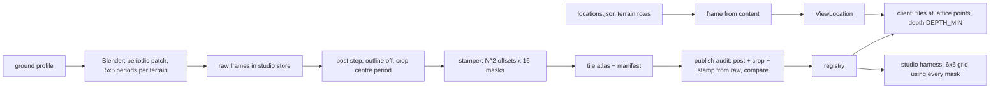

# feat: Dual-grid terrain tiles in the studio and under the followed place

## Overview

This plan adds ground terrain to Panthea's places.
- **Rendering:** Blender renders one seamless, periodic patch per terrain through the pinned render path.
- **Stamping:** a TypeScript stamper cuts a dual-grid tile set from the two patches. The set holds the 16 corner masks for each of the N² offsets of an N×N periodic field.
- **Publishing:** the set goes through pack, approve and publish, and is audited at publish.
- **Authoring:** each mortal place gets an authored 8×8 terrain grid in content.
- **Game client:** draws that grid under the followed place, then moves structures, actors and effects onto the shared isometric placement and depth.

The first set is grass↔flagstone.

## Problem Frame

Today the game draws its ground as horizontal paper rules and orders depth by screen row. The studio harness draws flat olive diamonds, and places carry no terrain. Foundation-plan Unit 11 asked for a texture that was either generated or chosen, a Tiled export, and a studio-only preview. Since then, ADR-0012 made art pre-rendered from Blender. Maps are content JSON, and nothing reads Tiled files.

## Requirements Trace

- **X02** ("Provide polished isometric pixel art and expressive portraits"). Terrain follows ADR-0012's retro look, and the owner judges the visuals.
- **U08** ("Support documented file/code content packs"). Place terrain grids are documented content, validated with the rest of the pack.
- **R19** (origin; tracked through X02). Autotiles are stamped from seamless sources with isometric diamond masks, dual grid first, and render edge-consistent and depth-sorted in the studio preview and the game.
- **F5** (origin; tracked through X02). The flow is base texture, then dual-grid set, then map preview.

## Scope Boundaries

- One terrain pair, grass↔flagstone, for the 11 mortal places. Olympus and the underworld have no terrain in this pass and draw bare background.
- Excluded: Tiled or Wang export, a map editor, elevation, animated tiles and ground decals.
- Each place grid holds two terrains.

### Deferred to Separate Tasks

- Olympus and underworld terrain pairs, as a later set per realm.
- Unit 10 art follow-ups (session note #457; plan `docs/plans/2026-10-13-001-feat-structures-effects-plan.md`).

## Terms

- **Grid cell:** one square of a place's 8×8 terrain grid.
- **Lattice point:** a corner where four grid cells meet. The ground draws one tile per lattice point.
- **Mask:** the 0–15 index of a tile, built from its four corner terrains.
- **Offset:** the tile's position inside the N×N period, (x mod N, y mod N).
- **Atlas cell:** one 64×32 image in the set, found by (mask, offset).
- **Blend field:** the continuous per-pixel value that decides grass or flagstone inside a tile.
- **Patch:** one terrain's rendered periodic image, covering N×N lattice steps.

## Context & Research

### Relevant Code and Patterns

- `packages/renderer/src/iso.ts`:
  - `diamondOrigin` is `((x−y)·32−32, (x+y)·16−z·16)`.
  - `depthZ` puts depth before layer, and `DEPTH_MIN` is −152.
  - `iso.test.ts` asserts that diamonds abut with no seam or overlap.
- Scene and studio preview:
  - `packages/renderer/src/scene.ts`: `composeScene`, `SceneEntity`, `place`, `InstanceArt`.
  - `apps/studio/src/renderer/preview.ts`: `PreviewItem`, plus a fixed 480×270 logical size.
  - `apps/studio/src/harness/layout.ts`: the 4×4 ground patch and the local `STRUCTURE_FOOTPRINTS`.
- Asset contracts:
  - `packages/contracts/src/assets.ts`. `ASSET_KINDS` already lists `tile`. `KIND_KEYS` and `VOCABULARY_KINDS` refuse it. The `rendered` gate is sprite-only. `RenderedSlot` requires state, clip, facing and `seed: 0`, and each slot has to match a manifest animation.
- Render path:
  - `packages/assets/src/render/audit.ts` `auditRendered`: it is sprite-only, requires a `structure` profile when the profile is not a figure, and recomputes slot hashes from state, clip, facing and seed.
  - `packages/assets/src/render/recipe.ts`: `revisionRecipe` hashes `postStep.settings`, `postSettingsFor` builds them, and `frameOf` sets the render frame.
  - `profile.ts`: `profileHash` hashes the canonical profile JSON, and `StructureBuild` is `house | tree`.
  - `post.ts` `postProcessSlot`: `modeDownscale` to `settings.cell`, then palette snap, then an unconditional `addOutline`.
  - `tools/render/blender/render.py`: build dispatch covers `house` and `tree` only, and imports are glTF only.
- `packages/assets/src/resolve-core.ts`: a non-sprite gets `wrong-kind`, and the query is shaped for sprites.
- Content and game client:
  - `packages/content/src/load.ts` `withGodSprites` attaches assembly-time data to the pack.
  - `packages/world/src/state.ts` builds `LocationState` from the pack.
  - `apps/client/src/store.ts` copies `viewLocation` field by field.
  - `apps/client/src/assets/canon.ts` builds the client's `RegistrySnapshot`.
  - `apps/client/src/renderer/layout.ts`: `LOGICAL_SIZE` is 576×336, `fitView` gives zoom 1 at DPR 1 and zoom 2 at DPR 2 for any height up to 635, and it holds `BUILDING_SLOT` and `ACTOR_FOOT`.
  - `decor.ts` draws the paper rules, and `actors.ts` uses the screen-row `depthZ`.
- Reference digests are `tools/scenarios/studio-zeus-scene/reference-digests.json` (ADR-0011: adding or moving art regenerates them).

### Institutional Learnings

- `docs/solutions/best-practices/studio-owned-isometric-projection-depth-2026-10-08.md`: placement and depth stay studio-owned. three-flatland `TileMap2D` places tiles orthogonally.
- `docs/solutions/best-practices/size-render-target-to-its-container-2026-10-14.md`: fit to the scene area at DPR 1 and 2.
- `docs/solutions/best-practices/procedural-effects-byte-exact-and-audited-2026-10-14.md`: use exact ops only, and audit by regeneration.

### External References

- Dual grid: Jess::codes (2024) and github.com/jess-hammer/dual-grid-tilemap-system-godot. For isometric pitfalls, github.com/pablogila/TileMapDual.
- Blender isometric tiles: clintbellanger.net/articles/isometric_tiles/. The practice there is to render a larger continuous patch and crop it, check seams after quantisation, and not outline ground.

## Prior-Art Survey

```json
{
  "schema_version": 2,
  "verdict": "extend",
  "scope": "panthea: packages/{renderer,assets,contracts,content,world}, apps/{client,studio}, tools/{render,content,probes/retro-render}, content/greek",
  "freshness": {
    "vcs_reference": "53e448ee5f3409b4f0c94faad2dc73d3a803a2c9"
  },
  "budget": {
    "max_search_passes": 18,
    "max_candidate_inspections": 22,
    "exhausted": false
  },
  "candidates": [
    {
      "path_or_symbol": "packages/renderer/src/iso.ts",
      "description": "Isometric projection and depth: 64x32 tiles, 64x31 diamond, diamondOrigin, depthZ with depth before layer, ground layer first.",
      "disposition": "extend"
    },
    {
      "path_or_symbol": "packages/renderer/src/scene.ts#composeScene",
      "description": "Composes diamond and sprite entities into depth-sorted instances.",
      "disposition": "extend"
    },
    {
      "path_or_symbol": "apps/studio/src/renderer/preview.ts#createPreview",
      "description": "Studio preview with diamond, sprite, effect and flat items and string-keyed atlases.",
      "disposition": "extend"
    },
    {
      "path_or_symbol": "apps/studio/src/harness/layout.ts#harnessItems",
      "description": "Harness scene with a 4x4 ground diamond patch.",
      "disposition": "extend"
    },
    {
      "path_or_symbol": "packages/contracts/src/assets.ts#ASSET_KINDS",
      "description": "Asset kinds include tile; KIND_KEYS, VOCABULARY_KINDS and the rendered provenance gate refuse it.",
      "disposition": "extend"
    },
    {
      "path_or_symbol": "packages/assets/src/render/audit.ts#auditRendered",
      "description": "Offline publish audit from stored raw frames and the job ledger; sprite-only.",
      "disposition": "extend"
    },
    {
      "path_or_symbol": "packages/assets/src/render/post.ts#postProcessSlot",
      "description": "Deterministic post step: mode downscale, palette snap, unconditional exterior outline.",
      "disposition": "extend"
    },
    {
      "path_or_symbol": "packages/assets/src/resolve-core.ts",
      "description": "Canon and draft resolution; refuses non-sprites as wrong-kind.",
      "disposition": "extend"
    },
    {
      "path_or_symbol": "packages/assets/src/effects/random.ts#hash2",
      "description": "Exact-op integer hash and value noise; noise periodic in one axis only.",
      "disposition": "extend"
    },
    {
      "path_or_symbol": "packages/content/src/load.ts#withGodSprites",
      "description": "Attaches assembly-time data from content to the loaded pack.",
      "disposition": "extend"
    },
    {
      "path_or_symbol": "packages/renderer/src/textures.ts#diamondImage",
      "description": "One flat olive diamond, the only ground art.",
      "disposition": "insufficient",
      "insufficiency_reason": "A flat fill with no art, masks or seam test."
    },
    {
      "path_or_symbol": "apps/client/src/renderer/layout.ts",
      "description": "Followed-place layout in screen pixels with a screen-row depth key.",
      "disposition": "insufficient",
      "insufficiency_reason": "No tile grid; isometric place layout was deferred to this unit."
    },
    {
      "path_or_symbol": "tools/probes/retro-render/render_retro.py#Tiles",
      "description": "Probe-only Blender tiles with a diamond crop and no outline; no masks or manifest.",
      "disposition": "insufficient",
      "insufficiency_reason": "Probe code outside production with no dual-grid masks."
    }
  ]
}
```

## Key Technical Decisions

- **Hybrid art.** Blender renders one seamless patch per terrain in the retro look, and a TypeScript stamper cuts the masks. The probe rendered each tile in Blender, and the tiles repeated visibly. A pure TypeScript generator would look flatter than the rendered art.
- **Variation from an N×N periodic field, starting with N=4.**
  - Both patches and the noise repeat every N lattice steps.
  - The set holds 16 masks × N² offsets: 256 atlas cells in a 1024×512 atlas at N=4. The atlas frame index is `offset·16 + mask`.
  - N is a profile parameter. If the repetition reads badly, raise N and re-render.
- **Mask and blend field.** For lattice point P(x,y), the corner grid cells are N=(x−1,y−1), E=(x,y−1), S=(x,y) and W=(x−1,y). The mask bits are N=1, E=2, S=4, W=8, and a set bit means `over`. In the first pair, base is grass and over is flagstone.
  - The mask sets the silhouette, and noise only nudges it. The blend field is the bilinear blend of the four corners plus low-frequency, low-amplitude lattice noise, with a wavelength of about 1–3 tiles. High-frequency noise gives salt-and-pepper edges and narrow necks.
  - The noise is `periodicValueNoise`: `hash2` at integer nodes, wrapped mod N on both axes, seeded by a profile stamp parameter.
  - If the edge reads jagged at 1×, the continuous field is smoothed before the threshold, sampling the field across tile borders. That keeps the result palette-exact and seam-safe.
  - A pixel is `over` when the field is strictly greater than 0.5, so ties go to base. The noise amplitude stays below the margin that keeps the four diamond vertices pure.
- **Edge treatment.** A narrow, broken band of the flagstone ramp's darkest shade sits on the flagstone side, driven by distance to the boundary in the continuous field. A few grass overhangs are placed deliberately from the seeded layout. There is no continuous rim with a highlight, which would read as an outline, and no side face, because the ground is flat.
- **Seams come from continuity, and two exact gates check them.**
  - 64×31 diamonds tile the plane exactly, so neighbouring tiles share no pixels.
  - *Field gate:* any grid assembled from atlas cells is byte-identical to the same grid stamped directly from the patches and the blend field.
  - *Patch gate:* after the post step, the patch's centre period equals the same period shifted by one period along each lattice axis, byte for byte. The comparison uses rhombus masks and colour only, because depth isn't periodic.
  - The patch gate holds only when the render is translation-invariant and pixel-aligned.
    - The tile side is `32√2/ppu`, so one lattice step is exactly 128×64 raw pixels and the camera origin sits on the 4×4 block grid.
    - The geometry is periodic and instanced over at least 5×5 periods, because slabs overhang period edges.
    - The sun is uniform with shadows off, the film filter is 0, TAA takes 1 sample, and AO, horizon scan and SSR are pinned off.
  - The gate is proved first on flat colour, then the toon bands and geometry detail are added back one at a time. A feature that breaks exactness is redesigned to be periodic. Any weaker gate needs the owner's decision and is recorded in the plan.
- **Ground takes no outline, and existing hashes stay put.**
  - A ground profile sets `outline: false`. When the key is absent the outline is on, and absent is what every existing profile and post setting carries.
  - The `profileHash` values of zeus, greek-house and oak-tree, and one published canon `revisionRecipe` hash, are pinned before `post.ts` changes.
- **Tile provenance is a variant of `rendered`.**
  - A tile slot names its role (`base` or `over`) instead of state, clip and facing.
  - `auditRendered` gains a tile branch that rebuilds the atlas offline: the post step runs on the stored raw frames, then the crop, then the stamper, and the result is compared with the atlas.
  - A ground render is requested as a recipe request of kind `tile`.
  - The `derived` method doesn't fit, because its audit passes non-sprites silently.
- **The manifest stays small.** It carries `{base, over, N, palette, recipe, atlas}`, and one function maps (mask, offset) to an atlas rect.
- **Ground always draws first.** A tile entity sits at its lattice-point origin (`diamondOrigin(x,y)` raised 16 px), at depth `DEPTH_MIN` on layer `ground`. Tiles never overlap, so their order doesn't matter. Lattice points outside the grid clamp to the nearest grid cell, so an 8×8 grid draws 9×9 tiles.
- **Terrain comes from content, not saves.** Places are fixed content. The grid is read from the loaded content pack when the frame for the client is built, and it isn't persisted. That way an edited grid reaches every existing world.
- **Every mortal place uses one fixed 8×8 grid.** The ground diamond is 576 px wide. `LOGICAL_SIZE` height is computed from the manifests, and any height up to 635 keeps zoom 1 at DPR 1 and zoom 2 at DPR 2.
- **Realm and palette family.** The set declares palette family `town`, and no realm→family map is added.

## Open Questions

### Resolved During Planning

- **Tiled/Wang export:** dropped.
- **Where tiles show:** in the studio and in the game.
- **Terrain source:** an authored grid per place.
- **First pair:** grass↔flagstone.
- **Visible repetition:** handled by N×N variation. The offset shapes stay subtle, and N rises if the repeat is conspicuous.
- **Ground geometry:** script-built in `render.py`, with no kit. Flagstones are low-relief slabs and grass is sparse low tufts. The layout is keyed on lattice index mod N with a deterministic hash, so the geometry varies across the period.
- **Stone colour:** the town family's `stone-sky` ramp (grey-green sage). The palette is unchanged.

### Deferred to Implementation

- **Noise parameters, the edge band width and the overhang count:** tuned visually against 1× crops, then fixed in the profile.
- **Smoothing:** whether the field smoothing is needed, decided at 1×.
- **Final `LOGICAL_SIZE` height:** computed from the manifests by the layout test.
- **Frame seam:** where exactly the frame builder reads content. If it has no content access, carry the grid on `LocationState` and move the store version from 7 to 8.

## High-Level Technical Design

> *This illustrates the intended approach and is directional guidance for review, not implementation specification. The implementing agent should treat it as context, not code to reproduce.*



## Implementation Units

### Stage A: the tile set (PR 1)

- [x] **Unit 1: Tile kind and tile provenance in contracts**

**Goal:** a tile manifest with `rendered` tile provenance parses, and a tile recipe request is accepted.

**Requirements:** X02.

**Dependencies:** none.

**Files:**
- Modify: `packages/contracts/src/assets.ts` (`KIND_KEYS`, `VOCABULARY_KINDS`, the tile manifest, the tile `RenderedSlot` variant, the `rendered` gate and slot checks).
- Modify: `content/greek/assets/vocabulary.json` (a `tile` cell class, 64×32), `tools/studio/test/kit.ts`, `tools/scenarios/studio-zeus-scene/src/reference.ts`.
- Modify: `packages/assets/src/studio/request.ts` (`KINDS`: `tile` for recipe requests only).
- Modify: `packages/assets/src/conformance.ts`, `tools/content/src/assets.ts`.
- Test: `packages/contracts/src/assets-manifest.test.ts`, `packages/contracts/src/assets.test.ts`, `packages/contracts/src/asset-lifecycle.test.ts`, `packages/assets/src/conformance.test.ts`, `packages/assets/src/studio/store.test.ts`, `packages/assets/src/studio/request.test.ts`, `apps/studio/src/source/tauri.test.ts`, `tools/content/src/assets.test.ts`.

**Approach:**
- Rewrite the tests that pin the `tile` refusal so they assert acceptance.
- Tile conformance covers full diamond coverage, binary alpha, an empty row 31 and palette membership.

**Test scenarios:**
- Happy path: a tile manifest with N=4 and two tile slots (`base`, `over`) parses and round-trips byte-identical, and (mask, offset) maps to the right atlas rect.
- Error path: an atlas hash that doesn't match the bytes refuses, and so does an N that isn't a positive integer.
- Happy path: a recipe request of kind `tile` is accepted, and a non-recipe tile request is refused.
- Conformance: an atlas cell with a partial-alpha pixel or a pixel outside the diamond fails.

**Verification:** `validate:assets` accepts the new vocabulary.

- [x] **Unit 2: Ground profile, outline opt-out and periodic patch**

**Goal:** Blender renders a periodic patch for each terrain through the existing engine. The post step crops the centre period, with no outline.

**Requirements:** X02, R19.

**Dependencies:** Unit 1.

**Files:**
- Modify: `packages/assets/src/render/profile.ts` (a `ground` branch in `StructureBuild` with N, the slab and tuft parameters and the stamp parameters; `outline: false`).
- Modify: `packages/assets/src/render/post.ts`, `packages/assets/src/render/recipe.ts`.
- Modify: `tools/render/blender/render.py`:
  - a `Ground` `Structure` subclass built with `MeshBuilder` and `MaterialBook`, plus a `ground` branch in `make_structure`;
  - the tile side derived from `ppu`;
  - a layout keyed on lattice index mod N with `hash_unit`;
  - 5×5 period instancing;
  - AO, horizon scan and SSR pinned off.
- Create: `tools/render/profiles/grass-flagstone.json` (one `ground` part; the `olive` and `stone-sky` ramps).
- Modify: `packages/assets/test/render/fake-blender.ts` (a `ground` branch that writes a generated periodic mosaic), `packages/assets/test/render/rig.ts` (`submitTile`).
- Create: `packages/assets/test/render/ground-mosaic.ts` (a pure TypeScript generator of a periodic raw colour, id and depth mosaic).
- Test: `packages/assets/src/render/post.test.ts`, `packages/assets/src/render/profile.test.ts`, `packages/assets/src/render/structure-profile.test.ts` (hash pins), a new `packages/assets/src/render/ground.test.ts`, `packages/assets/src/render/structure-live.test.ts` (live ground case).

**Approach:**
- **Geometry.** Flagstones are low-relief slabs and grass is sparse low tufts, all script-built. Flat tops render as one toon band, so the visible variation comes from slab edges, tufts and the stamper. Anything crossing a period edge is instanced with its wrapped copies.
- **Frame and crop.** The frame is about 512×192 at 1× plus a margin, so the centre period and its shifts along each lattice axis all lie on fully rendered geometry. `modeDownscale` is local to each block, so cropping the centre period in TypeScript after the downscale is exact when the crop origin is on the 4×4 block grid. The profile defines lattice (0,0) and the 32 px diamond halo around the N×N rhombus.
- **Palette.** Each ground colour must snap to itself, because the palette snap searches every family.

**Execution note:** test-first. Pin the existing `profileHash` values and one canon `revisionRecipe` hash before touching `post.ts`.

**Test scenarios:**
- **Regression:** the zeus, greek-house and oak-tree `profileHash` values, one pinned canon `revisionRecipe` hash and the post-step goldens stay unchanged.
- **Happy path:** two adjacent diamonds posted with `outline: false` have no outline pixel on their shared edge.
- **Alignment:** with the side derived from `ppu`, one lattice step projects to exactly 128×64 raw pixels, and one period to 512×256.
- **Patch gate in CI:** the generated periodic mosaic goes through `postProcessSlot`. The centre period equals itself shifted one period along each lattice axis, compared on rhombus masks for colour only.
- **Patch gate, live (opt-in Blender):** the same comparison runs on the real render. It is proved on flat colour first, then with toon bands and full geometry. The test also dumps the EEVEE AO, horizon and SSR settings in use.
- **Palette:** every colour in the ground profile snaps to itself.

**Verification:** a real headless render produces both patches and passes the live patch gate. The owner sees them as 1× crops before the noise is tuned.

- [ ] **Unit 3: Dual-grid stamper and tile audit**

**Goal:** a deterministic stamper turns the two cropped patches into the set, and publish audits it offline.

**Requirements:** R19, X02.

**Dependencies:** Units 1 and 2.

**Files:**
- Create: `packages/assets/src/tiles/stamp.ts`, `packages/assets/src/tiles/lattice-noise.ts`, `packages/assets/src/tiles/index.ts`.
- Modify: `packages/assets/src/render/audit.ts` (the tile branch), `packages/assets/src/render/candidate.ts` (pack builds the tile atlas from the two rendered slots).
- Test: `packages/assets/src/tiles/stamp.test.ts`, `packages/assets/src/tiles/lattice-noise.test.ts`, `packages/assets/src/render/rendered.test.ts`.

**Approach:**
- `periodicValueNoise` follows `risingNoise`'s wrap and applies it to both axes.
- The edge band and any field smoothing read the continuous field, never a tile-local raster, so they stay seam-safe.
- Overhang positions come from the same seeded lattice hash, so they are periodic.

**Execution note:** test-first. The field gate is the spec.

**Test scenarios:**
- Field gate: on a seeded random 12×12 two-terrain grid, assembling atlas cells is byte-identical to stamping the grid directly, with the edge band and overhangs included.
- Periodicity: on dyadic inputs (k/16), the noise at (u+N, v) and (u, v+N) equals the noise at (u, v). A field value of exactly 0.5 gives base.
- Diagonals: masks 5 and 10 keep a connected bridge at every offset, with no isolated single-pixel islands of either terrain.
- Purity: masks 0 and 15 are pure base and pure over, and every atlas cell's four diamond vertices take their corner's terrain.
- Determinism and coverage: a synthetic patch pair gives a golden atlas hash with every (mask, offset) present.
- Audit: a changed atlas byte and a changed recipe both refuse publish, and unchanged inputs publish.

**Verification:** a real grass↔flagstone set packs, and every conformance check passes.

- [ ] **Unit 4: Tile resolution, studio harness and canon publish**

**Goal:** the studio previews a tile set, and the first set reaches canon and the game's registry snapshot.

**Requirements:** R19, X02.

**Dependencies:** Unit 3.

**Files:**
- Modify: `packages/renderer/src/scene.ts` (a `tile` `SceneEntity` and its `place` branch at `DEPTH_MIN`, with the atlas frame from (mask, offset)), `packages/renderer/src/iso.ts` (the lattice-point origin).
- Modify: `packages/assets/src/resolve-core.ts` (tile resolution: `{assetId, mask, offset}`), the studio port and source paths.
- Modify: `apps/studio/src/renderer/preview.ts` (a tile `PreviewItem`), `apps/studio/src/harness/layout.ts` (a 6×6 grid that uses every mask, cycling offsets).
- Modify: `apps/client/src/assets/canon.ts` (tile manifests enter the snapshot).
- Modify: `content/greek/assets/registry/` (publish `grass-flagstone`).
- Test: `packages/renderer/src/iso.test.ts`, a new `packages/renderer/src/scene.test.ts`, `apps/studio/src/harness/layout.test.ts`, `apps/studio/src/renderer/preview.test.ts`, `apps/client/src/assets/canon.test.ts`.

**Approach:**
- The harness ground is the selected tile set. An unresolved set fails fast, and the flat-diamond branch is removed if nothing else uses it.
- A draft previews after pack.
- Publishing goes through the CLI, after the owner approves a headless preview that cycles offsets.

**Test scenarios:**
- Placement: four tiles at the lattice points around one grid cell meet exactly at that cell's centre.
- Depth: the tile at (0,1) sorts below an actor at (0,0).
- Harness: the 6×6 grid shows all 16 masks and fits 480×270.
- Snapshot: a published tile manifest enters the client's registry snapshot.

**Verification:** the owner approves the preview, `validate:assets` passes, and the registry gains one tile asset.

### Stage B: terrain in the game (PR 2)

- [ ] **Unit 5: Place terrain grids from content**

**Goal:** each mortal place carries an authored 8×8 grid, and the grid reaches the client view.

**Requirements:** U08, R19.

**Dependencies:** Unit 4.

**Files:**
- Modify: `content/greek/world/locations.json` (11 mortal places get `terrain: {set, rows}`, with rows over `g` for grass and `f` for flagstone).
- Modify: `packages/contracts/src/content.ts` (the `Location` parse), `tools/content/src/assets.ts` (the set is a published tile whose pair is grass and flagstone).
- Modify: the frame builder and `apps/client/src/store.ts` (`ViewLocation`, `viewLocation`).
- Test: `packages/contracts/src/content.test.ts`, `tools/content/src/assets.test.ts`, the frame tests, `apps/client/src/store.test.ts`.

**Approach:**
- Olympus and underworld places have no `terrain`.
- A headless render of all 11 grids on the published set goes to the owner before Unit 6.

**Test scenarios:**
- Happy path: a mortal place's rows appear unchanged on its `ViewLocation`.
- Error path: 7 rows, a 9-character row, a character other than `g` or `f`, or a set that isn't a published tile each refuse with a named reason.
- Edge case: a place without `terrain` has none in the view.

**Verification:** the content checks pass on all 16 places, and the owner approves the grid preview.

- [ ] **Unit 6: Draw terrain under the followed place**

**Goal:** the game draws the followed place's terrain under the current layout.

**Requirements:** X02, R19.

**Dependencies:** Unit 5.

**Files:**
- Modify: `apps/client/src/renderer/scene.ts`, `apps/client/src/renderer/decor.ts` (remove the paper rules), `apps/client/src/renderer/layout.ts` (fit the 9×9 ground).
- Test: `apps/client/src/renderer/scene.test.ts`, `apps/client/src/renderer/layout.test.ts`.

**Test scenarios:**
- Happy path: a mortal place draws 81 tiles whose masks match its rows.
- No terrain: an Olympus place draws bare background.
- Error path: a mortal place whose set can't be resolved draws bare background and reports it once.
- Fit: the target fits the 714×635 scene area at zoom 1 (DPR 1) and zoom 2 (DPR 2).

**Verification:** the owner sees a headless view render.

- [ ] **Unit 7: Isometric placement for structures, actors and effects**

**Goal:** buildings, actors, fire and the strike sit on grid cells and use the shared depth key.

**Requirements:** X02, R19.

**Dependencies:** Unit 6.

**Files:**
- Modify: `apps/client/src/renderer/layout.ts` (slot tables of grid cells replace `BUILDING_SLOT` and `ACTOR_FOOT`; `LOGICAL_SIZE` and `CAMERA_ORIGIN` are recomputed), `apps/client/src/renderer/scene.ts`, `structures.ts` and `actors.ts` (route through `composeScene`; remove `spriteInstances`, `DEPTH_ROW` and `DEPTH_LIMIT`), `apps/client/src/renderer/decor.ts` (re-anchor the event ring, the repair bar and the fallen mark; the repair bar draws above the ground).
- Modify: `packages/renderer/src/structures.ts` (house and oak footprints, moved from the harness).
- Modify: `tools/scenarios/studio-zeus-scene/reference-digests.json` (regenerated, as a reviewed pixel change).
- Test: `apps/client/src/renderer/layout.test.ts`, `scene.test.ts`, `structures.test.ts`, `actors.test.ts`, `strike.test.ts`.

**Approach:**
- The house footprint is 4×3 and sits in the back rows. Actors take front-row grid cells, assigned deterministically by index.
- Actors and buildings compare by `depthOf` of their bottom cell. The rows are a layout choice and don't override depth.
- Fire and the strike anchor on the building's bottom cell plus `STRUCTURE_ANCHORS`.

**Test scenarios:**
- Layout: footprints never overlap and everything lies inside the grid.
- Depth: an actor on a grid cell in front of a house draws over it, and an actor behind it draws under it.
- Effects: the fire sits on the roof anchor, and the strike plays once for new events at the followed place only.
- Decor: the repair bar draws above the ground.

**Verification:** a headless view render shows a mortal place on its terrain, and the owner sees it. The inspection fixture passes with the regenerated digests.

## System-Wide Impact

- **Interaction graph:** content feeds the frame and then the client view, through one new field. The registry gains a tile kind, read by the studio resolve path and the client snapshot.
- **Unchanged invariants:**
  - Simulation outcomes don't change.
  - Existing manifests, profile hashes, recipe hashes and post-step goldens stay byte-identical.
  - The store isn't touched unless the frame seam forces it.
- **Integration coverage:**
  - the field and patch gates;
  - the publish audit from raw frames;
  - the client snapshot test;
  - headless client renders of a real place.

## Risks & Dependencies

| Risk | Mitigation |
|---|---|
| The patch doesn't wrap exactly after the downscale | The patch gate is byte-exact, so a failure points at the light or geometry in the profile. |
| Repetition still reads at N=4 | Raise N and re-render. |
| Depth regressions when the client moves to iso | Draw the terrain first (Unit 6), then move placement separately (Unit 7). |
| The outline change touches existing assets | Hashes are pinned before `post.ts` changes, and an absent key means the outline is on. |

## Documentation / Operational Notes

- Rewrite R19 and F5 in the origin brainstorm in place, without Tiled. Foundation-plan Unit 11 points here.
- Art guide: ground takes no outline, and the draft tile fields (`wangId`, `orientation`, `layer`, `occlusion`) become the real manifest fields.
- ADR-0009: rewrite in place to cover the tile kind.
- `docs/product/traceability.md`: add X02 and U08 notes in each PR.

## Sources & References

- **Origin document:** [docs/brainstorms/2026-10-03-asset-studio-requirements.md](../brainstorms/2026-10-03-asset-studio-requirements.md) (R19, F5)
- Foundation plan Unit 11: `docs/plans/2026-10-03-001-feat-asset-studio-foundation-plan.md`
- ADR-0009, ADR-0011, ADR-0012
- Probe: `tools/probes/retro-render/README.md`
